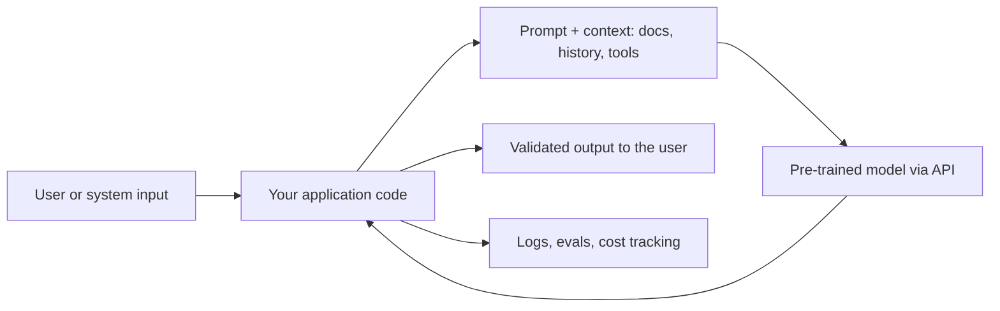

# What AI engineers do

> Module 0 · Lesson 1 · ~10 min

**Goals**
- Describe the AI engineer role in one or two sentences
- List the day-to-day responsibilities that come with it
- Tell the difference between AI engineering and ML engineering

## The short version

An AI engineer builds products on top of pre-trained models. You don't train a language model from scratch. You take one that already exists (Claude, GPT, Gemini, Llama, and so on), and you wire it into software that does something useful: answers support tickets, searches internal docs, reviews code, extracts fields from invoices.

The model is a component, like a database or a payment API. It's an unusual component, though. It's probabilistic, it's sometimes wrong in confident ways, it costs money per word, and its behavior shifts when you change a sentence in the prompt. Most of the craft is in managing those quirks.

Notice how much of that diagram is *not* the model. That's the job.

## What the work looks like

On a typical week you might:

- **Pick a model** for a feature, weighing quality against cost, latency, and privacy ([Module 3](../03-choosing-models/README.md)).
- **Write and version prompts**, then iterate on them against real examples ([Module 4](../04-prompt-engineering/README.md)).
- **Decide what goes into the model's context**: which docs, how much chat history, which tool results ([Module 5](../05-context-engineering/README.md)).
- **Build retrieval** so the model can answer from your company's data instead of guessing ([Modules 6](../06-embeddings-and-vector-search/README.md) and [7](../07-rag/README.md)).
- **Give the model tools** and let it take actions, carefully ([Modules 8](../08-agents/README.md) and [9](../09-mcp/README.md)).
- **Measure quality** with evals, so "it seems better" becomes a number ([Module 11](../11-evals/README.md)).
- **Watch production**: traces, token spend, latency, failures ([Module 12](../12-observability/README.md)).
- **Defend against misuse**, like prompt injection and data leaks ([Module 13](../13-safety-and-ethics/README.md)).

Product impact is the point of all of this. AI engineers are often the people who turn "could an LLM do this?" into a shipped feature, and who tell the team honestly when the answer is "not reliably, yet."

## AI engineer vs ML engineer

The two roles overlap, and plenty of people do both. The center of gravity is different.

| | AI engineer | ML engineer |
|---|---|---|
| Starting point | A pre-trained model behind an API or on a local runtime | Data, from which you train or fine-tune a model |
| Main levers | Prompts, context, retrieval, tools, model choice | Features, architectures, training runs, hyperparameters |
| Typical output | A product feature or workflow | A trained model and its serving pipeline |
| Core skills | Software engineering, API design, evals, UX for uncertainty | Statistics, deep learning, data pipelines, GPUs |
| Feedback loop | Minutes (change prompt, rerun) | Hours to weeks (retrain) |

A useful mental model: the ML engineer builds the engine, the AI engineer builds the car. You need to understand engines well enough to choose one and not abuse it (that's [Module 1](../01-how-llms-work/README.md)), but you spend most of your time on the rest of the car.

> [!NOTE]
> The line moves. AI engineers increasingly fine-tune small models, and ML engineers increasingly build on foundation models. Don't treat the table as a fence.

Check yourself: your team wants a model that classifies legal documents. Who starts where?

An AI engineer would start by prompting an existing model with a few labeled examples and measuring accuracy. An ML engineer might start by collecting a labeled dataset and training a classifier. Often the right move is to try the AI-engineer route first because it's faster, and only train a model if the evals show you need to.

> [!TIP]
> **Try it:** Pick an app you use daily that has an AI feature (email autocomplete, support chat, code suggestions, search summaries). Spend three minutes sketching its likely pipeline using the diagram above as a template. What context do you think it sends the model? Where could it go wrong? Keep the sketch. You'll be able to fill in a lot more detail by Module 8.

## Key takeaways
- AI engineers build products on top of pre-trained models rather than training models from scratch.
- Most of the work lives around the model: context, retrieval, tools, evals, monitoring, and safety.
- ML engineers focus on training and serving models. AI engineers focus on applying them. The roles overlap.
- The model is a powerful but unreliable component, and your job is to make the overall system reliable.

## Go deeper
- [The Rise of the AI Engineer](https://www.latent.space/p/ai-engineer) — the essay by swyx that popularized the term and the role.
- [Building effective agents](https://www.anthropic.com/engineering/building-effective-agents) — Anthropic's practical take on what to build with LLMs, and when to keep it simple.

---
[← Module home](README.md) · [The vocabulary →](02-the-vocabulary.md)
