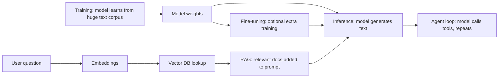

# The vocabulary

> Module 0 · Lesson 2 · ~15 min

**Goals**
- Define the core terms you'll hear in every AI engineering conversation
- See how those terms fit together in one picture
- Know which module covers each idea in depth

This lesson is a map, not the territory. Each term gets a plain-language definition and a pointer to where the course goes deeper. Don't try to master everything here.

## The big picture first

Training happens once, far away, at a model lab. Everything to the right of "Model weights" is where you'll spend your time.

## AI vs AGI

**AI** (artificial intelligence) is a broad umbrella for software that does things we'd call intelligent: recognizing images, translating, playing chess, writing text. It's been around for decades and includes plenty of systems that aren't LLMs.

**AGI** (artificial general intelligence) is a hypothetical system that can learn and perform any intellectual task a human can, across domains, at human level or better. There's no agreed-upon test for it, and people disagree about how close current models are. As an AI engineer, you build with the narrow, real capabilities of today's models. Plan around what they reliably do, not what they might do someday.

## Large language model (LLM)

A neural network trained on a huge amount of text to predict the next piece of text. That simple objective, at enough scale, produces a model that can summarize, translate, write code, answer questions, and follow instructions. Claude, GPT, Gemini, Llama, and Qwen are all LLMs. Many are now *multimodal*, accepting images or audio as well. → [Module 1](../01-how-llms-work/README.md), [Module 10](../10-multimodal/README.md)

## Training

The process of adjusting a model's internal numbers (its *weights*) so its predictions get better. *Pretraining* on trillions of words gives the model its general knowledge. Later stages teach it to follow instructions and be helpful. Training a frontier model costs millions of dollars, and you won't be doing it. → [Training vs inference](../01-how-llms-work/02-training-vs-inference.md)

## Inference

Running a trained model to get output. Every API call you make is an inference request. You pay per token, and inference is where latency comes from. → [Training vs inference](../01-how-llms-work/02-training-vs-inference.md), [Module 2](../02-calling-models/README.md)

## Embeddings

A list of numbers (a vector) that represents the *meaning* of a piece of text. Texts with similar meanings get vectors that are close together, even if they share no words. "How do I reset my password?" and "I forgot my login" end up near each other. → [What embeddings are](../06-embeddings-and-vector-search/01-what-embeddings-are.md)

## Vector databases

Databases built to store embeddings and quickly find the ones nearest to a query vector. Chroma, Pinecone, Qdrant, and pgvector are common choices. → [Vector databases](../06-embeddings-and-vector-search/04-vector-databases.md)

## RAG (retrieval-augmented generation)

A pattern, not a product: before asking the model a question, retrieve relevant documents (often via embeddings and a vector DB) and paste them into the prompt. The model answers from your data instead of from memory, which cuts hallucinations and lets you cite sources. → [Module 7](../07-rag/README.md)

## AI agents

A system where the model doesn't just answer once. It runs in a loop: decide on an action, call a tool (search, run code, query an API), look at the result, decide again, until the task is done. More capable than a single call, and harder to make reliable. → [Module 8](../08-agents/README.md)

## Fine-tuning

Extra training on a pre-trained model using your own examples, to change its style, format, or skill at a narrow task. It's the right tool less often than people think. Better prompts or RAG usually come first, because they're cheaper and easier to change. → [RAG vs fine-tuning](../07-rag/01-why-rag.md)

Check yourself: a user asks your bot about a policy that changed last week. Fine-tuning or RAG?

RAG. The facts change often, and you want the answer to cite the current document. Fine-tuning bakes knowledge into weights, so you'd have to retrain every time the policy changes, and the model still might not recall it precisely.

## A few more you'll hear constantly

| Term | One-line meaning | Where |
|---|---|---|
| Token | The chunk of text a model reads and writes, often part of a word | [Lesson 1.1](../01-how-llms-work/01-text-to-tokens.md) |
| Context window | The maximum tokens a model can consider in one request | [Lesson 1.3](../01-how-llms-work/03-context-windows.md) |
| Prompt | The input you send, including instructions and data | [Module 4](../04-prompt-engineering/README.md) |
| Hallucination | Fluent, confident output that is false | [Module 7](../07-rag/README.md), [Module 11](../11-evals/README.md) |
| Tool / function calling | The model asks your code to run a function and return the result | [Function calling](../02-calling-models/05-function-calling.md) |
| MCP | An open protocol for connecting models to tools and data | [Module 9](../09-mcp/README.md) |
| Evals | Automated tests for model output quality | [Module 11](../11-evals/README.md) |

> [!TIP]
> **Try it:** Without scrolling up, explain the following sentence to an imaginary teammate in your own words: *"We embed the help center into a vector DB and use RAG so the agent can answer at inference time without fine-tuning."* Then check yourself against the definitions above.
>
> 

One way to say it

>
> We turn every help-center article into a vector that captures its meaning and store those in a database built for similarity search. When a question comes in, we find the closest articles and paste them into the prompt. The assistant (which can loop and use tools) answers from those articles when it runs, so we never have to retrain the model.
>
> 

## Key takeaways
- LLMs are trained once by a lab. You work at inference time, calling a model that already exists.
- Embeddings turn meaning into vectors, vector DBs search them, and RAG feeds the results into the prompt.
- Agents are models running in a loop with tools. They're powerful and harder to make reliable.
- Reach for prompting and RAG before fine-tuning.

## Go deeper
- [Neural networks series by 3Blue1Brown](https://www.3blue1brown.com/topics/neural-networks) — visual intuition for what "weights" and "training" actually mean, including chapters on transformers.
- [Building effective agents](https://www.anthropic.com/engineering/building-effective-agents) — a clear breakdown of workflows vs agents, with patterns you'll meet in Module 8.

---
[← What AI engineers do](01-what-ai-engineers-do.md) · [Module home](README.md) · [Set up your workbench →](03-set-up-your-workbench.md)
