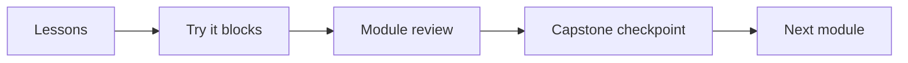

# Module 0: Orientation

Before you write a line of LLM code, it helps to know what the job actually is, what the jargon means, and to have a working setup. This module covers all three. By the end you'll have made your first call to a model from your own machine, and you'll have the words you need for the rest of the course.

**You'll be able to:**
- Explain what an AI engineer does and how the role differs from an ML engineer
- Define the core terms (LLM, inference, embeddings, RAG, agents, fine-tuning) in a sentence each
- Set up a Python project with `uv`, keep API keys out of your code, and call a model

**Prerequisites:** None. You should be comfortable writing Python and calling an HTTP API.

| # | Lesson | Time |
|---|--------|------|
| 1 | [What AI engineers do](01-what-ai-engineers-do.md) | ~10 min |
| 2 | [The vocabulary](02-the-vocabulary.md) | ~15 min |
| 3 | [Set up your workbench](03-set-up-your-workbench.md) | ~20 min |
| ✓ | [Module review](review.md) | ~10 min |

## How this course works

Every module follows the same rhythm, so you always know where you are:

- **Lessons** are short (10–20 minutes). Each one opens with its goals and closes with key takeaways and a few "Go deeper" links if you want more.
- **Try it** blocks are small hands-on tasks, usually a few minutes each. Do them. Reading about temperature is not the same as watching it change an answer.
- **Check yourself** questions pop up mid-lesson. Answer in your head first, then expand the collapsed answer.
- **Module reviews** close each module with 8–12 questions and one slightly bigger hands-on challenge.
- **The capstone**, Course Buddy, is a single project you grow module by module: a Python assistant that answers questions about this course's own Markdown files. Each module adds one capability, so by the end you've built a real, evaluated, observable AI app. See the [capstone overview](../capstone/README.md).

> [!TIP]
> Keep a scratch folder open while you read. Most lessons have something you can paste and run in under a minute.

## Capstone checkpoint
You'll create the `course-buddy` project with `uv`, load your API key from a `.env` file, and make a hello-world call to Claude. Everything after this builds on that project. See the [capstone overview](../capstone/README.md).

---
[← Course home](../README.md) · [Start lesson 1 →](01-what-ai-engineers-do.md)
