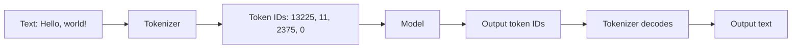

# From text to tokens

> Module 1 · Lesson 1 · ~15 min

**Goals**
- Explain what a token is and why models use them instead of characters or words
- See real tokenization output and spot what makes text "expensive"
- Count tokens for a Claude request before you send it
- Connect tokens to cost, limits, and some odd model behaviors

## Models don't read text

A neural network only works with numbers. So before your prompt reaches the model, a **tokenizer** chops it into pieces called **tokens** and maps each piece to an integer ID from a fixed vocabulary (typically 100k–200k entries). The model reads a sequence of IDs and writes a sequence of IDs, and the tokenizer turns the output back into text.



Why not just use words? There are too many of them, and new ones appear constantly (usernames, typos, `getUserById`). Why not single characters? Sequences would get very long, which makes models slower and more expensive. Tokens are the compromise: common words get one token, rarer words are built from a few subword pieces, and anything at all can still be spelled out byte by byte. Most modern tokenizers learn this vocabulary with an algorithm called **byte-pair encoding (BPE)**, which repeatedly merges the most frequent adjacent pieces in a training corpus.

## See it for yourself

OpenAI publishes its tokenizer as an open-source library, [`tiktoken`](https://github.com/openai/tiktoken), which makes it a handy way to *look* at tokens locally.

```bash
uv add tiktoken
```

```python
import tiktoken

enc = tiktoken.get_encoding("o200k_base")  # the encoding used by GPT-4o-era models

for text in ["Hello, world!", "Tokenization isn't free.", "unbelievably",
             " 12345678", "def add(a, b):\n    return a + b"]:
    ids = enc.encode(text)
    pieces = [enc.decode_single_token_bytes(i).decode("utf-8", "replace") for i in ids]
    print(f"{len(ids):>2} tokens  {pieces}")
```

Output:

```text
 4 tokens  ['Hello', ',', ' world', '!']
 5 tokens  ['Token', 'ization', " isn't", ' free', '.']
 3 tokens  ['un', 'bel', 'ievably']
 4 tokens  [' ', '123', '456', '78']
11 tokens  ['def', ' add', '(a', ',', ' b', '):\n', '   ', ' return', ' a', ' +', ' b']
```

A few things to notice:

- **Spaces usually attach to the front of a word.** `" world"` and `"world"` are different tokens.
- **Rare words split into pieces.** `unbelievably` is three tokens.
- **Numbers are chunked in groups of digits**, not as numeric values. The model never sees "12,345,678" as a quantity, just as `123`, `456`, `78`.
- **Code costs more than you'd guess**, because of punctuation and indentation.

A rough rule of thumb for English prose is about **4 characters per token**, or about **¾ of a word per token**. Code, numbers, and non-English text (especially non-Latin scripts) usually take more tokens per character.

> [!IMPORTANT]
> Every model family has its own tokenizer. `tiktoken` shows you how OpenAI models split text, and it will **undercount** for Claude. Even within one provider, tokenizers change between model generations. Always count with the tokenizer of the model you'll actually call.

## Counting tokens for Claude

Anthropic's tokenizer isn't a downloadable library. Instead, the API has a [token counting endpoint](https://platform.claude.com/docs/en/build-with-claude/token-counting) that takes the same shape as a real request and tells you how many input tokens it would use. It's free (with its own rate limit), and it accounts for the system prompt, tools, images, and PDFs as well as plain text.

```python
from dotenv import load_dotenv
import anthropic

load_dotenv()
client = anthropic.Anthropic()

count = client.messages.count_tokens(
    model="claude-sonnet-5-5",
    system="You are a concise teaching assistant.",
    messages=[{"role": "user", "content": "Tokenization isn't free."}],
)
print(count.input_tokens)
```

The number will be a bit higher than the raw text alone, because the request format itself (role markers, the system prompt) also takes tokens. The docs note the count is an estimate that can differ slightly from the final billed amount, which you get from `response.usage` after a real call.

## Why you should care

**Cost.** Providers bill per million tokens, with separate prices for input and output. Output tokens usually cost several times more than input tokens. Check the current numbers on the [pricing page](https://platform.claude.com/docs/en/about-claude/pricing).

**Limits.** The context window ([Lesson 3](03-context-windows.md)), the `max_tokens` cap on a response, and rate limits like tokens-per-minute are all measured in tokens, not characters or words.

**Latency.** A model generates output one token at a time, so long answers take longer. Long inputs also add time before the first token appears.

**Strange failures.** Because the model sees chunks rather than letters, character-level tasks can trip it up: counting the letters in a word, reversing a string, or doing exact digit-by-digit arithmetic on long numbers. Modern models handle these much better than older ones, but when you need exactness, have the model call code instead ([Function calling](../02-calling-models/05-function-calling.md)).

<details><summary>Check yourself: you translate your app's prompts from English to Japanese and the bill goes up. Why?</summary>

The same meaning often takes more tokens in Japanese (and many other non-English languages) because tokenizer vocabularies are usually trained on mostly-English data. More tokens per request means higher cost and less room in the context window.

</details>

> [!TIP]
> **Try it:** Pick one paragraph of real text you work with (an email, a function from your codebase, a JSON payload). Count its tokens with both `tiktoken` (`o200k_base`) and Claude's `count_tokens`.
> 1. Which counts more tokens, and by how much?
> 2. Minify the JSON (or strip comments from the code) and count again. How much did you save?
> 3. Compute characters per token for each. How close is it to the ~4 rule of thumb?
>
> <details><summary>What to expect</summary>
>
> Claude's count is usually higher than `tiktoken`'s for the same text (a system prompt adds a little more on top). Whitespace and pretty-printing in JSON and code can cost a surprising number of tokens, so minifying data you send to a model is a cheap win. Prose lands near 4 characters per token; code and JSON land lower.
>
> </details>

## Key takeaways
- Models read and write integer token IDs. A tokenizer converts text to tokens and back.
- Tokens are usually subword pieces: about 4 characters of English, fewer for code, numbers, and non-English text.
- Tokenizers differ between providers and model generations. Count with the one you'll use. For Claude, call `client.messages.count_tokens`.
- Cost, context limits, output limits, rate limits, and latency are all measured in tokens.

## Go deeper
- [Let's build the GPT Tokenizer (Andrej Karpathy)](https://www.youtube.com/watch?v=zduSFxRajkE) — builds BPE from scratch and explains many tokenization quirks.
- [Claude token counting docs](https://platform.claude.com/docs/en/build-with-claude/token-counting) — counting with system prompts, tools, images, and PDFs.
- [tiktoken on GitHub](https://github.com/openai/tiktoken) — OpenAI's fast BPE tokenizer and its encodings.
- [OpenAI Tokenizer playground](https://platform.openai.com/tokenizer) — paste text and see tokens highlighted in the browser.

---
[← Module home](README.md) · [Training vs inference →](02-training-vs-inference.md)
