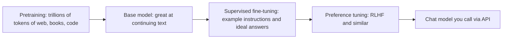
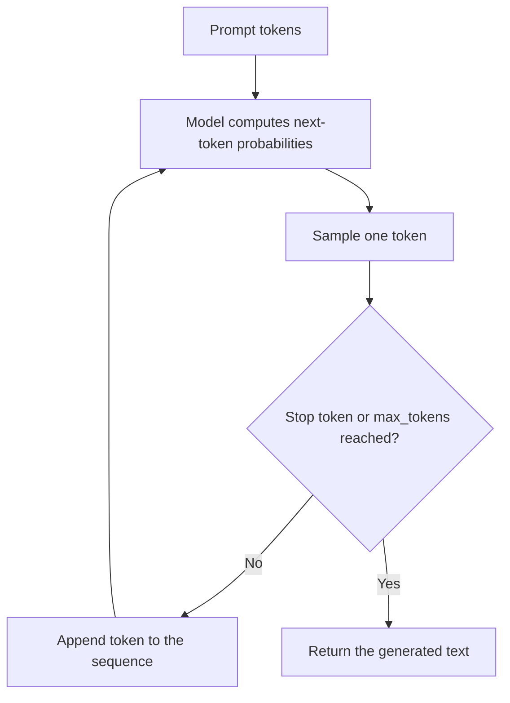

# Training vs inference

> Module 1 · Lesson 2 · ~15 min

**Goals**
- Explain next-token prediction, the one task an LLM is trained on
- Describe the stages that turn a raw model into a helpful assistant: pretraining, fine-tuning, and RLHF
- Walk through what happens during inference, one token at a time
- Know which of these stages you, as an AI engineer, can actually influence

## One task: predict the next token

Strip away the chat interface and an LLM does exactly one thing. Given a sequence of tokens, it outputs a probability for every token in its vocabulary being the *next* one.

```text
Input:  "The capital of France is"
Output: " Paris" 0.92,  " a" 0.02,  " the" 0.01,  " located" 0.01, ...
```

That's it. Answering questions, writing code, and following instructions all emerge from doing this one prediction extremely well, at enormous scale. The architecture underneath is the **transformer**, whose key trick (*attention*) lets every token look at every earlier token to decide what matters for the prediction. You don't need the math to build with LLMs, but this framing explains a lot: the model is always continuing a text, and your prompt is the beginning of that text.

## How a model gets trained

Training happens in stages. Each stage uses the same basic mechanism (show the model text, measure how wrong its predictions were, nudge the weights to be less wrong) on different data.



**Pretraining.** The model reads a huge, broad corpus and learns to predict the next token. This is where nearly all of its knowledge and language ability comes from, and nearly all of the cost: thousands of GPUs for weeks or months. The result is a **base model**. Ask a base model "What is the capital of France?" and it might continue with "What is the capital of Germany? What is..." because that's a plausible continuation of a list of quiz questions. It knows things, but it isn't trying to help you.

**Supervised fine-tuning (SFT).** The base model is trained further on a much smaller set of example conversations: an instruction, and a high-quality response written or curated by people. Now the most likely continuation of a question is an answer.

**Preference tuning (RLHF and friends).** In *reinforcement learning from human feedback*, people compare pairs of model responses and pick the better one. Those preferences train the model toward answers that are more helpful, honest, and safe. Variants use AI-generated feedback guided by written principles (Anthropic's *Constitutional AI* is one example) or optimize directly on the preference data. Modern models also get further training on tasks with checkable answers, such as math and code, which is part of how "reasoning" models learned to think step by step before answering.

> [!NOTE]
> A model's knowledge stops at its **training cutoff**. It doesn't know about events after that date, or about your private data, unless you put that information in the prompt. That gap is the whole reason RAG exists ([Module 7](../07-rag/README.md)).

**Fine-tuning for your use case** is the same SFT idea applied by *you*, on your own examples, to adjust style or a narrow skill. Some providers offer it as a service, and it's common with open-weight models. It rarely adds reliable factual knowledge, though, which is why the course reaches for prompting and retrieval first ([RAG vs fine-tuning](../07-rag/01-why-rag.md)).

## Inference: generating one token at a time

Inference is running the trained model. The weights are frozen, so nothing you send changes the model. Generation is a loop:



A few practical consequences fall straight out of that loop:

- **Output is sequential, so it's the slow part.** The model processes your whole prompt in one parallel pass (often called *prefill*), then produces output one token per step (*decode*). That's why streaming exists ([Streaming responses](../02-calling-models/03-streaming-responses.md)), and why output tokens cost more than input tokens.
- **The model can't go back.** Once a token is emitted, the rest of the answer builds on it. A bad early token can derail everything after it. Asking for reasoning *before* the final answer often helps ([Reasoning patterns](../04-prompt-engineering/03-reasoning-patterns.md)).
- **Each step is a choice among probabilities.** How that choice is made (always the top token, or a random draw) is controlled by the sampling settings in [Lesson 4](04-sampling-knobs.md).
- **The model is stateless.** It has no memory between requests. If it "remembers" earlier turns in a chat, that's because your code sent the whole conversation again ([Lesson 3](03-context-windows.md)).

<details><summary>Check yourself: a user says "I told the bot my name yesterday and it remembered today, so it learned from me." Is that training?</summary>

No. Inference never updates the weights. The app almost certainly saved the name somewhere and put it back into the prompt. That's memory built by the application, which you'll build yourself in [Module 5](../05-context-engineering/02-memory-and-state.md).

</details>

## What you control

| Stage | Who does it | Your lever |
|---|---|---|
| Pretraining | Model lab | Choose which model to use ([Module 3](../03-choosing-models/README.md)) |
| SFT and preference tuning | Model lab | Choose a chat or instruction-tuned model, not a base model |
| Your own fine-tuning | You (optional) | Narrow style or format changes, usually after prompting and RAG |
| Inference | You, every request | Prompt, context, tools, sampling settings, `max_tokens` |

Nearly all of this course lives in that last row.

> [!TIP]
> **Try it:** See next-token prediction leak through. Send Claude a prompt that is the start of a document rather than a question, and compare it with the question form:
> ```python
> prompts = [
>     "Write the opening line of a cookbook for busy software engineers.",
>     "Chapter 1: Breakfast in Five Minutes\n\nEvery engineer knows",
> ]
> ```
> Run each through `client.messages.create(...)` from [the workbench lesson](../00-orientation/03-set-up-your-workbench.md). How does the model treat the second prompt?
>
> <details><summary>What you'll likely see</summary>
>
> The chat model usually recognizes the fragment and either continues it or asks how you'd like it continued. Its instruction tuning makes it treat input as a request, but the continuation instinct from pretraining is still there. Prompts that look like the start of the document you want are a real technique, and you'll see them again in [Module 4](../04-prompt-engineering/README.md).
>
> </details>

## Key takeaways
- An LLM is trained to predict the next token. Everything else emerges from doing that well at scale.
- Pretraining builds knowledge, then supervised fine-tuning and preference tuning (RLHF and similar) make the model follow instructions and be helpful.
- Inference is a loop that generates one token at a time with frozen weights. Your requests never retrain the model.
- Models have a training cutoff and no memory between requests, so anything current or private must go in the prompt.

## Go deeper
- [Attention Is All You Need](https://arxiv.org/abs/1706.03762) — the 2017 paper that introduced the transformer.
- [Training language models to follow instructions with human feedback](https://arxiv.org/abs/2203.02155) — the InstructGPT paper, the classic description of SFT plus RLHF.
- [Constitutional AI](https://www.anthropic.com/research/constitutional-ai-harmlessness-from-ai-feedback) — Anthropic's approach to training with AI feedback guided by written principles.
- [Neural Networks: Zero to Hero (Andrej Karpathy)](https://karpathy.ai/zero-to-hero.html) — a free video course that builds a GPT from scratch, if you want the internals.

---
[← From text to tokens](01-text-to-tokens.md) · [Module home](README.md) · [Context windows →](03-context-windows.md)
