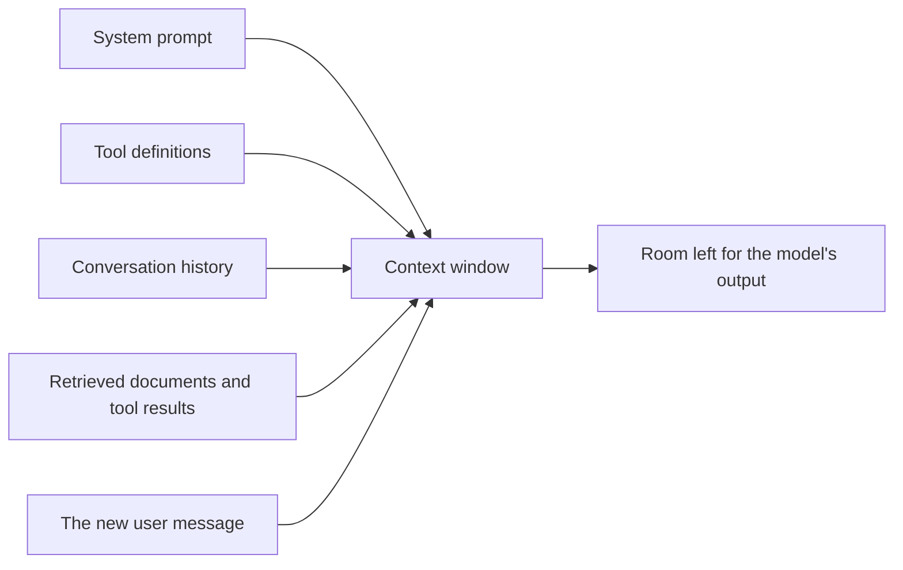

# Context windows

> Module 1 · Lesson 3 · ~15 min

**Goals**
- Define "context" and list everything that takes up space in it
- Explain why chat apps resend the whole conversation on every turn
- Know what happens when a request hits the context window limit
- Recognize that a prompt fitting in the window doesn't mean the model uses all of it well

## Context is everything the model sees

The model is stateless (see [Lesson 2](02-training-vs-inference.md)). For each request, the only information it has is what's in that request. That bundle of tokens is the **context**, and the **context window** is the maximum number of tokens a model can handle in a single request, *input and output combined*.

What fills it:



Everything on the left competes for the same budget. As an AI engineer, deciding what goes in that window, and what stays out, is one of your main jobs. It has its own name, *context engineering*, and its own module ([Module 5](../05-context-engineering/README.md)).

## How big are context windows?

Sizes vary by model and keep growing. As of this writing, every current Claude model (`claude-opus-5-5`, `claude-sonnet-5-5`, `claude-haiku-5-5`) accepts up to 1M tokens, and older ones like Haiku 4.5 accept 200K. Other providers' frontier models are in a similar range, and small local models are often much smaller in practice (Ollama, for example, may run a model with a much smaller context than it supports unless you raise the `num_ctx` setting).

For a sense of scale, 200K tokens is roughly a 500-page book. 1M tokens is a medium-sized codebase.

Don't memorize numbers. Look them up. The Models API reports each model's limits:

```python
info = client.models.retrieve("claude-sonnet-5-5")
print(info.max_input_tokens, info.max_tokens)  # context window, max output
```

## Chat history is just more context

A chat app *feels* like a conversation, but every turn is a fresh, independent request containing the whole history so far:

```python
history = []

def ask(question: str) -> str:
    history.append({"role": "user", "content": question})
    response = client.messages.create(
        model="claude-sonnet-5-5",
        max_tokens=1024,
        messages=history,  # the ENTIRE conversation, every time
    )
    answer = "".join(b.text for b in response.content if b.type == "text")
    history.append({"role": "assistant", "content": answer})
    print(f"[input tokens this turn: {response.usage.input_tokens}]")
    return answer
```

So a long chat costs more per turn as it goes on, because you pay for the history again on every request. Eventually it hits the window. (Prompt caching softens the cost side of this; see [Module 5](../05-context-engineering/03-long-context-and-caching.md).)

## What happens at the limit

There are three different ceilings, and they fail differently:

| Situation | What you get |
|---|---|
| The output reaches the `max_tokens` you set | A normal response, cut short, with `stop_reason: "max_tokens"` |
| The input alone is bigger than the context window | The request is rejected: a 400 `invalid_request_error` ("prompt is too long") |
| Input fits, but input plus output runs out of window mid-answer | On recent Claude models, a truncated response with `stop_reason: "model_context_window_exceeded"` |

The common thread: **check `stop_reason` on every response**, and handle an oversized input before you send it. Count tokens up front with `count_tokens` ([Lesson 1](01-text-to-tokens.md)), and trim, summarize, or retrieve instead of sending everything.

> [!WARNING]
> Some tools and frameworks silently drop the oldest messages, or truncate documents, when the context is full. That avoids an error but quietly changes what the model knows. If you rely on a framework, find out what it does at the limit.

## Fitting isn't the same as working well

A bigger window is not a reason to fill it. Two effects show up in practice:

- **Lost in the middle.** Research has found that models tend to use information at the beginning and end of a long context more reliably than information buried in the middle.
- **Context rot.** As input length grows, accuracy on many tasks degrades, even when the needed fact is in there. Irrelevant text is a distraction, not free padding.

Long inputs also cost more and add latency to every request. So the usual strategy is to send the *smallest context that contains what the model needs*. That's the motivation for summarizing old turns ([memory and state](../05-context-engineering/02-memory-and-state.md)) and for retrieving only relevant chunks ([RAG](../07-rag/README.md)).

<details><summary>Check yourself: your 1M-token model answers questions about a 900K-token document, but it misses facts from the middle. Should you switch to a model with a bigger window?</summary>

Probably not. The document fits already. The problem is the model's attention over a very long input. Retrieving the few relevant sections and sending only those usually gives better answers, faster and cheaper.

</details>

> [!TIP]
> **Try it:** Watch context grow. Paste the `ask()` function above into a script (with the client setup from [the workbench lesson](../00-orientation/03-set-up-your-workbench.md)) and have a five-turn conversation. Print `response.usage.input_tokens` each turn.
> 1. How much does input grow per turn? What drives the growth: your questions or the model's answers?
> 2. Ask the model "What was my first question?" on turn five. Then clear `history` and ask again. What changed?
>
> <details><summary>What you should see</summary>
>
> Input tokens climb every turn because the full history is resent, and the model's answers usually dominate that growth. With history intact the model can recall your first question. After clearing it, the model has no idea, which proves the "memory" was just context you sent.
>
> </details>

## Key takeaways
- Context is everything in one request: system prompt, tools, history, retrieved data, the new message, and the output.
- Chat "memory" is your app resending history on every turn, so long chats get more expensive and eventually hit the window.
- Hitting `max_tokens`, overflowing the input, and running out of window mid-answer each fail differently. Check `stop_reason`.
- Models use long contexts imperfectly. Send the smallest context that contains what's needed.

## Go deeper
- [Claude context windows](https://platform.claude.com/docs/en/build-with-claude/context-windows) — how input, output, and thinking tokens share the window, and limit behavior.
- [Lost in the Middle: How Language Models Use Long Contexts](https://arxiv.org/abs/2307.03172) — the paper on position effects in long inputs.
- [Context Rot (Chroma research)](https://research.trychroma.com/context-rot) — measurements of how performance changes as input length grows.
- [Effective context engineering for AI agents](https://www.anthropic.com/engineering/effective-context-engineering-for-ai-agents) — treating context as a scarce resource.

---
[← Training vs inference](02-training-vs-inference.md) · [Module home](README.md) · [Sampling knobs →](04-sampling-knobs.md)
