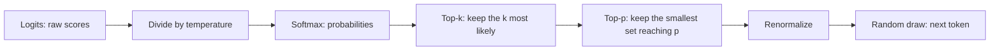

# Sampling knobs

> Module 1 · Lesson 4 · ~15 min

**Goals**
- Explain how a model turns next-token probabilities into an actual token
- Predict what temperature, top-k, and top-p do to a probability distribution
- Know what repetition, frequency, and presence penalties are for
- Know which providers and models expose these knobs today, and what to use instead when they don't

## From probabilities to a choice

At every step of generation ([Lesson 2](02-training-vs-inference.md)), the model produces a raw score, called a **logit**, for every token in its vocabulary. A softmax function turns those scores into probabilities that add up to 1. Then one token is picked. *How* it's picked is the job of the sampling settings:



Always picking the single most likely token (*greedy decoding*) sounds safe, but it tends to produce bland, repetitive text, and it can loop. Sampling adds controlled randomness. The knobs control how much.

## A worked example

Say the prompt is "The cat sat on the" and the model's top five candidates have these logits:

| Token | Logit | T = 0.5 | T = 1.0 | T = 1.5 |
|---|---|---|---|---|
| mat | 3.0 | **0.78** | 0.54 | 0.43 |
| floor | 2.2 | 0.16 | 0.24 | 0.25 |
| sofa | 1.6 | 0.05 | 0.13 | 0.17 |
| roof | 1.0 | 0.01 | 0.07 | 0.11 |
| moon | -0.5 | 0.00 | 0.02 | 0.04 |

**Temperature** divides every logit before the softmax. Below 1, the gaps between scores grow, so the top token dominates (0.78 at T = 0.5). Above 1, the gaps shrink and the distribution flattens, so unlikely tokens like "moon" get picked more often. At temperature 0, it's effectively greedy.

**Top-k** keeps only the *k* most likely tokens and renormalizes. With `top_k=3` at T = 1.0, "roof" and "moon" are dropped, and the rest become mat 0.59, floor 0.26, sofa 0.15. It's a blunt cutoff: always exactly *k* candidates, whether the model is confident or not.

**Top-p** (*nucleus sampling*) keeps the smallest set of top tokens whose probabilities add up to at least *p*. With `top_p=0.75` at T = 1.0: mat (0.54) isn't enough, mat + floor (0.78) is, so only those two survive, renormalized to 0.69 and 0.31. Top-p adapts. When the model is confident, the nucleus is tiny. When it's unsure, more candidates stay in.

<details><summary>Check yourself: with T = 1.0 and top_p = 0.95, which tokens survive?</summary>

Cumulative: mat 0.54, + floor 0.78, + sofa 0.91, + roof 0.98. You need four tokens to reach 0.95, so only "moon" is dropped.

</details>

## Repetition penalties

Models sometimes get stuck repeating a phrase. Penalties push down the scores of tokens that have already appeared:

- **Frequency penalty** subtracts more the more times a token has appeared. Good for curbing a word that keeps coming back.
- **Presence penalty** subtracts a flat amount once a token has appeared at all. Nudges the model toward new topics and vocabulary.
- **Repetition penalty** (common in open-model runtimes like Ollama and Hugging Face) scales down the scores of recently used tokens by a factor such as 1.1.

Use them sparingly. Too much penalty makes the model avoid words it legitimately needs, like a variable name in code or a key term in a summary.

## What you can actually set today

Support varies a lot, and it's changing as models shift toward built-in reasoning:

| Where | Knobs |
|---|---|
| Claude, current models (`claude-opus-5-5`, `claude-sonnet-5-5`, `claude-haiku-5-5`) | None. Non-default `temperature`, `top_p`, or `top_k` returns a 400 error. Steer with the prompt instead. |
| Claude Haiku 4.5 (`claude-haiku-4-5-20251001`, legacy) | `temperature` (0–1, default 1) **or** `top_p`, not both; `top_k` |
| OpenAI | `temperature` and `top_p` on many models, plus `frequency_penalty` and `presence_penalty` in Chat Completions. Reasoning models often don't accept them. |
| Ollama and other local runtimes | `temperature`, `top_k`, `top_p`, `min_p`, `repeat_penalty`, `seed`, and more |

> [!NOTE]
> Temperature 0 makes output *more* consistent, not identical. Hosted models can still vary run to run because of how requests are batched on the hardware. If you need repeatable behavior, design for it with structured output ([Module 2](../02-calling-models/04-structured-output.md)) and evals ([Module 11](../11-evals/README.md)), not a sampling setting.

Where the knobs are available, a sensible default is to leave them alone. Lower temperature can help for extraction and classification, and higher temperature for brainstorming. When they aren't available, you get the same effects from the prompt: "Give exactly one answer, the most standard one" versus "Propose five very different options."

The simplest place to experiment is a local model, where every knob works. Ollama's OpenAI-compatible endpoint (set up in [Module 0](../00-orientation/03-set-up-your-workbench.md)) takes them directly:

```python
from openai import OpenAI

client = OpenAI(base_url="http://localhost:11434/v1", api_key="ollama")
response = client.chat.completions.create(
    model="llama3.2",
    temperature=0.0,
    messages=[{"role": "user", "content": "Name a fruit. One word."}],
)
```

> [!NOTE]
> The current `anthropic` Python SDK no longer has `temperature`, `top_p`, or `top_k` arguments, because current Claude models reject them. Passing `temperature=0.0` raises a `TypeError` before any request is sent. To reach the legacy Haiku 4.5, which still accepts them, send the value as `extra_body={"temperature": 0.0}`.

> [!TIP]
> **Try it:** Simulate sampling locally, no API key needed. Save this as `sampling.py` and run `uv run sampling.py`:
> ```python
> import math, random
> from collections import Counter
>
> LOGITS = {"mat": 3.0, "floor": 2.2, "sofa": 1.6, "roof": 1.0, "moon": -0.5}
>
> def distribution(logits, temperature=1.0, top_k=None, top_p=None):
>     scaled = {t: l / temperature for t, l in logits.items()}
>     z = sum(math.exp(v) for v in scaled.values())
>     ranked = sorted(((t, math.exp(v) / z) for t, v in scaled.items()),
>                     key=lambda kv: kv[1], reverse=True)
>     if top_k:
>         ranked = ranked[:top_k]
>     if top_p:
>         kept, total = [], 0.0
>         for tok, p in ranked:
>             kept.append((tok, p))
>             total += p
>             if total >= top_p:
>                 break
>         ranked = kept
>     z = sum(p for _, p in ranked)
>     return {tok: p / z for tok, p in ranked}
>
> for settings in [dict(temperature=0.5), dict(temperature=1.5), dict(top_p=0.75)]:
>     dist = distribution(LOGITS, **settings)
>     draws = Counter(random.choices(list(dist), weights=dist.values(), k=1000))
>     print(settings, dict(draws))
> ```
> Then experiment: try `temperature=0.1`, `temperature=5`, and `top_k=1`. Predict the counts before you run each one.
>
> <details><summary>What you should see</summary>
>
> At `temperature=0.1`, nearly all 1000 draws are "mat". At `temperature=5`, the counts get close to even, and "moon" shows up regularly. `top_k=1` is greedy decoding: "mat" every time, at any temperature.
>
> </details>
>
> **Bonus:** using the Ollama snippet above, ask "Name a fruit. One word." five times at `temperature=0.0` and five times at `temperature=1.5`. How many distinct answers do you get in each batch?

## Key takeaways
- At each step the model scores every token. Sampling settings decide how one gets picked.
- Temperature sharpens (low) or flattens (high) the distribution. Top-k keeps a fixed number of candidates. Top-p keeps the smallest set that covers probability *p*.
- Frequency, presence, and repetition penalties discourage repeated tokens. Use them lightly.
- Many current frontier models, including Claude's latest, don't accept sampling parameters. Steer with the prompt, and get consistency from structure and evals, not temperature 0.

## Go deeper
- [The Curious Case of Neural Text Degeneration](https://arxiv.org/abs/1904.09751) — the paper that introduced top-p (nucleus) sampling and shows why greedy decoding degrades.
- [How to generate text (Hugging Face)](https://huggingface.co/blog/how-to-generate) — greedy, beam search, top-k, and top-p compared with runnable examples.
- [Ollama Modelfile parameters](https://docs.ollama.com/modelfile) — the full list of sampling options for local models, with defaults.

---
[← Context windows](03-context-windows.md) · [Module home](README.md) · [Module review →](review.md)
