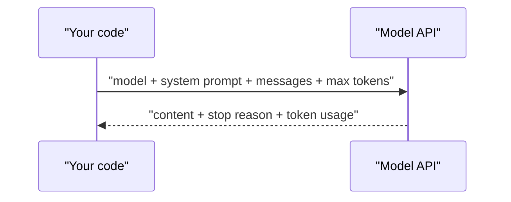

# Your first API call

> Module 2 · Lesson 1 · ~15 min

**Goals**
- Know the four things every model request carries and the three things every response gives back
- Call Claude, OpenAI and Gemini from Python and read the text, stop reason and token usage
- Hold a multi-turn conversation by resending the history yourself
- Handle the errors you'll actually hit: bad keys, rate limits and timeouts

## One request, one response

Strip away the SDKs and every chat model API is the same idea. You `POST` some JSON, and you get JSON back.



The request carries:

1. **Model**: which model to run, as an exact ID string.
2. **System prompt**: standing instructions ("You are a tutor. Be brief."). You'll go deep on this in [Module 4](../04-prompt-engineering/README.md).
3. **Messages**: the conversation so far, as alternating `user` and `assistant` turns.
4. **Output limit**: the most tokens the model may generate before it's cut off.

The response gives you the generated **content**, a **stop reason** (did it finish, or hit your limit?) and **usage** (input and output tokens, which is what you pay for).

The most important fact about these APIs is that **they are stateless**. The model doesn't remember your last request. If you want a conversation, you send the whole history every time. That's why the [context window](../01-how-llms-work/03-context-windows.md) matters so much, and why long chats get more expensive with every turn.

## Claude: the Messages API

Install the SDKs once (`uv add anthropic openai google-genai python-dotenv`). Each client reads its key from the environment, so your `.env` file from [Module 0](../00-orientation/03-set-up-your-workbench.md) is all the setup you need.

```python
# claude_hello.py
import anthropic
from dotenv import load_dotenv

load_dotenv()
client = anthropic.Anthropic()  # reads ANTHROPIC_API_KEY

response = client.messages.create(
    model="claude-sonnet-5-5",
    max_tokens=16000,
    system="You are a concise tutor for software developers.",
    messages=[{"role": "user", "content": "Explain an API rate limit in two sentences."}],
)

for block in response.content:
    if block.type == "text":
        print(block.text)

print(response.stop_reason)  # "end_turn" means it finished on its own
print(response.usage.input_tokens, response.usage.output_tokens)
```

A few things to notice:

- `system` is a top-level parameter, not a message.
- `max_tokens` is required. It's a ceiling, not a target: you pay only for tokens actually generated. Current Claude models think before answering, and that thinking counts toward the limit, so don't set it too low.
- `response.content` is a **list of blocks**, not a string. A reply can hold thinking blocks, text blocks and (in [lesson 5](05-function-calling.md)) tool-use blocks, so check `block.type`.
- `stop_reason` is worth checking every time. `"max_tokens"` means the answer was cut off. `"refusal"` means the model declined, and `content` may be empty.

## OpenAI: the Responses API

OpenAI's current API is the **Responses API**. (The older Chat Completions API still works and is the basis of [the next lesson](02-openai-compatible-apis.md).)

```python
# openai_hello.py
from openai import OpenAI
from dotenv import load_dotenv

load_dotenv()
client = OpenAI()  # reads OPENAI_API_KEY

response = client.responses.create(
    model="gpt-6.1-sol",
    instructions="You are a concise tutor for software developers.",
    input="Explain an API rate limit in two sentences.",
)

print(response.output_text)  # convenience: all text output joined together
print(response.usage.input_tokens, response.usage.output_tokens)
```

The system prompt is called `instructions`, and `input` takes either a plain string or a list of `{"role": ..., "content": ...}` messages. `output_text` saves you from walking `response.output`, which (like Claude's `content`) is a list of typed items.

One difference matters: Responses can be **stateful**. OpenAI stores responses by default, and you can continue a conversation by passing `previous_response_id=response.id` instead of resending history. It's convenient, but your data now lives on their servers and your app depends on that state. Pass `store=False` if you want the stateless behavior every other API has.

## Gemini: the Google Gen AI SDK

```python
# gemini_hello.py
from google import genai
from google.genai import types
from dotenv import load_dotenv

load_dotenv()
client = genai.Client()  # reads GEMINI_API_KEY

response = client.models.generate_content(
    model="gemini-3.8-flash",
    contents="Explain an API rate limit in two sentences.",
    config=types.GenerateContentConfig(
        system_instruction="You are a concise tutor for software developers.",
    ),
)

print(response.text)
print(response.usage_metadata.prompt_token_count, response.usage_metadata.candidates_token_count)
```

> [!NOTE]
> Google now recommends its newer **Interactions API** (`client.interactions.create(model=..., input=...)`, then `interaction.output_text`) for new projects. Like OpenAI's Responses API, it can keep conversation state on the server. `generate_content` is still fully supported and is stateless like Claude's API, so this course uses it. See Google's [migration guide](https://ai.google.dev/gemini-api/docs/migrate-to-interactions) if you want the newer style.

## Side by side

| | Claude | OpenAI | Gemini |
|---|---|---|---|
| Call | `client.messages.create` | `client.responses.create` | `client.models.generate_content` |
| System prompt | `system=` | `instructions=` | `config.system_instruction` |
| Conversation | `messages=[...]` | `input=` (string or list) | `contents=` (string or list) |
| Output limit | `max_tokens` (required) | `max_output_tokens` (optional) | `config.max_output_tokens` (optional) |
| Text out | text blocks in `content` | `output_text` | `text` |
| Usage | `usage.input_tokens` / `output_tokens` | `usage.input_tokens` / `output_tokens` | `usage_metadata.prompt_token_count` / `candidates_token_count` |

Different names, same shape. Once you've seen one, the others take minutes.

## Multi-turn: you own the history

To have a conversation, append each reply to the list and send it all again.

```python
history = []

def ask(question: str) -> str:
    history.append({"role": "user", "content": question})
    response = client.messages.create(
        model="claude-sonnet-5-5", max_tokens=16000, messages=history
    )
    # Store the full content blocks (not just the text) so thinking blocks round-trip intact
    history.append({"role": "assistant", "content": response.content})
    return "".join(b.text for b in response.content if b.type == "text")

print(ask("My name is Priya and I'm learning Rust."))
print(ask("What's my name, and what am I learning?"))
```

The second answer is right only because the first exchange rode along in `history`.

> [!TIP]
> **Try it**
> 1. Run all three hello scripts (or whichever you have keys for) and compare the token counts for the same question. They differ because each provider uses its own [tokenizer](../01-how-llms-work/01-text-to-tokens.md).
> 2. In the multi-turn script, comment out the line that appends the assistant reply. Does the model still know your name? Now remove the first `ask` call entirely. What does it say?
> 3. Set `max_tokens=20` on the Claude call and print `stop_reason`.
>
> <details><summary>What you should see</summary>
>
> Without the assistant turn, the model still sees your first user message, so it usually still knows your name. Without the first call at all, it has no idea. With `max_tokens=20` the text stops mid-sentence (or is missing entirely, if thinking used the budget) and `stop_reason` is `"max_tokens"`.
>
> </details>

## When things go wrong

The SDKs already retry connection errors, rate limits (429) and server errors (5xx) twice, with backoff. What's left for you is to tell recoverable failures from bugs:

```python
try:
    response = client.messages.create(...)
except anthropic.AuthenticationError:
    raise SystemExit("Check ANTHROPIC_API_KEY in your .env")
except anthropic.RateLimitError:
    ...  # still rate limited after retries: slow down, queue, or tell the user
except anthropic.APIStatusError as e:
    print(e.status_code, e.message)  # 400s are usually a bug in your request
except anthropic.APIConnectionError:
    ...  # network trouble or timeout
```

OpenAI's SDK has exceptions with the same names (`openai.RateLimitError` and so on). Order matters: catch the specific classes before the general `APIStatusError`.

<details><summary>Check yourself: you send a 40-turn conversation and pay for far more input tokens than the new question contains. Why?</summary>

The API is stateless, so every request includes all 40 previous turns as input tokens. Cost grows with history length. [Module 5](../05-context-engineering/README.md) covers how to trim and compact it.

</details>

## Key takeaways
- Every model call is model + system prompt + messages + output limit in, and content + stop reason + usage out.
- The APIs are stateless by default: you resend the conversation each turn, and you pay for it each turn.
- Responses are lists of typed blocks or items. Filter for text rather than assuming `content[0]` is the answer.
- Always check the stop reason. A truncated or refused answer looks like a short answer if you don't.
- The three big SDKs differ in names, not in concepts.

## Go deeper
- [Claude Messages API reference](https://platform.claude.com/docs/en/api/messages): every request and response field
- [OpenAI text generation guide](https://developers.openai.com/api/docs/guides/text): the Responses API from the ground up
- [Migrate to the Responses API](https://developers.openai.com/api/docs/guides/migrate-to-responses): how it differs from Chat Completions
- [Gemini API quickstart](https://ai.google.dev/gemini-api/docs/quickstart): keys, SDK install and first call

---
[← Module home](README.md) · [OpenAI-compatible APIs →](02-openai-compatible-apis.md)
