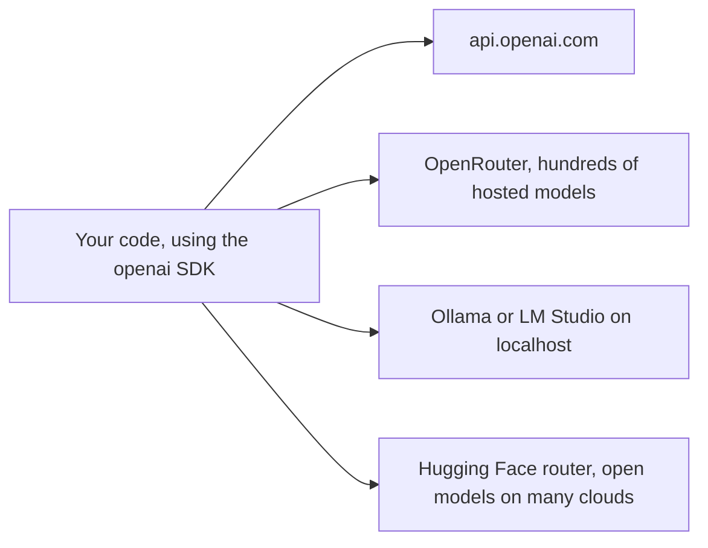

# OpenAI-compatible APIs

> Module 2 · Lesson 2 · ~15 min

**Goals**
- Explain why so many providers copy OpenAI's Chat Completions format
- Call OpenRouter, a local Ollama model and Hugging Face Inference Providers with the same client code
- Know what "compatible" quietly leaves out, and when to use a provider's native SDK instead

## A format that became a standard

OpenAI's **Chat Completions** endpoint (`POST /v1/chat/completions`) was the first LLM API most developers used. Its shape spread so far that almost every other server now speaks it: model routers, local runtimes, inference clouds, and even Anthropic and Google offer a compatibility layer.

The payoff is huge. Write your code once against the `openai` SDK, and you can reach hundreds of models by changing two settings: the **base URL** and the **API key**.



The Chat Completions shape is a little different from what you saw in [lesson 1](01-your-first-api-call.md). The system prompt is just a message with `role: "system"`, and the text lives at `choices[0].message.content`:

```python
from openai import OpenAI

client = OpenAI()
completion = client.chat.completions.create(
    model="gpt-6.1-sol",
    messages=[
        {"role": "system", "content": "You are a concise tutor."},
        {"role": "user", "content": "What is a base URL?"},
    ],
)
print(completion.choices[0].message.content)
print(completion.usage.prompt_tokens, completion.usage.completion_tokens)
```

> [!NOTE]
> For OpenAI's own models, the newer Responses API is the better choice. Chat Completions is still the common language everyone else speaks, which is why this lesson uses it.

## One client, many providers

Here's the whole trick: a small table of base URLs and key variables.

```python
# compat.py
import os
from openai import OpenAI
from dotenv import load_dotenv

load_dotenv()

PROVIDERS = {
    "openai":     {"base_url": None, "key_env": "OPENAI_API_KEY", "model": "gpt-6.1-sol"},
    "openrouter": {"base_url": "https://openrouter.ai/api/v1", "key_env": "OPENROUTER_API_KEY",
                   "model": "anthropic/claude-sonnet-5.5"},
    "ollama":     {"base_url": "http://localhost:11434/v1", "key_env": None, "model": "llama3.2"},
    "hf":         {"base_url": "https://router.huggingface.co/v1", "key_env": "HF_TOKEN",
                   "model": "openai/gpt-oss-120b:fastest"},
}

def chat(provider: str, question: str) -> str:
    cfg = PROVIDERS[provider]
    api_key = os.environ[cfg["key_env"]] if cfg["key_env"] else "ollama"  # Ollama ignores the key
    client = OpenAI(base_url=cfg["base_url"], api_key=api_key)
    completion = client.chat.completions.create(
        model=cfg["model"],
        messages=[{"role": "user", "content": question}],
    )
    return completion.choices[0].message.content

if __name__ == "__main__":
    import sys
    print(chat(sys.argv[1], "In one sentence: what is an OpenAI-compatible API?"))
```

Run `uv run compat.py openrouter`, then `uv run compat.py ollama`. Same code, different model, different company, different continent (or your laptop).

### OpenRouter: one key, many models

[OpenRouter](https://openrouter.ai/models) is a router that sits in front of most commercial and open models. You buy credits once and call any of them. Model IDs are `vendor/model`, such as `anthropic/claude-sonnet-5.5`, `openai/gpt-6.1-sol`, `google/gemini-3.8-flash` or `deepseek/deepseek-v4-flash`. It's ideal for comparing models (you'll do that in [Module 3](../03-choosing-models/04-picking-the-right-model.md)) and for automatic fallback when a provider is down:

```python
completion = client.chat.completions.create(
    model="anthropic/claude-sonnet-5.5",
    extra_body={"models": ["openai/gpt-6.1-sol", "google/gemini-3.8-flash"]},  # fallbacks
    messages=[{"role": "user", "content": "Hello"}],
)
print(completion.model)  # which model actually answered
```

The trade-off: another company sits in your data path, and you pay OpenRouter rather than each provider directly (check its pricing page for fees).

### Ollama: a local model behind the same API

[Ollama](https://ollama.com) runs open-weight models on your own machine and serves them at `http://localhost:11434/v1`. The key can be any string. Pull a model first (`ollama pull llama3.2`), then call it like any other provider. It's free, private and works offline. [Module 3](../03-choosing-models/02-running-models-locally.md) covers what your hardware can handle. LM Studio does the same thing at `http://localhost:1234/v1`.

### Hugging Face Inference Providers

Hugging Face routes requests for open models to partner clouds (Groq, Together, Cerebras and others) under one `HF_TOKEN`. Add a suffix to the model ID to choose: `:fastest` (the default), `:cheapest`, or a provider name like `:groq`.

You can use the OpenAI client with the router URL, as above, or Hugging Face's own `InferenceClient`, which also covers non-chat tasks like embeddings, image generation and speech recognition:

```python
from huggingface_hub import InferenceClient

client = InferenceClient()  # reads HF_TOKEN
completion = client.chat.completions.create(
    model="openai/gpt-oss-120b",
    messages=[{"role": "user", "content": "How many 'g's are in 'huggingface'?"}],
)
print(completion.choices[0].message.content)
```

You'll meet the rest of the Hugging Face ecosystem in [Module 3](../03-choosing-models/03-hugging-face.md).

> [!TIP]
> **Try it**
> Pick two providers from the table you can reach (Ollama is free if you have it installed). Run `compat.py` against both with the same question. Then add a `time.perf_counter()` around the call and print the elapsed seconds and `completion.usage`. Which was faster? Did both report usage?
>
> <details><summary>Hint</summary>
>
> Small local models often start answering faster than a cloud model (no network hop), but generate fewer tokens per second on a laptop. Some compatible servers return `usage` as `None` or with zeros, so guard for that before you build cost tracking on it.
>
> </details>

## What "compatible" leaves out

Compatibility covers the common core: messages, streaming, and usually tool calling. Beyond that, behavior varies, and **unsupported fields are often silently ignored** rather than rejected. That makes bugs quiet.

Some real examples:

- Anthropic's compatibility endpoint (`https://api.anthropic.com/v1/`) ignores `response_format` and the `strict` flag on tools, so you don't get guaranteed JSON. It merges all system messages into one, and it doesn't support prompt caching. Anthropic describes it as a way to test and compare, not a production integration.
- Local servers may accept `response_format` or `tools` but only honor them for models trained to use them.
- Provider-specific features (Claude's thinking and citations, Gemini's grounding, OpenAI's built-in tools) need either the native SDK or provider-specific `extra_body` fields.

A sensible rule: **use the native SDK for your primary provider, and the compatible API for breadth** (comparisons, fallbacks, local development). Course Buddy will do exactly that in [Module 3](../03-choosing-models/README.md).

<details><summary>Check yourself: your app sends `response_format` with a JSON schema through a compatibility layer, and the replies are suddenly prose. No errors were logged. What happened?</summary>

The server probably ignores `response_format` and accepted the request anyway. Check the provider's compatibility notes, and validate the output yourself ([lesson 4](04-structured-output.md)) so a silent change fails loudly.

</details>

## Key takeaways
- The Chat Completions format is the de facto standard. Base URL plus API key is all it takes to switch providers.
- OpenRouter gives you one key for hundreds of models, Ollama and LM Studio give you local models, and Hugging Face gives you open models on many clouds.
- "Compatible" means the core works. Advanced fields may be silently ignored.
- Use native SDKs where you need a provider's full feature set, and compatible APIs for breadth.

## Go deeper
- [OpenRouter quickstart](https://openrouter.ai/docs/quickstart): keys, headers and model IDs
- [Ollama OpenAI compatibility](https://docs.ollama.com/api/openai-compatibility): which endpoints and fields are supported
- [Hugging Face Inference Providers](https://huggingface.co/docs/inference-providers/index): providers, routing suffixes and the InferenceClient
- [Claude's OpenAI SDK compatibility](https://platform.claude.com/docs/en/cli-sdks-libraries/libraries/openai-sdk): a clear list of what a compatibility layer ignores

---
[← Your first API call](01-your-first-api-call.md) · [Module home](README.md) · [Streaming responses →](03-streaming-responses.md)
