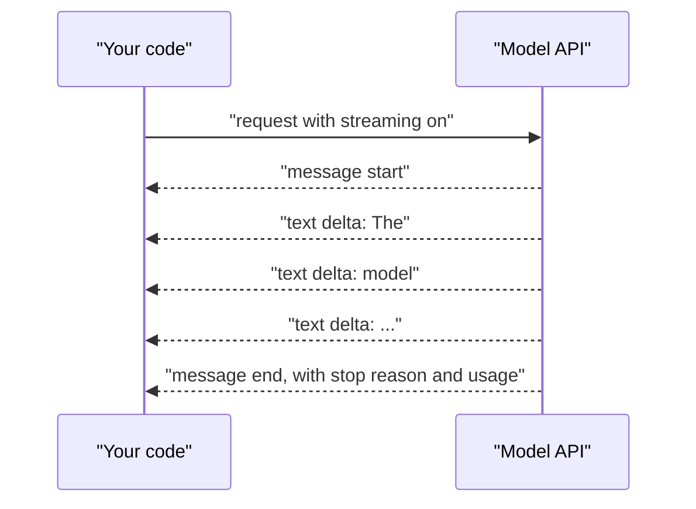

# Streaming responses

> Module 2 · Lesson 3 · ~10 min

**Goals**
- Explain why streaming makes apps feel faster without making the model faster
- Stream text from Claude, OpenAI and Gemini
- Build a streaming chat loop that keeps conversation history
- Know what you lose when you stream, and how to handle it

## Why stream?

A model generates one token at a time. Without streaming, your code waits until the very last token is done and then gets everything at once. A 600-token answer might take 8 seconds, and your user stares at a spinner for all 8.

With streaming, the server sends each chunk as soon as it's generated. The total time is the same, but the first words show up in well under a second. The number users feel is **time to first token (TTFT)**, not total time.



Under the hood this is usually **Server-Sent Events (SSE)**: one long HTTP response that delivers a series of small `event:` / `data:` messages. The SDKs parse them for you.

There's a second, less obvious reason: long generations can outlast HTTP timeouts. Streaming keeps bytes flowing, so the connection stays alive. For Claude requests with very large `max_tokens`, the SDK expects you to stream.

## Claude

The `messages.stream()` helper gives you a text iterator and, at the end, the full assembled message:

```python
import anthropic

client = anthropic.Anthropic()

with client.messages.stream(
    model="claude-sonnet-5-5",
    max_tokens=64000,
    messages=[{"role": "user", "content": "Write a haiku about latency."}],
) as stream:
    for text in stream.text_stream:
        print(text, end="", flush=True)
    final = stream.get_final_message()

print()
print(final.stop_reason, final.usage.output_tokens)
```

`flush=True` matters. Without it, Python buffers output and your "stream" appears in clumps.

If you need more than text (to show a "thinking..." indicator, say), iterate the stream itself to get typed events: `message_start`, `content_block_start`, `content_block_delta`, `content_block_stop`, `message_delta` (which carries the stop reason and final usage) and `message_stop`.

## OpenAI

The Responses API streams **semantic events**, each with a `type`. You usually only care about the text deltas and the completion event:

```python
from openai import OpenAI

client = OpenAI()
stream = client.responses.create(
    model="gpt-6.1-sol",
    input="Write a haiku about latency.",
    stream=True,
)
for event in stream:
    if event.type == "response.output_text.delta":
        print(event.delta, end="", flush=True)
    elif event.type == "response.completed":
        print("\n", event.response.usage.output_tokens)
```

For Chat Completions (and every OpenAI-compatible server from the [last lesson](02-openai-compatible-apis.md)), pass `stream=True` and read `chunk.choices[0].delta.content`, which can be `None` on some chunks.

## Gemini

```python
from google import genai

client = genai.Client()
for chunk in client.models.generate_content_stream(
    model="gemini-3.8-flash",
    contents="Write a haiku about latency.",
):
    if chunk.text:
        print(chunk.text, end="", flush=True)
```

## A streaming chat loop

Here's the core of Course Buddy's chat: a loop that streams each answer and keeps history.

```python
# chat.py
import anthropic
from dotenv import load_dotenv

load_dotenv()
client = anthropic.Anthropic()
history = []

while True:
    question = input("\nyou> ").strip()
    if question in {"", "exit", "quit"}:
        break
    history.append({"role": "user", "content": question})

    print("buddy> ", end="", flush=True)
    with client.messages.stream(
        model="claude-sonnet-5-5",
        max_tokens=64000,
        system="You are Course Buddy, a friendly tutor. Keep answers short.",
        messages=history,
    ) as stream:
        for text in stream.text_stream:
            print(text, end="", flush=True)
        reply = stream.get_final_message()

    history.append({"role": "assistant", "content": reply.content})
```

Notice that you still need the complete message at the end. Streaming is for display. Your program logic (history, logging, cost tracking) runs on the final message.

> [!TIP]
> **Try it**
> Measure TTFT yourself. Record `start = time.perf_counter()` before the request, print the elapsed time when the first text chunk arrives, and again at the end. Ask for a 300-word story, once streaming and once with plain `messages.create`. Compare when you first see text.
>
> <details><summary>Hint</summary>
>
> Use a flag: `first = True`, and inside the loop `if first: print(f"[TTFT {time.perf_counter() - start:.2f}s]"); first = False`. Expect TTFT to be a small fraction of total time. Without streaming, "time to first text" equals total time.
>
> </details>

## What streaming costs you

Streaming isn't free. Plan for these:

- **No validation until the end.** If you need JSON ([next lesson](04-structured-output.md)), a half-streamed object isn't parseable. Either don't stream structured output, or stream it to the screen and validate the final message.
- **Errors can arrive mid-stream.** The request can succeed, start streaming, and then fail (an overloaded server, a dropped connection). Wrap the loop in `try` and decide what the user sees: the partial text plus an error note, or a retry.
- **Stopping early.** If the user cancels, `break` out of the loop. Leaving the `with` block closes the connection, so the model stops generating and you stop paying for further output.
- **Usage comes last.** Token counts arrive in the final events. If you log cost, read it from the final message.
- **Rendering partial Markdown.** A half-finished code fence or table renders badly. Terminal apps can ignore this. Web UIs usually re-render the accumulated text on every chunk.

<details><summary>Check yourself: streaming made your chatbot "faster" according to users, but your latency dashboard shows no change. Is something broken?</summary>

No. Streaming improves time to first token, not total generation time. If your dashboard measures total request duration, it won't move. Track TTFT separately (more on this in [Module 12](../12-observability/README.md)).

</details>

## Key takeaways
- Streaming sends tokens as they're generated, which slashes time to first token. Total time stays the same.
- Each SDK exposes a text iterator or delta events. Always `flush` when printing.
- Keep using the final assembled message for history, logging and cost.
- Plan for mid-stream errors, early cancellation, and the fact that you can't validate output until it's complete.

## Go deeper
- [Claude streaming messages](https://platform.claude.com/docs/en/build-with-claude/streaming): the full event list and error events
- [OpenAI streaming responses](https://developers.openai.com/api/docs/guides/streaming-responses): Responses API event types
- [Using server-sent events (MDN)](https://developer.mozilla.org/en-US/docs/Web/API/Server-sent_events/Using_server-sent_events): the wire format behind most LLM streaming

---
[← OpenAI-compatible APIs](02-openai-compatible-apis.md) · [Module home](README.md) · [Structured output →](04-structured-output.md)
