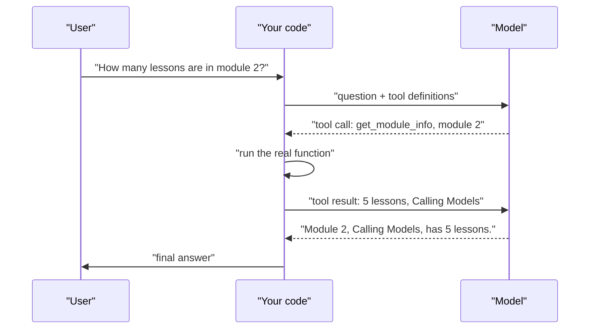

# Function calling

> Module 2 · Lesson 5 · ~15 min

**Goals**
- Explain what function calling (tool use) is, and what the model does and doesn't do
- Define a tool with a JSON Schema and run one full round trip with Claude
- Map the same flow onto OpenAI's Responses API
- Handle tool errors and keep tool execution safe

## The model asks, your code acts

A model can't look anything up or change anything by itself. It only produces text. **Function calling** (Anthropic calls it **tool use**) gives it a structured way to say: "I'd like you to run `get_module_info` with `{"module": 2}`." Your code decides whether to run it, runs it, and sends the result back. The model then uses that result to answer.



Two things to internalize:

1. **The model never executes anything.** It emits a request. Your code is the only thing with real power, which also makes it the place for permission checks.
2. **A tool definition is a prompt.** The model chooses tools by reading their names and descriptions, so write them like documentation for a smart new colleague.

## Defining a tool

A tool is a name, a description, and a JSON Schema for its input. (It's the same schema idea as [structured output](04-structured-output.md), applied to arguments.)

```python
import json
import anthropic

client = anthropic.Anthropic()

MODULES = {
    1: {"title": "How LLMs Work", "lessons": 4},
    2: {"title": "Calling Models", "lessons": 5},
    3: {"title": "Choosing Models", "lessons": 4},
}

def get_module_info(module: int) -> dict:
    if module not in MODULES:
        raise ValueError(f"No module {module}. Valid modules: {sorted(MODULES)}")
    return MODULES[module]

TOOLS = {"get_module_info": get_module_info}

tool_specs = [{
    "name": "get_module_info",
    "description": "Look up a course module's title and number of lessons. "
                   "Use this whenever the user asks about a specific module.",
    "input_schema": {
        "type": "object",
        "properties": {"module": {"type": "integer", "description": "Module number, e.g. 2"}},
        "required": ["module"],
        "additionalProperties": False,
    },
    "strict": True,  # guarantees the input matches the schema
}]
```

## One round trip with Claude

```python
messages = [{"role": "user", "content": "How many lessons are in module 2, and what's it called?"}]

response = client.messages.create(
    model="claude-sonnet-5-5", max_tokens=16000, tools=tool_specs, messages=messages
)

if response.stop_reason == "tool_use":
    messages.append({"role": "assistant", "content": response.content})  # keep the tool_use blocks
    results = []
    for block in response.content:
        if block.type != "tool_use":
            continue
        try:
            output = TOOLS[block.name](**block.input)
            results.append({"type": "tool_result", "tool_use_id": block.id,
                            "content": json.dumps(output)})
        except Exception as err:
            results.append({"type": "tool_result", "tool_use_id": block.id,
                            "content": str(err), "is_error": True})
    messages.append({"role": "user", "content": results})  # all results in ONE message

    response = client.messages.create(
        model="claude-sonnet-5-5", max_tokens=16000, tools=tool_specs, messages=messages
    )

print("".join(b.text for b in response.content if b.type == "text"))
```

The details that trip people up:

- **`stop_reason == "tool_use"`** is your signal. The `tool_use` block carries an `id`, the tool `name` and the parsed `input`.
- **Echo the assistant turn back.** The next request must include the assistant message with its `tool_use` blocks, followed by a user message with matching `tool_result` blocks (same `tool_use_id`).
- **Models can call several tools at once.** Run them all and return every result together in a single user message.
- **Errors are results too.** Send `is_error: True` with a useful message. The model will often fix its input and try again, or explain the problem to the user.

> [!NOTE]
> This code handles exactly one round of tool calls. Real tasks often need several: call a tool, read the result, call another. Wrapping this in a loop is what turns a chatbot into an **agent**, and that's the subject of [Module 8](../08-agents/02-tools-and-the-react-loop.md).

## The same flow with OpenAI

The concepts map one to one. Only the names change:

```python
from openai import OpenAI

oai = OpenAI()
tools = [{
    "type": "function",
    "name": "get_module_info",
    "description": tool_specs[0]["description"],
    "parameters": tool_specs[0]["input_schema"],
    "strict": True,
}]
items = [{"role": "user", "content": "How many lessons are in module 2?"}]

response = oai.responses.create(model="gpt-6.1-sol", input=items, tools=tools)
items += response.output  # keep the function_call items
for item in response.output:
    if item.type == "function_call":
        output = TOOLS[item.name](**json.loads(item.arguments))  # arguments is a JSON string
        items.append({"type": "function_call_output", "call_id": item.call_id,
                      "output": json.dumps(output)})

response = oai.responses.create(model="gpt-6.1-sol", input=items, tools=tools)
print(response.output_text)
```

| | Claude | OpenAI Responses |
|---|---|---|
| Schema field | `input_schema` | `parameters` |
| Call arrives as | `tool_use` content block | `function_call` output item |
| Arguments | `block.input` (a dict) | `item.arguments` (a JSON string) |
| ID to echo | `tool_use_id` | `call_id` |
| Result goes in | `tool_result` block in a user message | `function_call_output` item |

Gemini's SDK can go one step further: pass plain Python functions as tools, and it calls them for you automatically. Convenient, but you give up the checkpoint between "model asked" and "code ran".

## Steering tool use

By default the model decides whether to call a tool (`tool_choice` is `auto`). If it should always call one, say so in the prompt ("Use get_module_info to answer") and keep `strict: True` so arguments stay valid. Note that the newest Claude models (`claude-sonnet-5-5`, `claude-opus-5-5`) reject forced tool choice (`{"type": "any"}` or `{"type": "tool", ...}`) with a 400, so steer with instructions instead. If all you need is JSON back, use [structured output](04-structured-output.md), not a fake tool.

## Keep it safe

The model's arguments are **untrusted input**, just like a form submission. In particular:

- Validate arguments before acting. `strict` guarantees the shape, not that the values are safe or sensible.
- Never pass model output to `eval`, a shell or raw SQL.
- Require human confirmation for anything destructive or costly (sending email, deleting data, spending money).
- Tool results go back into the prompt, so text from the outside world (a web page, a file) can carry instructions. This is **prompt injection**, covered in [Module 13](../13-safety-and-ethics/02-prompt-injection.md).

> [!TIP]
> **Try it**
> 1. Run the Claude example, then ask "What's in module 9?" (not in `MODULES`). Watch how the model uses the `is_error` result.
> 2. Add a second tool, `list_modules()`, that returns all module numbers and titles (an empty `properties` object is fine). Ask "Which module covers choosing models?" and print each `tool_use` block to see which tool it picks.
>
> <details><summary>Hint</summary>
>
> Schema for a no-argument tool: `{"type": "object", "properties": {}, "additionalProperties": False}`. Call it with `TOOLS[block.name](**block.input)` as before, since `block.input` will be `{}`. A good description ("List every module with its number and title") is what makes the model pick it.
>
> </details>

<details><summary>Check yourself: you return tool results but the API answers with a 400 error about a missing tool_use. What did you forget?</summary>

You didn't append the assistant message containing the `tool_use` blocks before the user message with the `tool_result` blocks. Each result must answer a `tool_use` in the immediately preceding assistant turn.

</details>

## Key takeaways
- Function calling lets the model request an action. Your code decides and executes.
- A tool is a name, a description and a JSON Schema. The description is a prompt, so write it well.
- The round trip: send tools, receive a call, run it, return the result with the matching ID, get the final answer.
- Return errors as results, return parallel results together, and treat arguments as untrusted input.
- One round is function calling. A loop of rounds is an agent (Module 8).

## Go deeper
- [Claude tool use overview](https://platform.claude.com/docs/en/agents-and-tools/tool-use/overview): tool definitions, results, parallel calls and strict mode
- [OpenAI function calling](https://developers.openai.com/api/docs/guides/function-calling): the Responses API flow end to end
- [Gemini function calling](https://ai.google.dev/gemini-api/docs/function-calling): manual and automatic modes

---
[← Structured output](04-structured-output.md) · [Module home](README.md) · [Module review →](review.md)
