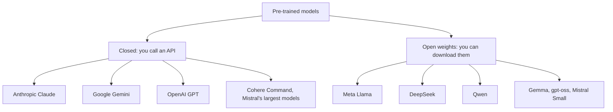

# Closed vs open models

> Module 3 · Lesson 1 · ~15 min

**Goals**
- Explain what a pre-trained model is, and the difference between base and instruction-tuned versions
- Name the major closed model families and the major open-weight families
- Tell "open weights" apart from "open source", and spot the license terms that matter
- Weigh the real trade-offs between closed and open models for a product

## Every model you use is pre-trained

Training a frontier LLM costs tens or hundreds of millions of dollars. You won't do it, and you don't need to. As an AI engineer you work with **pre-trained models**: someone else did the expensive [pretraining](../01-how-llms-work/02-training-vs-inference.md), and you use the result through an API or by downloading it.

Model releases usually come in two flavors:

- **Base model**: trained only to predict the next token on a huge pile of text. Give it "The capital of France is" and it continues. Ask it a question and it may continue with three more questions. Useful mostly as a starting point for fine-tuning.
- **Instruction-tuned model** (often marked `-instruct`, `-it` or `-chat`): the base model after further training to follow instructions and hold a conversation. This is what you want almost every time.

On Hugging Face you'll see both side by side, for example `google/gemma-4-31B` (base) and `google/gemma-4-31B-it` (instruction-tuned). Closed APIs only expose the tuned versions.

## The two camps

**Closed models** live behind the vendor's API. You never see the weights. You send data to their servers and pay per token.

- **Anthropic Claude**: Opus, Sonnet and Haiku tiers, strong at coding, agents and long documents.
- **Google Gemini**: Pro, Flash and Flash-Lite tiers, very long context and strong multimodal input.
- **OpenAI GPT**: several tiers from a flagship to small, cheap models. Its reasoning models think before answering, an idea most vendors have now adopted.
- **Cohere**: the Command models, aimed at enterprise retrieval and search, plus popular embedding and re-ranking models.
- **Mistral**: a European lab that sells its largest models through an API and also releases open-weight ones.

**Open-weight models** publish the trained weights, so anyone can download and run them on their own hardware or rent someone else's.

- **Meta Llama**: the family that kicked off the open-weight wave. Huge ecosystem support.
- **DeepSeek**: Chinese lab whose releases have been close to frontier quality at very low cost.
- **Qwen** (Alibaba): a wide range of sizes, from tiny to very large, with strong coding and multilingual skills.
- **Gemma** (Google): small and mid-size models built from Gemini research, good for laptops and phones.
- Also worth knowing: OpenAI's **gpt-oss** and **Mistral Small**.

Specific version numbers change every few months, so check each provider's model page instead of memorizing them.

## Open weights is not the same as open source

"Open source" software means you get the source, and you can use, change and share it for any purpose. Most "open" models give you the **weights** (the trained numbers) but not the training data or the full training code. The Open Source Initiative's definition of open-source AI asks for more than most releases provide, so "open-weight" is the more accurate term.

What matters day to day is the **license**, because licenses vary a lot:

| License type | Examples | What to check |
|---|---|---|
| Permissive (Apache 2.0, MIT) | Qwen3, DeepSeek V4, gpt-oss, Gemma 4, Mistral Small | Very few restrictions. Keep the license notice |
| Custom community license | Llama 4, older Gemma versions | Acceptable-use policies, attribution, user-count thresholds, rules on using outputs to train other models |
| Research or non-commercial | Many fine-tunes and smaller releases | You can't ship it in a product |

Llama's license, for example, requires companies with more than 700 million monthly active users to get a separate license from Meta, and requires "Built with Llama" attribution. Neither matters for most teams, but you should know they're there. Read the license on the model card before you build on a model. A fine-tune inherits the base model's license terms.

> [!TIP]
> **Try it**
> Open three model cards on Hugging Face: `Qwen/Qwen3-8B`, `meta-llama/Llama-4-Scout-17B-16E-Instruct` and `google/gemma-4-E4B-it`. For each, find the license (top of the page, and the `LICENSE` file) and answer: can you use it commercially? Do you have to accept terms before downloading? Is it a base or instruction-tuned model?
>
> 

What you should find

>
> Qwen3-8B and Gemma 4 E4B are Apache 2.0: commercial use is fine, with no gate. Llama 4 Scout uses Meta's Llama 4 Community License, and you must accept the terms (a gated repo) before downloading. All three are tuned for chat. Qwen3-8B has no `-instruct` suffix, though: its base version is the separate `Qwen/Qwen3-8B-Base` repo. Read the card, not just the name.
>
> 

## The trade-offs

| | Closed (API) | Open weights (self-hosted) |
|---|---|---|
| Peak quality | Usually the frontier | Close behind, and often good enough |
| Setup | An API key | Hardware, serving software, ops |
| Cost shape | Pay per token, zero at idle | Pay for machines, cheap per token at high volume |
| Data | Leaves your network (check retention terms) | Can stay entirely on your machines |
| Control | Vendor can update or retire models | You pin exact weights forever |
| Customization | Prompting, sometimes vendor fine-tuning | Full fine-tuning, quantization, any modification |
| Features | Built-in tools, caching, huge context | Whatever your serving stack supports |

The middle path is common: **open weights served by someone else**. Providers like Groq, Together or Fireworks (directly, or through OpenRouter and Hugging Face) host open models behind an API. You get open-model prices and portability without running GPUs, though your data still leaves your network.

Check yourself: a hospital wants a chatbot that summarizes patient notes, and policy forbids sending patient data to third parties. Which camp, and what's the catch?

Open weights, self-hosted inside the hospital's network (or a closed model only if a vendor agreement and deployment option satisfy the policy). The catch: they now own hardware, serving, updates and evaluation, and a model small enough to run cheaply may not be good enough. They have to measure that, not assume it.

## Key takeaways
- You'll almost always use pre-trained, instruction-tuned models. Base models are for fine-tuning.
- Closed models (Claude, Gemini, GPT, Cohere, Mistral's largest) are API-only. Open-weight models (Llama, DeepSeek, Qwen, Gemma and others) can be downloaded and run anywhere.
- "Open weights" isn't "open source". Read the license: permissive, custom or non-commercial.
- Closed buys peak quality and zero ops. Open buys control, privacy and cost at scale. Hosted open models sit in between.

## Go deeper
- [Claude models overview](https://platform.claude.com/docs/en/about-claude/models/overview): a closed vendor's lineup, with tiers, context and pricing
- [The Open Source AI Definition (OSI)](https://opensource.org/ai/open-source-ai-definition): what "open source" would actually require for AI
- [Llama 4 Community License](https://www.llama.com/llama4/license/): read a real custom model license
- [Mistral models](https://docs.mistral.ai/getting-started/models/): one vendor with both API-only and open-weight models

---
[← Module home](README.md) · [Running models locally →](02-running-models-locally.md)
