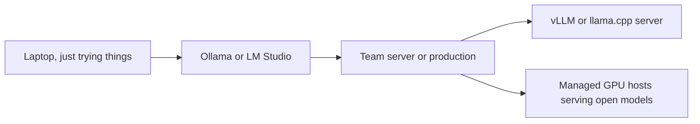

# Running models locally

> Module 3 · Lesson 2 · ~20 min

**Goals**
- Decide when self-hosting a model is worth it
- Run an open model with Ollama and call it from Python through the OpenAI-compatible API
- Estimate whether a model fits your machine, and explain what quantization trades away
- Know the tools for the next step up: LM Studio on the desktop, vLLM and llama.cpp on servers

## Why run a model yourself?

You already know how to call a model in the cloud. Running one locally earns its keep when:

- **Data can't leave the machine**: health records, legal documents, source code under strict policy.
- **You want zero marginal cost**: development loops, tests, batch jobs over millions of small items.
- **You need to work offline**, or want to pin an exact model that a vendor can't change or retire.
- **You want to learn**: watching a small model fail is a great way to understand what big ones do well.

The cost is quality (a model that fits a laptop is far from the frontier) and operations (you own updates, scaling and uptime).

## Ollama in five minutes

[Ollama](https://ollama.com) downloads, quantizes and serves open models with one command. Install it from the website, then:

```bash
ollama pull llama3.2        # ~2 GB, a 3B-parameter model that runs almost anywhere
ollama run llama3.2         # chat in the terminal (/bye to exit)
ollama list                 # what you've downloaded
ollama ps                   # what's loaded in memory, and whether it's on GPU or CPU
```

Ollama runs a local server on port 11434 with an OpenAI-compatible API, so the code from [Module 2](../02-calling-models/02-openai-compatible-apis.md) works unchanged:

```python
from openai import OpenAI

client = OpenAI(base_url="http://localhost:11434/v1", api_key="ollama")  # key is ignored
completion = client.chat.completions.create(
    model="llama3.2",
    messages=[{"role": "user", "content": "Give me three names for a pet rock."}],
)
print(completion.choices[0].message.content)
```

Browse the [Ollama library](https://ollama.com/library) for more. Tags pick the size: `qwen3:8b`, `gemma4:12b`, `gpt-oss:20b`. Bigger is smarter and slower, and needs more memory.

> [!WARNING]
> Ollama uses a **4,096-token context window by default**, whatever the model supports. Longer prompts get truncated without an error, so a local RAG app can quietly lose most of its retrieved text. Raise it with the `OLLAMA_CONTEXT_LENGTH` environment variable before starting the server (memory use rises with it).

## Will it fit? Memory math

A model is mostly its weights, and each weight takes some number of bits. A good first estimate:

> **memory (GB) ≈ parameters (billions) × bits per weight ÷ 8, plus 1–2 GB of overhead, plus the KV cache for your context**

| Model size | 16-bit | 8-bit | 4-bit |
|---|---|---|---|
| 3B | ~6 GB | ~3 GB | ~2 GB |
| 8B | ~16 GB | ~8 GB | ~5 GB |
| 32B | ~64 GB | ~32 GB | ~18 GB |
| 70B | ~140 GB | ~70 GB | ~40 GB |

It has to fit in **GPU memory (VRAM)** to be fast. If it spills into system RAM, it still runs, just several times slower (`ollama ps` shows the split). Apple Silicon Macs share one pool of unified memory between CPU and GPU, which is why a 32 GB MacBook can run models that would need an expensive graphics card on a PC.

The **KV cache** is the model's working memory for the current context, and it grows with every token in the window. A long context can need several extra gigabytes on top of the weights.

## Quantization: trading precision for memory

Models are trained with 16-bit (or higher) numbers. **Quantization** stores the weights with fewer bits (8, 5, 4, sometimes less). The model gets 2 to 4 times smaller and faster, and slightly worse.

- **8-bit** is nearly indistinguishable from the original for most tasks.
- **4-bit** (for example `Q4_K_M`, Ollama's usual default) is the sweet spot for local use: a big size win for a small quality loss.
- **Below 4-bit**, quality drops off quickly, especially for reasoning, math and code.

A rule of thumb that usually holds: **a bigger model at 4-bit beats a smaller model at 16-bit** for the same memory.

You'll see these files in **GGUF** format, the single-file format used by llama.cpp, Ollama and LM Studio. On Hugging Face, look for repos ending in `-GGUF` with one file per quantization level.

> [!TIP]
> **Try it**
> 1. Pull two sizes of the same family, for example `ollama pull qwen3:1.7b` and `ollama pull qwen3:8b` (skip the bigger one if you have less than 16 GB of memory).
> 2. Run each with `ollama run <model> --verbose` and ask the same tricky question, such as "A bat and a ball cost $1.10 in total. The bat costs $1.00 more than the ball. How much is the ball?"
> 3. Compare the `eval rate` (tokens per second) printed after each answer, and the answers themselves. Check `ollama ps` while each one is loaded.
>
> <details><summary>What to look for</summary>
>
> The small model is several times faster and more likely to answer "10 cents" (wrong; it's 5 cents). Qwen3 models may also print their reasoning before the answer. The bigger model is slower but more reliable. That's the size, speed and quality trade-off in one experiment. If `ollama ps` shows a CPU/GPU split, the model didn't fully fit in GPU memory.
>
> </details>

## Other local and self-hosted options



- **LM Studio**: a desktop app with a model browser, a chat UI and a local OpenAI-compatible server at `http://localhost:1234/v1`. It also has a CLI (`lms get`, `lms load`, `lms server start`). On Apple Silicon it can run MLX-format models, which are optimized for Macs. A friendlier choice than Ollama if you prefer a GUI.
- **llama.cpp**: the C++ engine underneath much of this ecosystem. Its `llama-server` gives you an OpenAI-compatible server with fine-grained control.
- **vLLM**: the standard for serving open models on GPU servers at scale. It handles many concurrent users efficiently and exposes an OpenAI-compatible API (`vllm serve <hf-model-id>`).

Notice the pattern: everything speaks the OpenAI-compatible API, so moving from a laptop to a server is mostly a base URL change.

<details><summary>Check yourself: your 16 GB laptop runs an 8B model at 4-bit fine, but becomes painfully slow once you paste in a long document. What happened?</summary>

The KV cache grows with the context. The long prompt pushed total memory past what fits in GPU or unified memory, so part of the work spilled to slower memory or CPU. A smaller context, a smaller model or more memory are the fixes. (Also check that the document wasn't silently truncated by the default context length.)

</details>

## Key takeaways
- Self-host for privacy, cost at volume, offline use or control. Pay for it in quality and operations.
- Ollama and LM Studio make local models one command away, behind the same OpenAI-compatible API you already use.
- Memory ≈ parameters × bits ÷ 8, plus overhead and the KV cache. It needs to fit in VRAM or unified memory to be fast.
- 4-bit quantization is the usual sweet spot. Bigger-and-quantized often beats smaller-and-full-precision.
- Watch default context limits on local servers: truncation is silent.

## Go deeper
- [Ollama quickstart](https://docs.ollama.com/quickstart): install, pull and run your first model
- [Ollama model library](https://ollama.com/library): sizes, tags and capabilities (tools, vision, thinking)
- [LM Studio docs](https://lmstudio.ai/docs/app): the desktop app and local server
- [llama.cpp](https://github.com/ggml-org/llama.cpp): the engine, quantization formats and `llama-server`
- [GGUF on Hugging Face](https://huggingface.co/docs/hub/gguf): the file format and how to find quantized models

---
[← Closed vs open models](01-closed-vs-open-models.md) · [Module home](README.md) · [Hugging Face →](03-hugging-face.md)
