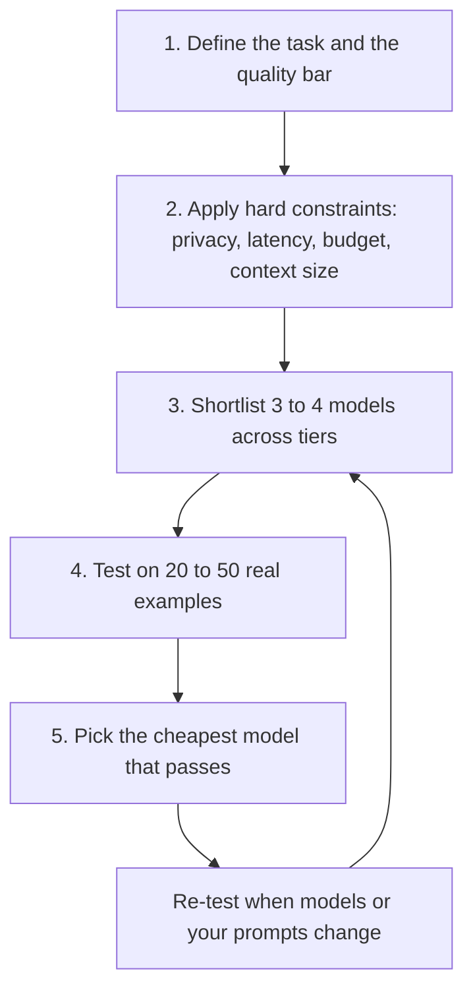

# Picking the right model

> Module 3 · Lesson 4 · ~15 min

**Goals**
- Use a repeatable framework to choose a model: requirements, constraints, shortlist, test, decide
- Estimate monthly cost from token counts and prices
- Compare several models side by side on your own prompts through OpenRouter
- Make the model a config value so you can change your mind cheaply

## Leaderboards are a starting point, not an answer

It's tempting to open a leaderboard and pick the top model. But public benchmarks measure someone else's tasks. Your task (answering questions about *your* docs, in *your* format, at *your* volume) is the only benchmark that matters. Plenty of teams pay for a frontier model when a model ten times cheaper passes their tests just as well. Plenty of others ship a cheap model that fails on the 5% of cases their users care about most.

The goal: **the cheapest, fastest model that clears your quality bar, within your constraints.**

## A five-step framework



**1. Define the task and the bar.** What does a good answer look like? Write down 20 to 50 real inputs and what you'd accept as output. That's the seed of an eval set, which you'll formalize in [Module 11](../11-evals/README.md).

**2. Apply hard constraints.** These rule models out before you test anything:

| Constraint | Question to ask | Pushes you toward |
|---|---|---|
| Privacy | Can this data leave our network? Under what terms? | Self-hosted open weights, or vendor agreements and regional hosting |
| Latency | Does a user wait on this? Is it streamed? | Smaller and faster tiers, low reasoning effort |
| Cost | Requests per day × tokens per request? | Smaller models, caching, batch APIs |
| Context | How much text goes in at once? | Long-context models, or [retrieval](../07-rag/README.md) |
| Capabilities | Need vision, tool use, structured output? | Models and providers that support them natively |

**3. Shortlist across tiers.** Include at least one model from each: a frontier model (to learn the ceiling), a mid-tier workhorse, and a small or open model (to learn the floor). For Claude, that's `claude-opus-5-5`, `claude-sonnet-5-5` and `claude-haiku-5-5`.

**4. Test on your examples.** Same prompts, same settings, every candidate. Record quality, latency and cost per request.

**5. Pick the cheapest that passes**, and keep the comparison script. You'll rerun it when new models ship, which happens every few weeks.

## Back-of-the-envelope cost

Prices are quoted per million tokens (MTok), with output tokens costing several times more than input. The math is simple:

> **cost = requests × (input tokens × input price + output tokens × output price) ÷ 1,000,000**

Say Course Buddy handles 10,000 questions a day, each with 2,000 input tokens (system prompt plus retrieved lessons) and 500 output tokens. At the time of writing, Claude Sonnet 5.5 costs $2 input and $10 output per MTok:

- Input: 10,000 × 2,000 = 20M tokens × $2 = **$40/day**
- Output: 10,000 × 500 = 5M tokens × $10 = **$50/day**
- Total: about **$90/day, or $2,700/month**. The same traffic on Claude Opus 5.5 ($4 / $20) costs twice as much.

Two things jump out. Input volume matters as much as output, because context adds up (it's why [prompt caching](../05-context-engineering/03-long-context-and-caching.md) and trimming retrieved text pay off). And reasoning models also bill for their thinking tokens as output, so measure real usage instead of guessing. Always check current prices on each provider's pricing page.

> [!NOTE]
> Self-hosting turns this per-token cost into a fixed cost (GPUs, whether busy or idle) plus engineering time. It usually only wins at high, steady volume, or when privacy forces it.

## Compare models side by side with OpenRouter

OpenRouter lets one script call every candidate with one key, and it reports what each call cost:

```python
# compare.py
import os, time
from openai import OpenAI
from dotenv import load_dotenv

load_dotenv()
client = OpenAI(base_url="https://openrouter.ai/api/v1", api_key=os.environ["OPENROUTER_API_KEY"])

MODELS = ["anthropic/claude-sonnet-5.5", "openai/gpt-6.1-sol",
          "google/gemini-3.8-flash", "qwen/qwen3.8-27b"]
PROMPTS = [
    "Explain what a context window is to a junior developer in two sentences.",
    "Is a 70B model at 4-bit likely to fit in 24 GB of VRAM? Answer yes or no, then why.",
]

for prompt in PROMPTS:
    print(f"\n=== {prompt}")
    for model in MODELS:
        start = time.perf_counter()
        r = client.chat.completions.create(model=model, messages=[{"role": "user", "content": prompt}])
        secs = time.perf_counter() - start
        cost = getattr(r.usage, "cost", None)  # OpenRouter adds cost in USD to usage
        print(f"\n--- {model}  {secs:.1f}s  {r.usage.completion_tokens} out tokens  ${cost}")
        print(r.choices[0].message.content)
```

Read the answers yourself for now. Grading them automatically (including with an LLM as judge) is the subject of [Module 11](../11-evals/README.md).

> [!TIP]
> **Try it**
> Replace `PROMPTS` with five real questions about this course (the kind Course Buddy will get), and run `compare.py`. For each model, note: was every answer correct? Was it fast enough to feel interactive? What would 10,000 of these cost per day? Which model would you pick, and what's the cheapest one you'd accept?
>
> <details><summary>Hint</summary>
>
> Multiply each call's `cost` by 10,000 for a rough daily figure. Look at latency too, and remember that streaming hides some of it. Don't be surprised if two or three models are all "good enough". That's the normal outcome, and the reason you pick on cost and speed after quality.
>
> </details>

## Make the model a config value

Whatever you pick today will change. Keep the provider and model out of your logic so switching is a config edit. Here's a sketch of Course Buddy's `providers.py`. It uses the native SDK for Claude and the OpenAI-compatible API for everything else:

```python
# course_buddy/providers.py
import os
import anthropic
from openai import OpenAI

PROVIDER = os.getenv("BUDDY_PROVIDER", "anthropic")   # anthropic | openai | ollama
MODEL = os.getenv("BUDDY_MODEL", "claude-sonnet-5-5")

COMPAT = {
    "openai": {"base_url": None, "api_key": os.getenv("OPENAI_API_KEY")},
    "ollama": {"base_url": "http://localhost:11434/v1", "api_key": "ollama"},
}

def stream_reply(system: str, messages: list[dict]):
    """Yield text chunks from whichever provider is configured."""
    if PROVIDER == "anthropic":
        with anthropic.Anthropic().messages.stream(
            model=MODEL, max_tokens=64000, system=system, messages=messages
        ) as stream:
            yield from stream.text_stream
    else:
        client = OpenAI(**COMPAT[PROVIDER])
        stream = client.chat.completions.create(
            model=MODEL, stream=True,
            messages=[{"role": "system", "content": system}, *messages],
        )
        for chunk in stream:
            if chunk.choices and chunk.choices[0].delta.content:
                yield chunk.choices[0].delta.content
```

Then `BUDDY_PROVIDER=ollama BUDDY_MODEL=llama3.2 uv run course-buddy chat` runs the same app on your laptop. Keep history as plain `{"role", "content"}` text messages so it works with every backend.

A natural next step is **routing**: send easy questions to a small model and hard ones to a big one, or fall back to a second provider when the first errors out. Start simple, with one model and a config switch, and add routing only when the numbers justify it.

<details><summary>Check yourself: the top model on a public leaderboard costs 8x your current model. Your team wants to switch. What do you do first?</summary>

Run both on your own examples (step 4). If the expensive model doesn't clearly pass cases your current one fails, the leaderboard gap doesn't matter for your product. If it does, check whether a mid-tier model closes the gap for less, or whether routing only the hard cases to the expensive model is enough.

</details>

## Key takeaways
- Choose for your task, not a leaderboard: the cheapest, fastest model that clears your quality bar.
- Hard constraints (privacy, latency, cost, context, capabilities) narrow the field before you test.
- Shortlist across tiers, test on 20 to 50 real examples, and keep the comparison script for the next model release.
- Cost = requests × tokens × price. Input volume and thinking tokens are easy to underestimate.
- Make provider and model config values, so changing your mind is cheap.

## Go deeper
- [Choosing a Claude model](https://platform.claude.com/docs/en/about-claude/models/choosing-a-model): Anthropic's own selection advice
- [OpenRouter models](https://openrouter.ai/models): prices, context lengths and providers for hundreds of models
- [LMArena leaderboard](https://lmarena.ai/leaderboard): human-preference rankings, useful for building a shortlist
- [Artificial Analysis](https://artificialanalysis.ai/): independent quality, speed and price comparisons

---
[← Hugging Face](03-hugging-face.md) · [Module home](README.md) · [Module review →](review.md)
