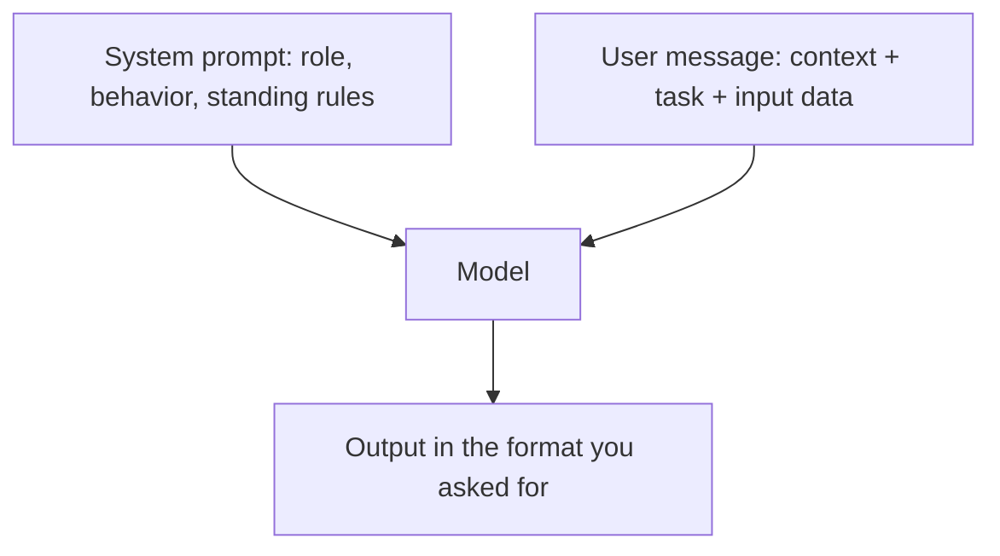

# Anatomy of a prompt

> Module 4 · Lesson 1 · ~15 min

**Goals**
- Name the parts of a well-structured prompt and what each one does
- Split instructions between the system prompt and the user message
- Use delimiters (XML tags) to separate instructions from data
- Rewrite a vague prompt into a reliable one

## The model only knows what you tell it

Imagine handing a task to a smart contractor who started five minutes ago. They know a lot in general, but nothing about your product, your users, or what "good" looks like for you. Everything they need has to be in the brief. A prompt is that brief.

Most bad outputs come from missing information, not from a "dumb" model. So when a result disappoints, the first question is: *what did the model not know?*

## The parts

A solid prompt usually has these pieces. Not every prompt needs all of them, but when output goes wrong, one of them is usually missing.

| Part | What it answers | Example |
|------|-----------------|---------|
| Role & behavior | Who is answering, and how should they act? | "You are a support agent for a billing product. Be brief and friendly." |
| Context | What background does the model need? | Product docs, the user's plan, the conversation so far |
| Task | What exactly should it do? | "Classify this ticket and draft a reply." |
| Constraints | What must it avoid or respect? | "Never promise refunds. Max 120 words." |
| Output format | What shape should the answer take? | "Return JSON with `category` and `reply`." |
| Input format | Where does the data start and end? | `<ticket>…</ticket>` |



## System prompt vs user message

Every major API gives you a **system prompt**: instructions that frame the whole conversation. Put things there that stay the same across requests: the role, tone, standing rules, and output format. Put the request-specific material (the document, the question) in the user message.

This split matters for three reasons:
- **Clarity.** The model treats the system prompt as the operator's standing instructions.
- **Reuse.** One system prompt serves thousands of requests.
- **Caching.** A system prompt that never changes can be cached cheaply (you'll do this in [Module 5](../05-context-engineering/03-long-context-and-caching.md)).

## Before and after

Here is a prompt a developer might write on day one:

```text
Summarize this support ticket and tell me what to do.

Hi, I was charged twice this month?? I already emailed last week and nobody answered.
This is the third time. Account 4471.
```

The model will produce *something*, but you can't predict its length, structure, or tone, and your code can't parse it.

Now the improved version. Same model, same ticket:

```text
SYSTEM:
You are a triage assistant for the support team at a SaaS billing company.
Your readers are support agents who skim. Be direct and factual.

Rules:
- Never invent account details that are not in the ticket.
- If the customer mentions prior unanswered contact, set priority to "high".
- Keep the summary under 40 words.

Respond with only a JSON object:
{"summary": str, "category": "billing" | "bug" | "account" | "other",
 "priority": "low" | "normal" | "high", "next_step": str}

USER:
Triage the ticket below.

<ticket>
Hi, I was charged twice this month?? I already emailed last week and nobody answered.
This is the third time. Account 4471.
</ticket>
```

What changed, piece by piece:

| Before | After | Why it helps |
|--------|-------|--------------|
| No role | Triage assistant, audience is skimming agents | Sets tone and level of detail |
| "Summarize" | Summary under 40 words | Removes length guesswork |
| "Tell me what to do" | `next_step` field | Turns a vague ask into a concrete slot |
| No rules | Explicit priority rule, no invented details | Encodes business logic the model couldn't guess |
| Free text out | JSON with fixed enums | Your code can parse it |
| Ticket pasted inline | Wrapped in `<ticket>` tags | The model can tell instructions from data |

> [!NOTE]
> XML-style tags aren't special syntax. They're just clear, unambiguous delimiters, and Claude in particular is trained to pay attention to them. Use descriptive names (`<ticket>`, `<docs>`, `<examples>`) and refer to them in your instructions ("Triage the ticket in the `<ticket>` tags").

## In code

```python
# uv add anthropic
import anthropic

client = anthropic.Anthropic()  # reads ANTHROPIC_API_KEY

SYSTEM = """You are a triage assistant for the support team at a SaaS billing company.
Your readers are support agents who skim. Be direct and factual.

Rules:
- Never invent account details that are not in the ticket.
- If the customer mentions prior unanswered contact, set priority to "high".
- Keep the summary under 40 words.

Respond with only a JSON object:
{"summary": str, "category": "billing" | "bug" | "account" | "other",
 "priority": "low" | "normal" | "high", "next_step": str}"""

ticket = "Hi, I was charged twice this month?? I already emailed last week..."

response = client.messages.create(
    model="claude-sonnet-5-5",
    max_tokens=1024,
    system=SYSTEM,
    messages=[{
        "role": "user",
        "content": f"Triage the ticket below.\n\n<ticket>\n{ticket}\n</ticket>",
    }],
)
# The response can include non-text blocks (e.g. thinking), so keep only text.
print("".join(b.text for b in response.content if b.type == "text"))
```

Asking for JSON in the prompt works most of the time. When your code *depends* on the shape, use the API's structured output feature instead, which guarantees valid output against a schema. See [Structured output](../02-calling-models/04-structured-output.md).

## Habits that make prompts better

- **Say what to do, not only what to avoid.** "Write in plain prose paragraphs" beats "Don't use bullet points".
- **Explain why.** "Keep it under 40 words because agents read these on a phone" helps the model generalize to cases your rule didn't cover.
- **Be specific about the audience.** "For a developer new to Python" changes vocabulary, depth, and examples all at once.
- **Data first, question last.** For long inputs, put the document near the top and your question at the end. Models tend to answer better that way.
- **Don't shout.** ALL-CAPS and "CRITICAL!!!" were workarounds for older models. Current models follow calm, clear instructions, and shouting can make them overcorrect.

> [!WARNING]
> Older tutorials teach "prefilling": writing the start of the assistant's reply (like `{`) to force a format. Current Claude models reject a prefilled final assistant turn with a 400 error. Use instructions or structured output instead.

**Check yourself:** You're building a bot whose tone and rules never change, but whose input document changes on every request. Where does each go?

<details><summary>Answer</summary>

Tone and rules go in the system prompt (stable, reusable, cacheable). The document goes in the user message, wrapped in descriptive tags, with the question after it.

</details>

> [!TIP]
> **Try it.** Run the "before" prompt and the "after" prompt three times each against the same ticket. Compare how much the outputs vary between runs. Then delete the priority rule from the system prompt and see whether the model still marks the ticket "high".
>
> <details><summary>What you should notice</summary>
>
> The "before" outputs differ in length and structure on every run. The "after" outputs keep the same shape. Without the explicit rule, the model may still pick "high" (an angry repeat customer is a strong signal), but it's now a guess rather than your policy. Rules make behavior predictable, not just plausible.
>
> </details>

## Key takeaways
- Most bad outputs come from missing information. Ask "what didn't the model know?"
- A strong prompt covers role, context, task, constraints, and output format.
- Stable rules go in the system prompt; per-request data goes in the user message.
- Wrap input data in descriptive tags so the model can tell instructions from content.
- Prefer clear positive instructions with reasons over capitalized warnings.

## Go deeper
- [Claude prompt engineering overview](https://platform.claude.com/docs/en/build-with-claude/prompt-engineering/overview) — Anthropic's guide, with a recommended order for trying techniques
- [Claude prompting best practices](https://platform.claude.com/docs/en/build-with-claude/prompt-engineering/claude-prompting-best-practices) — current, model-specific advice on clarity, tags, and formatting
- [OpenAI prompt engineering guide](https://platform.openai.com/docs/guides/prompt-engineering) — the same ideas from another provider; most transfer directly
- [Prompt Engineering Guide](https://www.promptingguide.ai/) — community reference covering many techniques with examples

---
[← Module home](README.md) · [Zero-shot and few-shot prompting →](02-zero-shot-and-few-shot.md)
