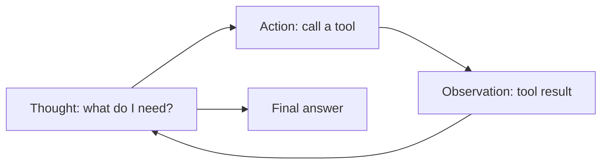

# Reasoning patterns: chain of thought and ReAct

> Module 4 · Lesson 3 · ~15 min

**Goals**
- Explain why letting a model "think out loud" improves answers on multi-step problems
- Write a chain-of-thought prompt that separates reasoning from the final answer
- Use built-in reasoning (thinking and effort) on modern models instead of hand-rolled CoT
- Recognize the ReAct pattern and how it led to native tool calling

## Why thinking out loud helps

A model produces text one token at a time, and each token is computed from everything before it. If you demand the answer immediately, the model has to get it right in the first few tokens with no room to work. If you let it write out intermediate steps first, those steps become context it can build on. Writing the reasoning *is* the computation.

That's the idea behind **chain-of-thought (CoT)** prompting: ask the model to reason step by step before answering.

## Before and after

```text
BEFORE:
A course has 14 modules, numbered 0 through 14. Modules 0-3 have 4 lessons each,
modules 4-5 have 5 lessons each, and modules 6-14 have 3 lessons each. Each lesson
takes 12 minutes, and each module review takes 10 minutes. How many hours is the whole course? Answer with a number.
```

Forcing "answer with a number" on a multi-step problem invites a confident guess. A model with no room to think may well get this wrong. (Did you catch that modules "0 through 14" is 15 modules, not 14? A careful reasoner would flag that before calculating.)

```text
AFTER:
<problem>
A course has 14 modules, numbered 0 through 14. Modules 0-3 have 4 lessons each,
modules 4-5 have 5 lessons each, and modules 6-14 have 3 lessons each. Each lesson
takes 12 minutes, and each module review takes 10 minutes. How many hours is the whole course?
</problem>

Work through the problem step by step inside <reasoning> tags. Check that the numbers
in the problem are consistent before you calculate; if they aren't, say so and state
the assumption you're making. Then give the final answer inside <answer> tags.
```

The improved prompt does three things:
1. **Asks for reasoning before the answer.** Order matters. Reasoning written *after* the answer is just a justification.
2. **Tells it what to check.** Guided CoT ("check consistency, then calculate") beats a bare "think step by step".
3. **Separates reasoning from the answer with tags**, so your code can show users only the `<answer>` part:

```python
import re

def extract_answer(text: str) -> str:
    match = re.search(r"<answer>(.*?)</answer>", text, re.DOTALL)
    return match.group(1).strip() if match else text
```

## Built-in reasoning: let the model think for you

Hand-written CoT matters most for models without built-in reasoning (many small and local models). Current frontier models have reasoning built in: they think in a separate block before answering, and you control *how much* rather than writing "think step by step" yourself.

With Claude, adaptive thinking lets the model decide when and how much to think, and the `effort` setting trades depth for cost and speed:

```python
import anthropic

client = anthropic.Anthropic()

response = client.messages.create(
    model="claude-sonnet-5-5",
    max_tokens=16000,
    thinking={"type": "adaptive", "display": "summarized"},  # show a summary of the reasoning
    output_config={"effort": "high"},  # low | medium | high | xhigh | max
    messages=[{"role": "user", "content": PROBLEM}],  # PROBLEM = the course question above
)

for block in response.content:
    if block.type == "thinking":
        print("THINKING:", block.thinking)
    elif block.type == "text":
        print("ANSWER:", block.text)
```

Other providers have equivalents (OpenAI's reasoning models take a `reasoning` effort setting; Gemini has thinking settings). The pattern is the same: the provider manages the reasoning; you tune how much.

> [!NOTE]
> Built-in reasoning doesn't make your prompt irrelevant. Telling the model *what* to check ("verify the counts are consistent") still helps. What you can drop is the boilerplate "think step by step" and the need to parse reasoning out of the answer yourself.

**When reasoning hurts:** simple lookups, classification, and chit-chat don't need it. Extra reasoning adds latency and output tokens (which cost more than input tokens). Use low effort for easy, high-volume routes and save high effort for the genuinely hard ones.

## ReAct: reason, act, observe

CoT helps when everything the model needs is already in the prompt. But what if it needs to *look something up*? **ReAct** (Reason + Act) interleaves reasoning with actions: the model thinks, picks an action, your code runs it, and the result is fed back in as an observation.



As a pure prompting pattern, it looks like this:

```text
Answer the question. You can use these actions:
- search_course[query]: search the course lessons
- read_lesson[path]: read one lesson file

Use this exact format, one step at a time:
Thought: <your reasoning>
Action: <action>[<input>]
Then STOP and wait. I will reply with "Observation: <result>".
When you know the answer, write:
Final Answer: <answer>

Question: Which lesson covers prompt caching?
```

Your code then parses the `Action:` line, runs the matching function, appends `Observation: ...`, and calls the model again, looping until it sees `Final Answer:`.

This worked, but parsing free text is brittle: the model might format the action slightly differently, or invent its own observation. So providers built the loop into the API: **native tool calling** gives you structured, validated tool requests instead of text to parse. You met it in [Function calling](../02-calling-models/05-function-calling.md), and you'll build a full agent loop in [Tools and the ReAct loop](../08-agents/02-tools-and-the-react-loop.md).

The ReAct *idea* (think, act, observe, repeat) is still exactly how agents work. Only the plumbing changed.

> [!TIP]
> **Try it.** Run the "before" course-length prompt against a small local model (via Ollama) or a fast, cheap model with low effort, five times. Then run the "after" prompt. Count how often each version notices the 14-vs-15 module inconsistency.
>
> <details><summary>What to look for</summary>
>
> The "before" prompt usually produces a single number with no flag. The guided CoT prompt makes the model far more likely to notice the conflict and state an assumption, because you told it to check consistency first. Lesson: CoT improves answers, but *guided* CoT also surfaces problems in the question itself.
>
> </details>

## Key takeaways
- Reasoning written before the answer becomes context the model builds on; reasoning after is just justification.
- Guided chain of thought (tell it what to check) beats a bare "think step by step".
- Separate reasoning from the answer with tags so your code can extract the answer.
- On modern models, prefer built-in reasoning and tune effort; keep hand-rolled CoT for models without it.
- ReAct (thought, action, observation) is the core agent loop; native tool calling is its robust implementation.

## Go deeper
- [Chain-of-Thought Prompting Elicits Reasoning in Large Language Models](https://arxiv.org/abs/2201.11903) — the original CoT paper
- [ReAct: Synergizing Reasoning and Acting in Language Models](https://arxiv.org/abs/2210.03629) — the paper behind the thought/action/observation loop
- [Claude prompting best practices](https://platform.claude.com/docs/en/build-with-claude/prompt-engineering/claude-prompting-best-practices) — includes guidance on prompting with thinking enabled

---
[← Zero-shot and few-shot prompting](02-zero-shot-and-few-shot.md) · [Module home](README.md) · [Prompts as code →](04-prompts-as-code.md)
