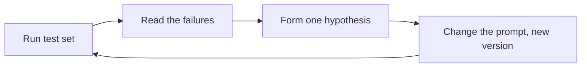

# Prompts as code

> Module 4 · Lesson 4 · ~15 min

**Goals**
- Move prompts out of string literals and into versioned template files
- Fill templates safely with variables
- Build a tiny test set and check every prompt change against it
- Iterate on a prompt with a repeatable loop instead of vibes

## The problem with prompts in f-strings

On day one, prompts live inline in your Python. By month two you have a 60-line f-string, three slightly different copies of it, and nobody remembers why the line "Do not mention pricing" was added. Someone "improves" the wording, and a behavior your users relied on quietly breaks.

A prompt is code. It changes behavior, it has bugs, and it needs review, versioning, and tests. Treat it that way.

## Step 1: Put prompts in files

```text
course-buddy/
  prompts/
    system.v1.md
    system.v2.md
    examples.md
  app.py
```

Before (inline, untracked):

```python
system = f"You are a helpful assistant for {course_name}. Answer questions about it. Be concise."
```

After (`prompts/system.v2.md`, reviewed in pull requests like any other code):

```markdown
You are Course Buddy, a study assistant for the course "$course_name".

Your users are developers learning to build with LLMs. They know Python but are new
to AI engineering, so explain terms the first time you use them.

Rules:
- Answer only questions about the course material. For anything else, say briefly
  that it's outside what you cover.
- If you are not sure, say so. Never invent lesson names or file paths.
- Keep answers under 150 words unless the user asks for more detail.

Format: a short direct answer first, then up to three bullet points of detail.
```

## Step 2: Fill templates safely

You need variables (`$course_name`) in templates. Python's built-in `string.Template` is enough for most apps, and it has a nice property: `substitute()` raises an error if you forget a variable, instead of shipping a prompt with a hole in it.

```python
from pathlib import Path
from string import Template

PROMPT_DIR = Path(__file__).parent / "prompts"

def load_prompt(name: str, version: str, **variables: str) -> str:
    text = (PROMPT_DIR / f"{name}.{version}.md").read_text()
    return Template(text).substitute(**variables)  # KeyError if a variable is missing

SYSTEM_PROMPT_VERSION = "v2"
system = load_prompt("system", SYSTEM_PROMPT_VERSION, course_name="Zero to Hero: AI Engineer")
```

> [!NOTE]
> Why `string.Template` and not `str.format()`? Prompts often contain literal braces, as in JSON examples like `{"answer": ...}`. With `.format()` you'd have to escape every one. `$name` placeholders avoid the clash. For prompts with loops or conditionals, Jinja2 is the common next step.

**Version explicitly.** Keep the version in the filename and log it with every request (`prompt_version="v2"`). When a user reports a bad answer, you'll know exactly which prompt produced it. That pays off in [Observability](../12-observability/README.md).

## Step 3: Keep a test set

You can't tell whether a prompt change is an improvement by trying one or two inputs. You need a fixed set of inputs with a way to check each answer. Start small: 10 to 20 cases that cover normal questions, edge cases, and things the bot should refuse.

```python
# eval_prompt.py
CASES = [
    {"q": "What is a context window?", "must_include": ["token"]},
    {"q": "Which module covers RAG?", "must_include": ["7"]},
    {"q": "What's the weather in Paris?", "must_include": ["outside"]},  # off-topic refusal
    {"q": "Explain few-shot prompting", "max_words": 150},
]

def check(case: dict, answer: str) -> bool:
    text = answer.lower()
    if any(word.lower() not in text for word in case.get("must_include", [])):
        return False
    if "max_words" in case and len(answer.split()) > case["max_words"]:
        return False
    return True

def run(version: str) -> None:
    system = load_prompt("system", version, course_name="Zero to Hero: AI Engineer")
    passed = 0
    for case in CASES:
        answer = ask(system, case["q"])  # your messages.create wrapper
        ok = check(case, answer)
        passed += ok
        if not ok:
            print(f"FAIL [{version}] {case['q']!r}\n  -> {answer[:120]}")
    print(f"{version}: {passed}/{len(CASES)} passed")

run("v1")
run("v2")
```

These checks are crude (keyword matching won't catch every good or bad answer), and that's fine for now. Even a crude test set turns "I think v2 is better" into "v2 passes 18/20, v1 passed 14/20, and here are the two it still fails". You'll build proper evals, including LLM-graded ones, in [Module 11](../11-evals/README.md).

## Step 4: Iterate with a loop, not vibes



A few rules make the loop work:
- **Change one thing at a time.** If you rewrite five lines and the score goes up, you don't know which one helped (or which one quietly hurt).
- **Read the failures, not only the score.** The fix is almost always visible in the bad outputs.
- **Add a test for every bug.** When a user finds a bad answer, add that question to `CASES` before you fix the prompt. It's now a regression test.
- **Run each case more than once** when outputs vary. A prompt that passes 1 run out of 3 isn't fixed.

> [!TIP]
> **Try it.** Create `prompts/system.v1.md` with a one-line prompt ("You are a helpful assistant for a course.") and `system.v2.md` with the fuller prompt above. Run both through the test script. Then add a case of your own that v2 fails, write `system.v3.md` to fix it, and confirm v3 doesn't break any case that v2 passed.
>
> <details><summary>Hint</summary>
>
> Off-topic questions are a common failure. If v2 happily answers "What's the weather?", check whether your refusal instruction is specific enough, and whether your test's `must_include` matches the wording you asked for. Sometimes the test is what needs fixing.
>
> </details>

## Key takeaways
- Prompts change behavior like code does, so store them in files, review them, and version them.
- Use templates that fail loudly on missing variables; `string.Template` plays well with JSON braces.
- Log the prompt version with every request so you can trace bad outputs back to their prompt.
- Keep a small test set and run every prompt change against it.
- Change one thing at a time, read the failures, and turn every bug into a test case.

## Go deeper
- [Claude docs: Define success criteria and build evaluations](https://platform.claude.com/docs/en/test-and-evaluate/develop-tests) — how to design test cases for prompts
- [Claude prompt engineering overview](https://platform.claude.com/docs/en/build-with-claude/prompt-engineering/overview) — recommends defining success criteria and tests before you start tuning
- [Python `string.Template` docs](https://docs.python.org/3/library/string.html#template-strings) — the templating used in this lesson

---
[← Reasoning patterns: chain of thought and ReAct](03-reasoning-patterns.md) · [Module home](README.md) · [Module review →](review.md)
