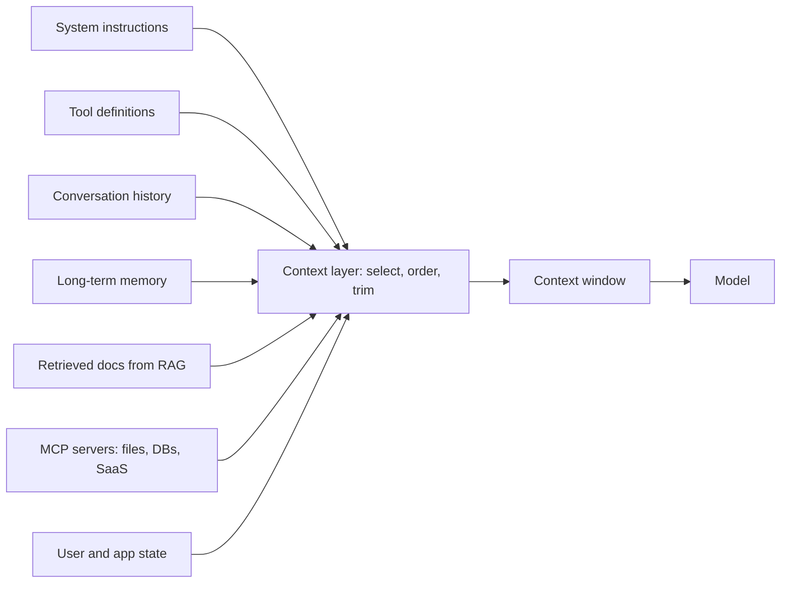

# Beyond the prompt

> Module 5 · Lesson 1 · ~12 min

**Goals**
- Explain the difference between prompt engineering and context engineering
- List the sources that feed a model's context window, including MCP
- Describe a "context layer" and why apps need one
- Assemble a request's context in a deliberate order

## From writing a prompt to assembling a context

In Module 4 you wrote prompts by hand. In a real app, you rarely write the final thing the model sees. Your code *assembles* it on every request from many parts: a system prompt from a file, the last few conversation turns, three chunks pulled from a vector database, the result of a tool call, a note saying the user is on the free plan.

**Context engineering** is the practice of deciding what goes into the model's context window, where it comes from, and in what order, on every call. Prompt engineering is one part of it (the instructions). Context engineering covers the whole window.

| | Prompt engineering | Context engineering |
|---|---|---|
| Focus | Wording of instructions and examples | Everything in the window, and how it got there |
| Unit of work | A prompt | A pipeline that builds context per request |
| Typical question | "How should I phrase this?" | "What does the model need to know right now, and what should I leave out?" |
| Changes when | You edit the text | Data, users, history, and tools change |

Why it matters: the context window is finite, every token costs money and latency, and models get *worse* at using information as the window fills with irrelevant material (more on that in [When context goes wrong](05-when-context-goes-wrong.md)). The goal isn't "as much context as possible". It's **the smallest set of high-signal tokens that lets the model do the job.**

## Where context comes from



| Source | Example | Changes |
|---|---|---|
| System instructions | Role, rules, output format | Rarely (per deploy) |
| Tool definitions | `search_course`, `read_lesson` schemas | Rarely |
| Conversation history | Prior user and assistant turns | Every turn |
| Long-term memory | "User prefers short answers; finished Module 3" | Across sessions |
| Retrieved documents | Top chunks from a vector search ([Module 7](../07-rag/README.md)) | Every request |
| Tool results | Output of a database query or API call | Every step of an agent |
| MCP servers | Files, tickets, metrics exposed through a standard protocol ([Module 9](../09-mcp/README.md)) | Varies |
| User and app state | Plan tier, locale, current page, today's date | Per session or request |

**MCP (Model Context Protocol)** deserves a special mention: it's an open standard for plugging external context sources and tools into an AI app. Instead of writing a custom integration for every system, you connect to an MCP server that exposes it. You'll build one in Module 9; for now, just think of it as a standard pipe into the context layer.

## The context layer

The **context layer** is the part of your app that sits between your data and the model and builds each request's context. In a small app it's a single function. In a big one it's a subsystem with its own retrieval, ranking, permission checks, and token budgets. Either way, it's worth making it an explicit, testable piece of code rather than string concatenation scattered across handlers.

Its jobs:
1. **Select:** decide which sources are relevant for this request.
2. **Filter:** apply permissions and relevance (this user may only see their own tickets).
3. **Order:** arrange content so the model uses it well and caching works.
4. **Budget:** keep the total under a token limit, trimming or summarizing the least important parts.

## Order matters

Two forces shape the order:
- **Caching** (lesson 3) rewards putting *stable* content first and *changing* content last, because caches match on the prefix.
- **Model attention** works best with long reference material before the question, and the question at the end.

Conveniently, they agree:

```text
1. System instructions          (stable)
2. Tool definitions             (stable)
3. Long-term memory / user profile  (per session)
4. Conversation history         (grows each turn)
5. Retrieved documents          (per request)
6. The current question         (per request)
```

## A context layer in miniature

```python
import anthropic

client = anthropic.Anthropic()
MODEL = "claude-sonnet-5-5"

def build_context(question: str, history: list[dict], user: dict, docs: list[dict]) -> dict:
    """Return the arguments for messages.create, assembled in a deliberate order."""
    system = SYSTEM_PROMPT  # stable, loaded from a versioned file (Module 4)

    profile = f"<user_profile>\nPlan: {user['plan']}\nProgress: {user['progress']}\n</user_profile>"
    sources = "\n".join(
        f'<doc source="{d["path"]}">\n{d["text"]}\n</doc>' for d in docs
    )
    current_turn = {
        "role": "user",
        "content": f"{profile}\n\n<docs>\n{sources}\n</docs>\n\n{question}",
    }
    return {"system": system, "messages": history + [current_turn]}

ctx = build_context(question, history, user, docs)
response = client.messages.create(model=MODEL, max_tokens=2048, **ctx)
```

Notice what *isn't* there: no timestamp in the system prompt, no dumping all 50 search results, no copy of the entire user record. Each piece earned its place.

> [!TIP]
> **Try it.** Take any LLM feature you've built (or the Course Buddy chat loop from Module 2) and log the full request just before it's sent. For each section, write down: where did it come from, does it change per request, and would the answer get worse without it? Find one thing to remove and one thing missing.
>
> <details><summary>What people usually find</summary>
>
> Common removals: duplicated instructions, entire JSON records when two fields are used, old tool results nobody needs anymore. Common additions: the user's actual situation (plan, locale, what they already tried) and source names on retrieved text so the model can cite them.
>
> </details>

**Check yourself:** Why put the current date in the latest user message rather than in the system prompt?

<details><summary>Answer</summary>

The date changes, and anything that changes at the start of the context breaks prefix caching for everything after it. Late in the context, it only affects the part that was changing anyway.

</details>

## Key takeaways
- Context engineering is deciding what enters the window, from where, and in what order, on every request.
- The goal is the smallest set of high-signal tokens, not the most tokens.
- Context comes from instructions, tools, history, memory, retrieval, MCP servers, and app state.
- Make the context layer explicit code that selects, filters, orders, and budgets.
- Put stable content first and the question last; it helps both caching and model attention.

## Go deeper
- [Effective context engineering for AI agents](https://www.anthropic.com/engineering/effective-context-engineering-for-ai-agents) — Anthropic's engineering post on treating context as a finite resource
- [Context engineering (Simon Willison)](https://simonwillison.net/2025/Jun/27/context-engineering/) — short take on why the term caught on
- [Claude docs: Context windows](https://platform.claude.com/docs/en/build-with-claude/context-windows) — how the window fills up across turns, tools, and thinking

---
[← Module home](README.md) · [Memory and state →](02-memory-and-state.md)
