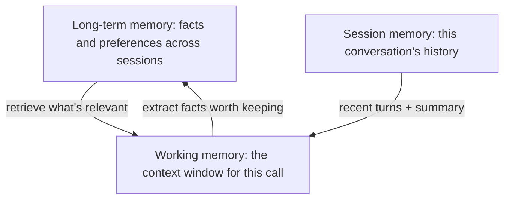
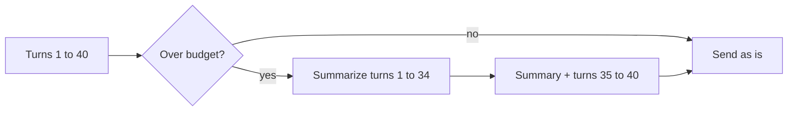

# Memory and state

> Module 5 · Lesson 2 · ~15 min

**Goals**
- Explain why LLM APIs are stateless and where conversation state actually lives
- Distinguish three tiers of memory: working, session, and long-term
- Implement history compaction: summarize old turns when you near a token budget
- Know the built-in options (server-side compaction, context editing, a memory tool)

## The model remembers nothing

Every API call starts from zero. When a chatbot "remembers" your name from three messages ago, that's because the app sent those three messages again. The conversation is state that *your code* stores and replays on every request.

That has two consequences. First, you decide what the model remembers, which is power and responsibility. Second, history grows every turn, so every turn costs more than the last, and eventually it won't fit.

## Three tiers of memory



| Tier | What it holds | Lifetime | Where it lives |
|---|---|---|---|
| Working | Everything in this request's context window | One call | The request itself |
| Session | The current conversation: turns, tool results, a running summary | One conversation | Your database or in memory |
| Long-term | Durable facts: preferences, past decisions, user profile | Across sessions | A database, key-value store, or vector store |

The interesting engineering is in the arrows: **what moves from session into long-term** (and who decides), and **what gets pulled from long-term into working** for a given request.

## Long-term memory: write and read paths

**Writing.** Two common approaches:
- *Explicit:* the user says "remember that I use Windows", and a tool call saves it.
- *Extracted:* after a session, a cheap model call pulls out durable facts ("Prefers short answers. Finished Module 3.") and stores them.

**Reading.** Small profiles can be loaded into every request. Large memory stores need retrieval: embed the memories and pull the few most relevant to the current question (the same technique as [RAG](../07-rag/README.md)).

> [!WARNING]
> Memory goes stale and can be wrong. Store when a fact was learned and where it came from, let users see and delete what's stored, and prefer recent facts when two conflict. A wrong memory gets repeated in every future session.

## Session memory: compaction

A long conversation eventually hits the context limit, and well before that it gets expensive and slower, and the model starts paying less attention to early details. The fix is **compaction**: when history passes a token budget, replace older turns with a summary and keep only the most recent turns word for word.



Here's a minimal implementation. It counts tokens with the API's token counter, and when the history is too big it summarizes everything except the last few turns.

```python
import anthropic

client = anthropic.Anthropic()
MODEL = "claude-sonnet-5-5"
TOKEN_BUDGET = 20_000   # compact when history exceeds this
KEEP_RECENT = 7         # messages kept word for word: 3 earlier pairs + the new question

def text_of(response) -> str:
    return "".join(b.text for b in response.content if b.type == "text")

class ChatMemory:
    def __init__(self, system: str):
        self.system = system
        self.messages: list[dict] = []  # plain text turns: {"role", "content": str}

    def tokens(self) -> int:
        return client.messages.count_tokens(
            model=MODEL, system=self.system, messages=self.messages
        ).input_tokens

    def compact(self) -> None:
        old, recent = self.messages[:-KEEP_RECENT], self.messages[-KEEP_RECENT:]
        transcript = "\n".join(f"{m['role'].upper()}: {m['content']}" for m in old)
        summary = text_of(client.messages.create(
            model=MODEL,
            max_tokens=1500,
            system="You summarize conversations so they can be continued later.",
            messages=[{"role": "user", "content": (
                f"<transcript>\n{transcript}\n</transcript>\n\n"
                "Summarize this conversation. Keep: the user's goals, decisions made, "
                "facts about the user, open questions, and any specifics (names, numbers, "
                "file paths) that later turns may need. Drop small talk."
            )}],
        ))
        # Fold the summary into the first kept user turn so roles still alternate.
        first = recent[0]
        first["content"] = (
            f"<earlier_conversation_summary>\n{summary}\n</earlier_conversation_summary>\n\n"
            + first["content"]
        )
        self.messages = recent

    def ask(self, question: str) -> str:
        self.messages.append({"role": "user", "content": question})
        if len(self.messages) > KEEP_RECENT and self.tokens() > TOKEN_BUDGET:
            self.compact()
        response = client.messages.create(
            model=MODEL, max_tokens=2048, system=self.system, messages=self.messages
        )
        answer = text_of(response)
        self.messages.append({"role": "assistant", "content": answer})
        return answer
```

Compaction runs right after the new question is appended, so history ends with a user turn. Because `KEEP_RECENT` is odd, the kept slice also *starts* with a user turn, which the API requires.

Things to notice:
- **The summary prompt says what to keep.** A generic "summarize this" drops the specifics (a file path, a version number) that the next question depends on. Tune it for your app.
- **Compaction is lossy.** Anything the summary leaves out is gone. For high-stakes details, also save them to long-term memory.
- **It costs a model call**, so compact in chunks (well before the hard limit) rather than every turn.

> [!NOTE]
> This class stores only the text of each reply. If you pass full response content back (thinking blocks, tool calls), check your provider's rules before rewriting history: some current models validate that earlier reasoning blocks haven't been edited. The server-side options below handle that for you.

## Built-in helpers

Providers increasingly do this work for you. With Claude:
- **Server-side compaction** (beta): the API summarizes older context itself when input passes a threshold you set. You append the full `response.content` each turn so the compaction block is preserved.

  ```python
  response = client.beta.messages.create(
      betas=["compact-2026-01-12"],
      model=MODEL,
      max_tokens=4096,
      messages=messages,
      context_management={"edits": [{
          "type": "compact_20260112",
          "trigger": {"type": "input_tokens", "value": 100_000},
      }]},
  )
  messages.append({"role": "assistant", "content": response.content})  # keep compaction blocks
  ```

- **Context editing** (beta): clears old tool results from an agent's history instead of summarizing them. Great for agents whose context fills with stale search results.
- **Memory tool**: gives the model a `/memories` directory it can read and write through tool calls. Your code implements the storage; the model decides what's worth remembering across sessions.

Use the built-ins when they fit. Write your own when you need control over what gets kept, or when you want the same code to work across providers.

> [!TIP]
> **Try it.** Drop `ChatMemory` into a chat loop with `TOKEN_BUDGET = 2_000` so compaction happens quickly. Tell it your name, your favorite language, and a made-up project codename early on, then chat about other things until it compacts. Ask for all three facts. Which survived? Edit the summary prompt until all three do.
>
> <details><summary>Hint</summary>
>
> Print the summary each time `compact()` runs. If the codename is missing, the summary prompt isn't asking for "specific names and identifiers" strongly enough, or `max_tokens` on the summary call is too small.
>
> </details>

## Key takeaways
- LLM APIs are stateless; your app stores and replays the conversation.
- Think in tiers: working (this call), session (this conversation), long-term (across sessions).
- Compaction summarizes old turns past a token budget and keeps recent turns verbatim; it's lossy, so say what to keep.
- Long-term memory needs write rules, retrieval, timestamps, and a way to correct mistakes.
- Server-side compaction, context editing, and memory tools can replace hand-rolled code when they fit.

## Go deeper
- [Claude docs: Compaction](https://platform.claude.com/docs/en/build-with-claude/compaction) — on-demand vs threshold compaction, and when to write your own
- [Claude docs: Context editing](https://platform.claude.com/docs/en/build-with-claude/context-editing) — clearing old tool results and thinking blocks
- [Claude docs: Memory tool](https://platform.claude.com/docs/en/agents-and-tools/tool-use/memory-tool) — a file-based memory the model manages across sessions
- [Effective context engineering for AI agents](https://www.anthropic.com/engineering/effective-context-engineering-for-ai-agents) — compaction, note-taking, and sub-agents as long-horizon strategies

---
[← Beyond the prompt](01-beyond-the-prompt.md) · [Module home](README.md) · [Long context and prompt caching →](03-long-context-and-caching.md)
