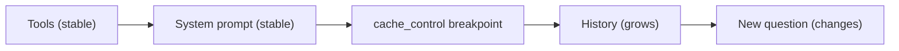

# Long context and prompt caching

> Module 5 · Lesson 3 · ~15 min

**Goals**
- Decide when to put a whole document in context and when to retrieve pieces of it
- Lay out long inputs so the model actually uses them
- Cache a stable prefix with Anthropic's `cache_control` and verify it worked
- Use metadata filters to narrow retrieval before anything reaches the window

## Big windows, real limits

Current frontier models accept hundreds of thousands to a million tokens. That's several novels. It's tempting to stop worrying and paste everything in. Three reasons not to:

1. **Cost and latency scale with input.** A 500K-token request is billed for 500K input tokens every time you send it, and takes longer to start answering.
2. **Attention degrades.** Models find a fact more reliably in a short context than in a long one, and research has shown that information buried in the middle of a long input is used less well than information at the start or end. More context can mean worse answers.
3. **Irrelevant text distracts.** Twenty near-miss documents can pull the model toward the wrong answer.

So long context is a tool, not a default. Use it when the task genuinely needs the whole thing (reviewing a full contract, answering questions that span a whole codebase). Use retrieval when only a slice is relevant.

## Laying out a long input

When you do send a long input:
- **Documents first, question last.** Put the long material at the top and your instructions and question at the end.
- **Wrap and label each document** so the model can tell them apart and cite them: `<doc source="05-context-engineering/02-memory-and-state.md">…</doc>`.
- **Ask for quotes first.** For question answering over long documents, asking the model to pull out the relevant quotes before answering helps it focus, and makes the answer easy to check.
- **Too big even so?** Map-reduce: summarize or extract from each chunk separately, then combine the results in a final call.

## Prompt caching

Most apps resend the same large prefix on every call: a long system prompt, tool definitions, a reference document, the conversation so far. **Prompt caching** lets the provider keep the processed prefix around, so later requests that start with the exact same bytes are cheaper and faster.

The one rule to remember: **caching is a prefix match.** Anything that changes invalidates the cache for everything after it. Claude renders requests in this order: `tools`, then `system`, then `messages`.



Everything up to the breakpoint can be reused. Everything after it is processed fresh.

### In code

Mark the end of the stable part with `cache_control`:

```python
import anthropic

client = anthropic.Anthropic()

SYSTEM_PROMPT = open("prompts/system.v2.md").read()      # several thousand tokens
COURSE_INDEX = open("course_index.md").read()            # module and lesson list

def ask(messages: list[dict]):
    return client.messages.create(
        model="claude-sonnet-5-5",
        max_tokens=2048,
        system=[{
            "type": "text",
            "text": f"{SYSTEM_PROMPT}\n\n<course_index>\n{COURSE_INDEX}\n</course_index>",
            "cache_control": {"type": "ephemeral"},   # cache tools + system up to here
        }],
        messages=messages,
    )

for question in ["What is a context window?", "And what happens when it fills up?"]:
    r = ask([{"role": "user", "content": question}])
    u = r.usage
    print(f"written={u.cache_creation_input_tokens} read={u.cache_read_input_tokens} "
          f"uncached={u.input_tokens}")
```

Expected output, roughly:

```text
written=5210 read=0 uncached=12
written=0 read=5210 uncached=14
```

The first call writes the cache; the second reads it. If `read` stays at 0, something in your prefix is changing between calls.

For multi-turn chat, you can also pass a top-level `cache_control={"type": "ephemeral"}` to `messages.create`. That tells the API to place a breakpoint on the last cacheable block automatically and move it forward as the conversation grows, so each turn reuses the whole conversation so far.

### The economics

On Anthropic's API (check the pricing page for current numbers):
- Cache **writes** cost a bit more than normal input: 1.25x for the default 5-minute lifetime, 2x for the optional 1-hour lifetime (`"ttl": "1h"`).
- Cache **reads** cost a small fraction of normal input (around 0.1x, less on some newer models).
- Each read refreshes the lifetime, so steady traffic keeps the cache warm.

With the 5-minute cache, one write plus one read already beats two uncached requests. There's also a **minimum prefix length** that varies by model; shorter prefixes just don't cache, with no error.

### Silent cache killers

| You did this | Why caching broke |
|---|---|
| Put `datetime.now()` in the system prompt | The prefix changes every request |
| Inserted the user's name or ID at the top of the system prompt | Every user gets their own prefix, nothing is shared |
| Built tool definitions from a set or an unsorted dict | Tool order changes, and tools come first |
| Switched models mid-conversation | Caches are per model |
| Edited an earlier message in the history | Everything after the edit is new |

Fix them all the same way: make the stable part byte-identical every time, and move anything dynamic to the end.

> [!NOTE]
> OpenAI and Gemini also offer prompt caching. OpenAI caches long prefixes automatically; Gemini supports both implicit and explicit caching. The prefix rule applies everywhere, so the layout advice in this lesson transfers.

## Retrieval with dynamic filters

When you retrieve instead of stuffing, filter *before* ranking. Most vector databases let you combine similarity search with metadata filters, so you only search the slice that could possibly be relevant: this user's documents, this product version, this module.

```python
# Chroma example: only search lessons from the module the user is studying
results = collection.query(
    query_texts=[question],
    n_results=5,
    where={"module": user["current_module"]},
)
```

Filters are cheap, deterministic, and enforce rules that similarity search can't (like "never show another customer's data"). You'll build this out in [Vector databases](../06-embeddings-and-vector-search/04-vector-databases.md) and [Module 7](../07-rag/README.md).

> [!TIP]
> **Try it.** Run the caching example twice and confirm `read` is non-zero on the second call. Then add `f"Current time: {datetime.now()}"` to the *start* of the system text and run again. Watch `read` drop to 0. Move the timestamp into the user message instead and confirm caching comes back.
>
> <details><summary>If you never see a cache read</summary>
>
> Your system text may be shorter than the model's minimum cacheable length. Pad it with real content (the full course index works) and try again. Also make sure both calls start within 5 minutes of each other.
>
> </details>

## Key takeaways
- A large window doesn't mean you should fill it: cost, latency, and answer quality all suffer.
- For long inputs, put labeled documents first and the question last; ask for supporting quotes.
- Prompt caching is a prefix match: stable content first, a `cache_control` breakpoint, dynamic content after.
- Verify caching with `cache_creation_input_tokens` and `cache_read_input_tokens`; zero reads means a silent invalidator.
- Retrieve with metadata filters to narrow the search before similarity ranking.

## Go deeper
- [Claude docs: Prompt caching](https://platform.claude.com/docs/en/build-with-claude/prompt-caching) — breakpoints, TTLs, pricing, and what invalidates the cache
- [Lost in the Middle: How Language Models Use Long Contexts](https://arxiv.org/abs/2307.03172) — the paper on position effects in long inputs
- [Context Rot (Chroma research)](https://research.trychroma.com/context-rot) — measurements of how performance drops as input length grows

---
[← Memory and state](02-memory-and-state.md) · [Module home](README.md) · [Context for multiple agents →](04-context-for-multiple-agents.md)
