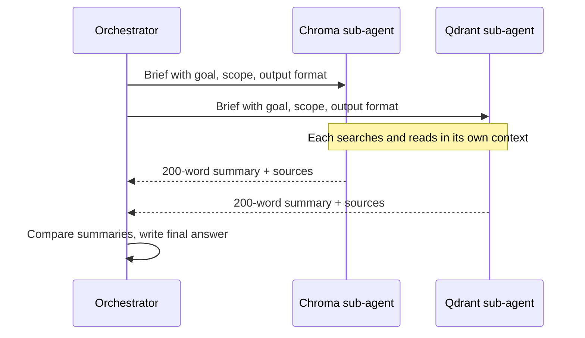

# Context for multiple agents

> Module 5 · Lesson 4 · ~12 min

**Goals**
- Explain why sub-agents with isolated contexts help with large tasks
- Write a good brief for a sub-agent and ask for a condensed result
- Choose what to share between agents and what to keep isolated
- Recognize the failure mode where isolated agents make conflicting decisions

## One context, too many jobs

Picture an agent asked to "compare how five vector databases handle metadata filtering". It searches, reads docs for database one, then two, then three. By database four, its context is full of raw web pages about databases one to three, most of which no longer matter. It's slower, more expensive, and starting to confuse details between products.

The fix is the same one a team lead uses: **delegate.** Give each sub-task to a helper with a clean desk, and ask each helper for a one-page summary rather than their whole pile of notes.

## Context isolation: the sub-agent pattern

A **sub-agent** is just another model call (or agent loop) with its *own* fresh context. The orchestrator gives it a focused brief; it does the messy work in isolation; it returns only a condensed result. The orchestrator's context grows by a few hundred tokens per sub-task instead of tens of thousands.



Benefits:
- **Clean contexts.** Each sub-agent sees only what its task needs, so it's less distracted.
- **Parallelism.** Independent sub-tasks can run at the same time.
- **Cost control.** Sub-agents can use a cheaper, faster model.
- **Containment.** If a sub-agent reads a malicious web page, the injected text stays in *its* context and only reaches the orchestrator through the summary (which you can also check).

## The brief is everything

The sub-agent knows nothing except what you send it. A weak brief is the most common way this pattern fails.

Before:

```text
Research Qdrant.
```

After:

```text
<task>
Find out how Qdrant supports metadata filtering during vector search.
This is one of five databases being compared for a course on AI engineering.
</task>

<scope>
- Use the official docs only.
- Cover: filter syntax, supported operators, whether filtering happens before or
  during the vector search, and any performance caveats the docs mention.
- Ignore pricing and hosting options; another agent is covering those.
</scope>

<output>
At most 200 words, then a list of source URLs. If the docs don't answer a point,
say "not documented" rather than guessing.
</output>
```

It states the goal *and why*, sets boundaries (including what someone else is handling), and defines a compact return format.

## In code

A sub-agent can be as simple as a function that starts a new conversation:

```python
import anthropic

client = anthropic.Anthropic()

def run_subagent(brief: str, model: str = "claude-haiku-5-5") -> str:
    """Run a task in a fresh, isolated context and return only the final text."""
    messages = [{"role": "user", "content": brief}]
    # In a real agent this would be a tool loop (search, read...) — see Module 8.
    response = client.messages.create(model=model, max_tokens=2048, messages=messages)
    return "".join(b.text for b in response.content if b.type == "text")

databases = ["Chroma", "Qdrant", "pgvector"]
summaries = {db: run_subagent(make_brief(db)) for db in databases}  # make_brief fills the template above

final = client.messages.create(
    model="claude-sonnet-5-5",
    max_tokens=4096,
    messages=[{"role": "user", "content": "\n\n".join(
        f'<summary db="{db}">\n{text}\n</summary>' for db, text in summaries.items()
    ) + "\n\nCompare these databases' metadata filtering in a table, then recommend one for a small course-assistant app."}],
)
```

Only the summaries reach the orchestrator. The raw pages each sub-agent read never do.

## What to share, what to isolate

Isolation isn't free. Each sub-agent makes decisions based on its own partial view, and those decisions can clash.

| Share | Isolate |
|---|---|
| The overall goal and why it matters | Raw search results and full documents |
| Constraints and decisions already made ("we're using Python", "results go in a table") | Intermediate reasoning and dead ends |
| The output format the orchestrator expects | Tool-call history |
| Pointers to shared artifacts (a file path, a doc ID) | Other sub-agents' working context |

Two useful sharing mechanisms:
- **Shared artifacts.** Sub-agents write full results to files or a store, and pass back a short summary plus a reference. The orchestrator (or a later agent) can open the full version only if needed.
- **Decision logs.** For work where parts must fit together (like code), keep a short running list of decisions that every agent receives in its brief.

> [!WARNING]
> Splitting *tightly coupled* work across isolated agents often goes badly. If two sub-agents each build half of a UI without seeing each other's choices, you get two styles that don't fit. Sub-agents work best for **independent, read-heavy** tasks (research, search, review). For tightly coupled work, a single agent with good compaction is often better.

**Check yourself:** A sub-agent's result says "Qdrant filters before the vector search." The orchestrator has no way to check. What in the brief helps here?

<details><summary>Answer</summary>

Asking for source URLs (so the claim can be verified or cited) and telling it to say "not documented" rather than guess. You'll go further with evaluations in Module 11.

</details>

> [!TIP]
> **Try it.** Run the three-database example twice: once with the weak brief ("Research X") and once with the full brief. Compare the orchestrator's final table. Which version has comparable rows? Which one invented details?
>
> <details><summary>What you should notice</summary>
>
> Weak briefs produce summaries that cover different aspects at different lengths, so the final table has gaps and apples-to-oranges comparisons. A shared output format is what makes results combinable.
>
> </details>

## Key takeaways
- Sub-agents get fresh, isolated contexts, so messy work doesn't pollute the orchestrator's window.
- The brief is the sub-agent's entire world: goal, why, scope, and a compact output format.
- Return condensed results; keep full outputs in shared artifacts referenced by path or ID.
- Share goals, constraints, and decisions; isolate raw data and working notes.
- Isolation suits independent, read-heavy tasks; tightly coupled work suffers from it.

## Go deeper
- [How we built our multi-agent research system (Anthropic)](https://www.anthropic.com/engineering/multi-agent-research-system) — orchestrator-worker design, briefs, and lessons from production
- [Don't Build Multi-Agents (Cognition)](https://cognition.ai/blog/dont-build-multi-agents) — the case for sharing full context and avoiding conflicting decisions
- [Effective context engineering for AI agents](https://www.anthropic.com/engineering/effective-context-engineering-for-ai-agents) — sub-agents as one of several long-horizon strategies
- [Multi-agent systems](../08-agents/05-multi-agent-systems.md) — where this course builds multi-agent systems for real

---
[← Long context and prompt caching](03-long-context-and-caching.md) · [Module home](README.md) · [When context goes wrong →](05-when-context-goes-wrong.md)
