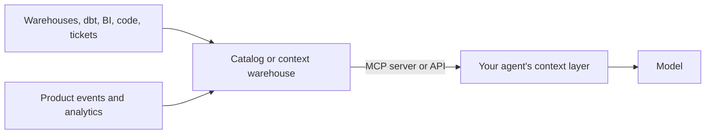

# Context tooling

> Module 5 · Lesson 6 · ~8 min

**Goals**
- Explain what data catalogs and "context warehouses" do for AI apps
- Know what DataHub, Atlan, PostHog, and modus each offer as context sources
- Decide whether your project needs this kind of tooling yet

## The enterprise version of the context problem

Everything so far assumed you know where your context lives: a folder of Markdown, a vector store, a chat history. Inside a real company, an agent asked "why did revenue dip in March?" faces a harder problem. Which of the 4,000 tables is the trusted revenue table? What does `rev_adj_v2` mean? Who owns it? Is it fresh? Was there a tracking change in March?

Humans answer those questions with tribal knowledge. Agents need it written down somewhere they can query. That's the job of a growing category of tools that act as **context sources for AI**: they gather metadata, definitions, and behavioral data from across a company and expose it to models, usually through [MCP](../09-mcp/README.md) servers.

## The tools

**DataHub** is an open-source metadata platform (with a managed cloud version). It catalogs data assets across your stack: tables, dashboards, pipelines, and their lineage, owners, documentation, and quality signals. Its MCP server lets an agent search for data in plain language, check lineage, and read that metadata before deciding which table to query. Good fit if you want an open-source catalog you can self-host.

**Atlan** is a commercial data catalog and governance platform covering similar ground: asset search, lineage, glossaries (business definitions of terms like "active user"), and governance. It also ships an MCP server, with tools for searching assets, exploring lineage, and updating metadata. Good fit for organizations that already use it for data governance.

**PostHog** is a product analytics platform (events, funnels, feature flags, experiments, session replay, error tracking). It plays two roles for AI engineers. As a **context source**, its MCP server lets an agent query product data and manage flags, so "how many users hit this error after the last release?" becomes answerable. As an **observability tool**, its LLM analytics feature tracks your own app's model calls, cost, and latency (more on that kind of tooling in [Module 12](../12-observability/README.md)).

**modus** is a young startup (it announced a seed round in 2026) building what it calls a **context warehouse**: a layer next to your data warehouse that continuously learns how the business works from sources like GitHub, dbt, Jira, Snowflake, and Postgres, then assembles a short, task-specific brief for an agent when it starts a task. The pitch is less over-fetching and fewer wasted tokens. It's early-stage, so treat it as an example of where the category is heading rather than an established standard, and check the current state before relying on it.

| Tool | Category | What it gives an agent | Open source? |
|---|---|---|---|
| DataHub | Metadata catalog | Data assets, lineage, ownership, docs, quality | Yes (core), plus a cloud version |
| Atlan | Metadata catalog and governance | Assets, lineage, glossary terms, governance metadata | No |
| PostHog | Product analytics | User behavior, events, flags, experiments, errors | Yes (core), plus a cloud version |
| modus | Context warehouse | Task-specific briefs assembled from company systems | No |

## The pattern behind the products

Strip away the branding and these tools implement the same ideas you've learned in this module, at company scale:
- **Select and filter** the few relevant assets out of thousands (lesson 1).
- **Pre-compute knowledge** so it doesn't have to be rediscovered each time, like long-term memory (lesson 2).
- **Send a compact brief instead of raw data**, like a sub-agent's summary (lesson 4).
- **Carry trust signals** (owner, freshness, certification) that help the model avoid stale or conflicting context (lesson 5).

## Do you need one?

For Course Buddy and most early projects: no. Your context lives in files and a vector store you control. Reach for this category when:
- Agents need to query a large, shared data estate (many tables, many teams).
- Wrong answers come from using the *wrong source*, not from bad reasoning.
- You already run a catalog for humans; connecting it to agents through MCP is a cheap win.

> [!TIP]
> **Try it.** Pick one question your team asks often that needs company data ("which customers churned last month and why?"). Write down every piece of context an agent would need to answer it correctly: tables, definitions, filters, caveats. Mark where each currently lives (a catalog, a wiki, someone's head). The "someone's head" items are exactly what this category of tools tries to capture.

## Key takeaways
- In companies, the hard part is often finding the *right* context among thousands of sources.
- Data catalogs (DataHub, Atlan) expose metadata, lineage, and definitions to agents, often via MCP.
- PostHog is both a source of product context and a way to observe your own LLM app.
- "Context warehouses" like modus are an emerging category that pre-assembles task-specific context.
- You probably don't need these early on; the underlying patterns are what matter.

## Go deeper
- [DataHub MCP Server docs](https://docs.datahub.com/docs/features/feature-guides/mcp) — what the server exposes and how to connect it
- [Atlan MCP overview](https://docs.atlan.com/product/capabilities/atlan-ai/how-tos/atlan-mcp-overview) — tools available to agents and setup
- [PostHog MCP docs](https://posthog.com/docs/model-context-protocol) — connecting agents to product analytics
- [modus raises $10M to build a context warehouse (The New Stack)](https://thenewstack.io/modus-enterprise-context-warehouse/) — coverage of the context warehouse idea

---
[← When context goes wrong](05-when-context-goes-wrong.md) · [Module home](README.md) · [Module review →](review.md)
