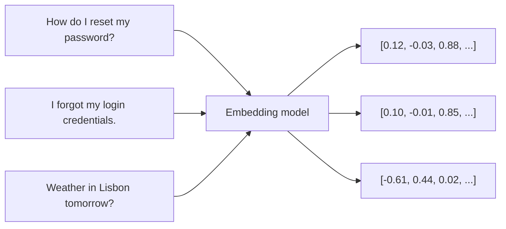

# What embeddings are

> Module 6 · Lesson 1 · ~15 min

**Goals**
- Explain an embedding as "meaning turned into coordinates"
- Compute cosine similarity yourself with numpy
- Generate real embeddings locally with Sentence Transformers

## The problem embeddings solve

Say a user types "I forgot my login credentials" into your help center search. The article that answers it is titled "How do I reset my password?". The two strings share zero keywords. Classic keyword search (`LIKE '%login%'`, BM25) won't connect them, but any human would.

An **embedding model** fixes this. It reads a piece of text and outputs a fixed-length list of numbers, a **vector**, positioned so that texts with similar meaning end up close together. "Forgot my login" and "reset my password" land near each other. "Weather in Lisbon" lands far away.



Once text is a vector, "how similar are these two things?" becomes plain geometry, and computers are very fast at geometry.

> [!NOTE]
> Embedding models are related to LLMs but they're a different tool. An LLM *generates* text one token at a time. An embedding model reads the whole input once and returns a single vector. No chat, no sampling, and they're usually much smaller and cheaper.

## Intuition: a 3-dimensional toy

Real embeddings have hundreds or thousands of dimensions, and no single dimension has a human-readable meaning. To build intuition, pretend we have only three, and that each one *does* mean something: animal-ness, finance-ness, and cuteness.

```python
import numpy as np

# Pretend each dimension means something: [animal-ness, finance-ness, cuteness]
kitten = np.array([0.9, 0.0, 0.8])
puppy  = np.array([0.8, 0.1, 0.9])
stock  = np.array([0.0, 0.9, 0.1])

def cosine(a, b):
    return np.dot(a, b) / (np.linalg.norm(a) * np.linalg.norm(b))

print(f"kitten vs puppy: {cosine(kitten, puppy):.2f}")  # 0.99
print(f"kitten vs stock: {cosine(kitten, stock):.2f}")  # 0.07
```

**Cosine similarity** measures the angle between two vectors and ignores their length:

- `1.0` means they point the same way (same meaning)
- `0` means they're unrelated (perpendicular)
- negative values mean they point in opposite directions (rare in practice for text)

The formula is just the dot product divided by the product of the lengths. If your vectors are already **normalized** to length 1 (OpenAI's and Voyage's are), cosine similarity *is* the dot product, which is why you'll often see `np.dot` used directly.

<details><summary>Check yourself: why compare angles instead of raw distance?</summary>

Length often reflects things like text length or word frequency rather than meaning. Two documents about cats, one short and one long, should count as similar. The angle captures *direction* (topic), which is what you usually care about. Lesson 5 covers the other metrics.

</details>

## Real embeddings in five lines

Now the real thing. [Sentence Transformers](https://sbert.net/) runs open embedding models locally, no API key needed.

```bash
uv add sentence-transformers
```

```python
from sentence_transformers import SentenceTransformer

model = SentenceTransformer("all-MiniLM-L6-v2")  # ~90 MB download, runs on CPU

sentences = [
    "How do I reset my password?",
    "I forgot my login credentials.",
    "What's the weather in Lisbon tomorrow?",
]
vectors = model.encode(sentences)
print(vectors.shape)                       # (3, 384)
print(model.similarity(vectors, vectors))  # 3x3 cosine similarity matrix
```

Output (abridged):

```text
(3, 384)
tensor([[1.0000, 0.6368, 0.0182],
        [0.6368, 1.0000, 0.0298],
        [0.0182, 0.0298, 1.0000]])
```

Each sentence became 384 numbers. The password and login sentences score 0.64 even though they share no words; the weather question scores about 0 against both. That's semantic similarity, computed in milliseconds on a laptop.

> [!IMPORTANT]
> Similarity scores are only meaningful **relative to the same model**. 0.64 might be "very similar" for one model and "meh" for another. Never compare vectors produced by two different models, and never set a fixed threshold without looking at real scores from your model first.

## What an embedding captures (and doesn't)

Embeddings are great at topic, paraphrase, and intent. They're weaker at:

- **Exact identifiers.** Error codes, SKUs, and function names (`ERR_4417`) often embed poorly. Keyword search still wins here, which is why production systems often combine both (hybrid search, covered in [the RAG pipeline lesson](../07-rag/02-the-rag-pipeline.md)).
- **Negation and fine logic.** "Supports Windows" and "does not support Windows" can land surprisingly close together.
- **Long inputs.** Every model has a max input length. `all-MiniLM-L6-v2` silently truncates anything past 256 tokens. That limit drives how you chunk documents in [Module 7](../07-rag/03-chunking-strategies.md).

> [!TIP]
> **Try it:** Run the Sentence Transformers snippet, then add three sentences of your own: a paraphrase of one existing sentence, a sentence that uses the same keywords but means something different (e.g. "The password field is on the left of the weather widget"), and a negation ("I did NOT forget my login"). Predict the scores before you run it.
>
> <details><summary>What you should notice</summary>
>
> The paraphrase scores high. The keyword-overlap sentence scores higher than you'd like, because embeddings still pick up on shared topic words. The negation usually scores *very* close to the original. Embeddings capture "what it's about" far better than "what exactly it claims".
>
> </details>

## Key takeaways
- An embedding is a fixed-length vector that places similar-meaning text close together.
- Cosine similarity compares direction, not length; for normalized vectors it equals the dot product.
- Sentence Transformers lets you embed text locally for free with a few lines of Python.
- Scores only make sense within one model, and embeddings are weak on exact identifiers, negation, and over-length inputs.

## Go deeper
- [Sentence Transformers quickstart](https://sbert.net/docs/quickstart.html) — the library used in this lesson
- [OpenAI embeddings guide](https://developers.openai.com/api/docs/guides/embeddings) — concise intro with use cases and normalization notes
- [Anthropic: Embeddings](https://platform.claude.com/docs/en/build-with-claude/embeddings) — Anthropic's guidance on choosing an embeddings provider
- [Pinecone: Vector similarity explained](https://www.pinecone.io/learn/vector-similarity/) — visual explanation of cosine, dot product, and Euclidean distance

---
[← Module home](README.md) · [Embedding models →](02-embedding-models.md)
