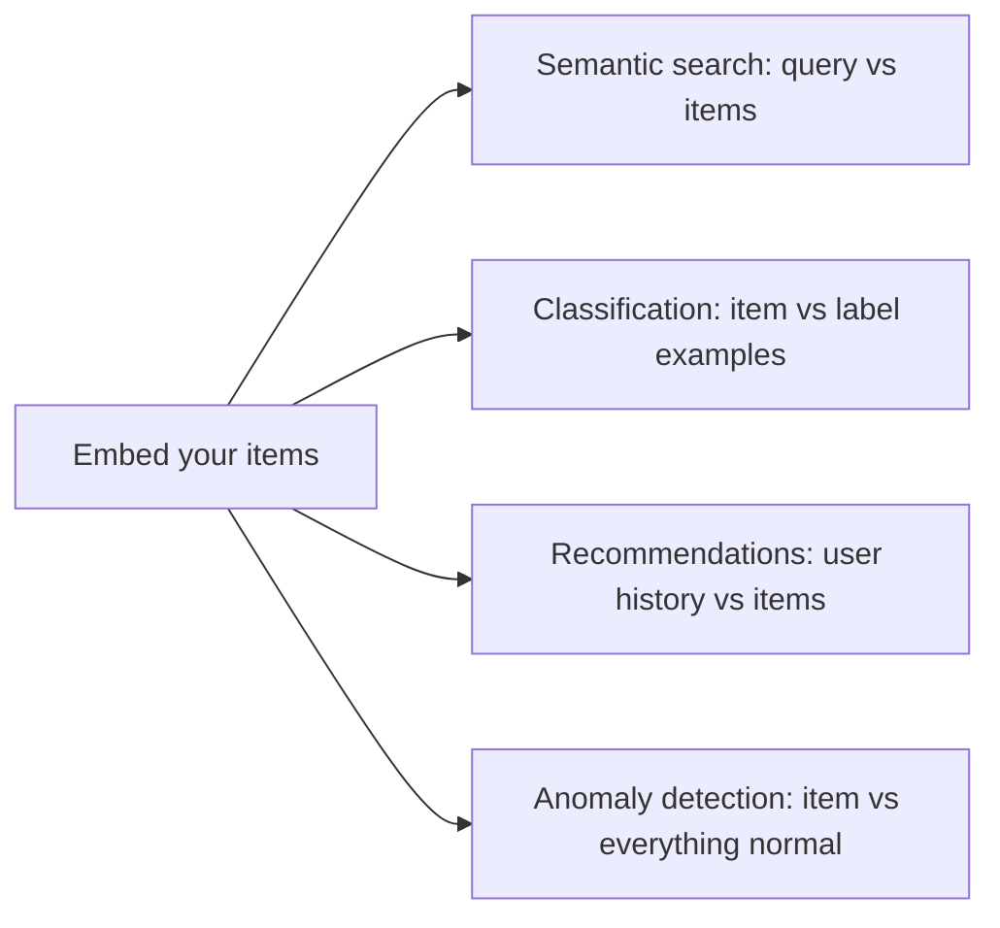

# What embeddings are good for

> Module 6 · Lesson 3 · ~15 min

**Goals**
- Recognize the four classic embedding use cases: search, classification, recommendations, anomaly detection
- Build a tiny classifier and outlier detector from a handful of examples
- Know when an embedding approach beats asking an LLM, and when it doesn't

## One trick, many products

Every use case in this lesson is the same move: **embed things, then measure distances**. What changes is what you compare against.



## Semantic search

Compare a query vector against every document vector and return the closest. This is the one you'll use most, because it's the "R" in RAG. It finds "reset my password" when the user typed "forgot my login". Lessons 4 and 5 make it fast and scalable.

## Classification

You have support tickets and want to route them to billing, bugs, or accounts. Options:

- Ask an LLM to label each ticket. Flexible, but costs a generation call per ticket.
- Train a classifier on embeddings. Very cheap per item, and needs only a few examples per label to start.

The simplest embedding classifier: average the vectors of a few examples per label (a **centroid**), then assign each new item to the nearest centroid.

```python
import numpy as np
from sentence_transformers import SentenceTransformer

model = SentenceTransformer("all-MiniLM-L6-v2")
embed = lambda texts: model.encode(texts, normalize_embeddings=True)

# A few labeled examples per category
examples = {
    "billing": ["I was charged twice this month", "How do I update my credit card?"],
    "bug":     ["The app crashes when I upload a photo", "Export button does nothing"],
    "account": ["I can't log in", "How do I delete my account?"],
}
# One centroid (average vector) per label
centroids = {label: embed(texts).mean(axis=0) for label, texts in examples.items()}

def classify(ticket: str) -> tuple[str, float]:
    v = embed([ticket])[0]
    scores = {label: float(np.dot(v, c) / np.linalg.norm(c)) for label, c in centroids.items()}
    best = max(scores, key=scores.get)
    return best, scores[best]

for t in ["Why is there a second charge on my statement?",
          "Clicking save freezes the whole page",
          "Password reset email never arrives",
          "What's your favorite pizza topping?"]:
    label, score = classify(t)
    print(f"{label:8} {score:.2f}  {t}")
```

```text
billing  0.48  Why is there a second charge on my statement?
bug      0.47  Clicking save freezes the whole page
account  0.36  Password reset email never arrives
account  0.11  What's your favorite pizza topping?
```

The first three are right, from just six examples. With hundreds of labeled examples you'd swap the centroid for a real classifier (logistic regression from scikit-learn on the vectors works well), but the idea is the same.

## Anomaly detection

Look at the last line: the pizza question got *a* label, but with a score of 0.11, far below the others. Nothing it's close to. That low score is itself a signal.

Anomaly detection with embeddings means "flag things that are far from everything normal". Typical uses:

- Tickets or log lines that don't resemble any known category (new bug? spam?)
- Off-topic or suspicious inputs to your chatbot (a cheap first guardrail, see [Module 13](../13-safety-and-ethics/README.md))
- Content drift: this week's queries sitting far from the documents you indexed

A simple version: compute each item's similarity to its nearest centroid (or nearest k neighbors) and flag anything below a threshold you picked by looking at real data.

## Recommendations

Embed every item (articles, products, lessons). Represent a user as the average of the items they engaged with. Recommend the nearest items they haven't seen. That's content-based recommendation in three lines of numpy, and it works on day one with no interaction history, the classic "cold start" problem for collaborative filtering. Real recommenders blend this with behavioral signals, but embeddings are a strong baseline.

## Also worth knowing

- **Clustering.** Run k-means on vectors to discover themes in thousands of reviews or tickets, then ask an LLM to name each cluster.
- **Deduplication.** Near-identical vectors (similarity > ~0.95 for many models) usually mean near-duplicate content.
- **Caching.** A "semantic cache" returns a stored LLM answer when a new question is close enough to an old one.

## Embeddings or an LLM call?

| | Embeddings | LLM call |
|---|---|---|
| Cost per item | Fractions of a cent, or free locally | Much higher |
| Speed | Milliseconds | Seconds |
| Needs examples | A few per label | Zero (just describe labels) |
| Explains itself | No, just a score | Yes, can give reasons |
| Handles nuance | Topic-level | Reads carefully |

A common production pattern uses both: embeddings filter or route the bulk cheaply, and an LLM handles the ambiguous cases near the decision boundary.

> [!TIP]
> **Try it:** Add a fourth label, `feature_request`, with two examples ("Please add dark mode", "It would be great to export to CSV"). Re-run the classifier with a new ticket like "Any plans for a mobile app?". Then pick a threshold below which you'd return `"unknown"` instead of a label. What value separates the pizza question from the real tickets?
>
> <details><summary>Hint</summary>
>
> Print scores for 10–20 mixed inputs and eyeball the gap. Here, anything around 0.2–0.25 would separate the pizza question (0.11) from the weakest real ticket (0.36). With real data you'd pick the threshold on a labeled validation set, not by eye.
>
> </details>

## Key takeaways
- Every embedding use case is "embed, then compare distances"; only the comparison target changes.
- A nearest-centroid classifier needs just a few examples per label and costs almost nothing per item.
- Low similarity to everything is a useful anomaly or off-topic signal.
- Embeddings are fast and cheap; LLMs are flexible and explain themselves. Combine them.

## Go deeper
- [OpenAI cookbook: Classification using embeddings](https://cookbook.openai.com/examples/classification_using_embeddings) — a fuller classifier walkthrough
- [OpenAI cookbook: Clustering](https://cookbook.openai.com/examples/clustering) — k-means on embeddings, then naming clusters with an LLM
- [Sentence Transformers: Clustering](https://sbert.net/examples/sentence_transformer/applications/clustering/README.html) — local clustering examples

---
[← Embedding models](02-embedding-models.md) · [Module home](README.md) · [Vector databases →](04-vector-databases.md)
