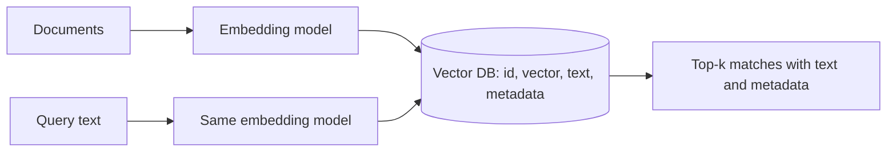

# Vector databases

> Module 6 · Lesson 4 · ~15 min

**Goals**
- Explain what a vector database adds beyond "a list of vectors in numpy"
- Compare the popular options (Chroma, Pinecone, Weaviate, FAISS, LanceDB, Qdrant, pgvector, MongoDB Atlas)
- Store and query documents in a local Chroma collection

## Why not just numpy?

For a few thousand vectors, `np.dot(matrix, query)` is honestly fine. It's exact and takes milliseconds. Things break down as you grow:

- **Speed.** Comparing a query against 10 million vectors on every request is too slow. You need an index that finds *approximately* nearest neighbors without checking everything (next lesson).
- **Persistence.** Your vectors should survive a restart without re-embedding.
- **Metadata.** You want "nearest chunks *from module 7*" or "*published after 2025*", not just nearest overall.
- **Updates.** Documents change. You need to add, update, and delete individual vectors without rebuilding everything.
- **Keeping text with vectors.** A vector alone is useless to a RAG app; you need the original text and its source back.

A vector database bundles all of that: storage, an approximate nearest-neighbor (ANN) index, metadata filtering, and CRUD.



## The options

| Tool | Type | Good fit when |
|---|---|---|
| **Chroma** | Open-source, embedded or server, plus a hosted cloud | Prototyping and small-to-medium apps in Python/JS. **This course uses it.** |
| **FAISS** | Library (Meta), not a database | You want raw ANN speed in-process and will handle storage and metadata yourself. |
| **LanceDB** | Open-source, embedded, file-based | Local or serverless apps, large datasets on disk or object storage, multimodal data. |
| **Qdrant** | Open-source server (Rust), plus cloud | Production self-hosting with rich filtering and good performance. |
| **Weaviate** | Open-source server, plus cloud | Built-in hybrid (keyword + vector) search and model integrations. |
| **Pinecone** | Fully managed service | You want zero ops and serverless scaling, and don't need self-hosting. |
| **pgvector / Supabase** | Postgres extension | You already run Postgres and want vectors next to your relational data, with SQL joins and transactions. |
| **MongoDB Atlas Vector Search** | Feature of MongoDB Atlas | Your data already lives in MongoDB. |

> [!NOTE]
> If you already run Postgres, seriously consider pgvector before adding a new database. One fewer system to operate often beats a few milliseconds of query speed. Reach for a dedicated vector DB when scale, filtering performance, or features like built-in hybrid search start to matter.

Concepts transfer between all of these: a **collection** (or index/table) of records, each with an **id**, a **vector**, optional **document text**, and **metadata**, queried by vector with filters. Learn one well and you can pick up the rest in an afternoon.

## Chroma in practice

Chroma runs inside your Python process and saves to a local folder. No server, no account.

```bash
uv add chromadb sentence-transformers
```

```python
import chromadb
from chromadb.utils.embedding_functions import SentenceTransformerEmbeddingFunction

client = chromadb.PersistentClient(path="./chroma_db")   # data persists in this folder

collection = client.get_or_create_collection(
    name="demo",
    embedding_function=SentenceTransformerEmbeddingFunction(model_name="all-MiniLM-L6-v2"),
    configuration={"hnsw": {"space": "cosine"}},          # distance metric, see lesson 5
)

collection.add(
    ids=["faq-1", "faq-2", "faq-3"],
    documents=[
        "To reset your password, click 'Forgot password' on the login page.",
        "Invoices are emailed on the first business day of each month.",
        "You can export your data as CSV from Settings > Export.",
    ],
    metadatas=[{"topic": "account"}, {"topic": "billing"}, {"topic": "data"}],
)

results = collection.query(query_texts=["I can't get into my account"], n_results=2)
print(results["ids"])        # [['faq-1', 'faq-3']]
print(results["documents"])  # [['To reset your password, ...', ...]]
print(results["distances"])  # [[0.53, 0.91]]  smaller = closer
```

A few things to notice:

- **Chroma embedded the text for you.** Because the collection has an `embedding_function`, `add` and `query` accept raw text. You can also compute vectors yourself and pass `embeddings=` / `query_embeddings=` instead. Lesson 5 and the [from-scratch RAG lesson](../07-rag/04-build-rag-from-scratch.md) do that to make each step visible.
- **Results are lists of lists.** You can pass several queries at once, so each field has one inner list per query. `results["documents"][0]` is the matches for your first query.
- **It returns distances, not similarities.** With the `cosine` space, distance = 1 − cosine similarity.
- If you omit `embedding_function`, Chroma uses its default, which is also `all-MiniLM-L6-v2` (run via ONNX). Being explicit protects you if the default ever changes.

Other operations you'll use:

```python
collection.count()                                    # number of records
collection.get(ids=["faq-2"])                         # fetch by id
collection.upsert(ids=["faq-2"], documents=["Invoices are emailed on the 1st."])  # insert or replace
collection.delete(ids=["faq-3"])
collection.delete(where={"topic": "billing"})         # delete by metadata
```

When you outgrow embedded mode, the same API talks to a Chroma server (`chromadb.HttpClient(...)`) or Chroma Cloud, so your code barely changes.

> [!WARNING]
> Chroma collection names must be 3–512 characters of letters, digits, `.`, `_`, or `-`. And once a collection is created with an embedding function and distance metric, keep using the same ones. If you change models, create a new collection and re-embed.

> [!TIP]
> **Try it:** Run the snippet twice and print `collection.count()`. It stays at 3: `add` quietly ignores ids that already exist, so edited text would *not* be updated. Switch to `upsert` and change one document to see it actually replaced. Then query "how do I pay?" without a filter and look at which record comes first. Finally, add `where={"topic": "billing"}` to see how metadata narrows the results.
>
> <details><summary>Hint</summary>
>
> ```python
> collection.query(query_texts=["how do I pay?"], n_results=2, where={"topic": "billing"})
> ```
>
> Unfiltered, the password FAQ (`faq-1`) actually ranks first for "how do I pay?", a nice reminder that small embedding models are fuzzy. With the filter you only get billing records, even when a non-billing record is closer.
>
> </details>

## Key takeaways
- A vector DB adds ANN indexing, persistence, metadata filtering, and CRUD on top of raw vectors.
- Chroma (embedded), FAISS (library), LanceDB (embedded), Qdrant/Weaviate (servers), Pinecone (managed), pgvector (Postgres), and MongoDB Atlas all share the same core concepts.
- In Chroma, `query` returns lists of lists and cosine *distances* (smaller is closer).
- Keep the embedding model and metric fixed per collection; changing either means a new collection.

## Go deeper
- [Chroma getting started](https://docs.trychroma.com/docs/overview/getting-started) — official quickstart and client modes
- [pgvector](https://github.com/pgvector/pgvector) — vector search inside Postgres
- [Qdrant documentation](https://qdrant.tech/documentation/) — a production-focused open-source alternative
- [LanceDB documentation](https://lancedb.github.io/lancedb/) — embedded, file-based vector database
- [FAISS](https://github.com/facebookresearch/faiss) — Meta's similarity search library that many databases build on

---
[← What embeddings are good for](03-what-embeddings-are-good-for.md) · [Module home](README.md) · [Indexing and similarity search →](05-indexing-and-similarity-search.md)
