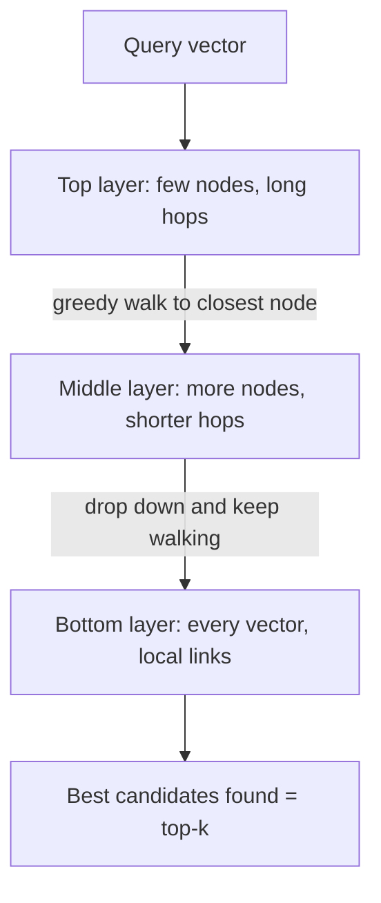

# Indexing and similarity search

> Module 6 · Lesson 5 · ~20 min

**Goals**
- Pick the right distance metric (cosine, dot product, Euclidean) and read Chroma's distances
- Explain how approximate nearest-neighbor (ANN) indexes like HNSW trade accuracy for speed
- Combine vector search with metadata filters
- Index this course into Chroma and add a `search` command to Course Buddy

## Exact search vs approximate search

The honest way to find the nearest vectors is to compare the query against every one of them. That's called **flat** or **brute-force** search. It's exact, and for up to roughly 100K vectors it's often fast enough.

Past that, you use an **approximate nearest-neighbor (ANN)** index. It checks only a small, cleverly chosen fraction of vectors and returns *almost* the true top-k, typically 95–99% of the time, at a fraction of the cost. The fraction of true nearest neighbors you get back is called **recall**.

The most popular ANN index is **HNSW** (Hierarchical Navigable Small World). Chroma, Qdrant, Weaviate, pgvector, and many others use it.



The intuition: it's like navigating by highway, then main roads, then side streets. Each vector is a node linked to its near neighbors. A search starts at the sparse top layer, greedily hops toward the query, then drops a layer and refines. You visit a few hundred nodes instead of millions.

Other index families you'll hear about: **IVF** (cluster vectors into buckets, then search only the closest buckets) and **PQ / quantization** (compress vectors so more fit in memory, at a small accuracy cost). FAISS offers all of them.

### The knobs

HNSW has three settings that trade speed and memory for recall. In Chroma they live in the collection's `hnsw` configuration:

| Setting | Chroma default | Raise it to... | Cost |
|---|---|---|---|
| `max_neighbors` (often called M) | 16 | improve recall | more memory, slower inserts |
| `ef_construction` | 100 | build a better graph | slower indexing |
| `ef_search` | 100 | search more candidates per query | slower queries |

For a course-sized index (a few thousand chunks) the defaults are more than enough. Tune these only when you have millions of vectors **and** an eval showing recall is your problem.

## Distance metrics

Three metrics cover almost everything:

| Metric | Measures | Chroma `space` | Chroma returns |
|---|---|---|---|
| Cosine | angle between vectors | `"cosine"` | `1 − cosine similarity` |
| Dot product (inner product) | angle *and* length | `"ip"` | `1 − dot product` |
| Euclidean (L2) | straight-line distance | `"l2"` (the default) | squared L2 distance |

Rule of thumb: **use whatever your embedding model was trained for, and default to cosine for text.** If vectors are normalized to length 1, all three produce the same ranking, so dot product is just the fastest way to compute cosine.

> [!WARNING]
> Chroma's default space is `l2`, not cosine. If you forget the `configuration={"hnsw": {"space": "cosine"}}`, rankings for normalized embeddings are still the same, but the distance numbers mean something different, and any threshold you copied from a cosine example will be wrong.

<details><summary>Check yourself: Chroma returns a cosine distance of 0.25. What's the cosine similarity?</summary>

0.75. With `space="cosine"`, distance = 1 − similarity.

</details>

## Metadata filters

Pure vector search answers "what's most similar?". Real apps also need "...among the things this user may see" or "...from the current docs version". Store metadata alongside each vector and filter at query time:

```python
collection.query(
    query_embeddings=[query_vec],
    n_results=5,
    where={"$and": [{"module": "07-rag"}, {"year": {"$gte": 2025}}]},
    where_document={"$contains": "Chroma"},   # filter on the raw text itself
)
```

Chroma's `where` supports `$eq`, `$ne`, `$gt`, `$gte`, `$lt`, `$lte`, `$in`, `$nin`, `$and`, and `$or`. A bare `{"module": "07-rag"}` is shorthand for `$eq`.

Filters are also a **security** tool. In a multi-tenant app, always filter by `tenant_id` (or use a collection per tenant) so one customer's query can never retrieve another's documents. Don't rely on the LLM to "ignore" chunks it shouldn't have seen.

## Capstone: index the course

Time to give Course Buddy a memory of the course. This is `course_buddy/index.py` from the [capstone layout](../capstone/README.md). It splits every `.md` file into sections, embeds them locally, and stores them with their source path.

```bash
uv add chromadb sentence-transformers
```

```python
"""Chunk, embed, and store the course in Chroma; search it."""
import sys
from pathlib import Path

import chromadb
from chromadb.errors import NotFoundError
from sentence_transformers import SentenceTransformer

COURSE_DIR = Path("../zth-ai-engineer")  # wherever your copy of the course lives
COLLECTION = "course"
MODEL_NAME = "all-MiniLM-L6-v2"

model = SentenceTransformer(MODEL_NAME)
client = chromadb.PersistentClient(path="./chroma_db")


def chunk_markdown(text: str) -> list[str]:
    """Naive chunker: one chunk per '## ' section. Module 7 improves this."""
    chunks, current = [], []
    for line in text.splitlines():
        if line.startswith("## ") and current:
            chunks.append("\n".join(current).strip())
            current = []
        current.append(line)
    chunks.append("\n".join(current).strip())
    return [c for c in chunks if c]


def build_index() -> None:
    try:
        client.delete_collection(COLLECTION)  # rebuild from scratch: no stale chunks
    except NotFoundError:
        pass
    collection = client.create_collection(
        COLLECTION,
        configuration={"hnsw": {"space": "cosine"}},
        metadata={"embedding_model": MODEL_NAME},
    )
    ids, docs, metas = [], [], []
    for path in sorted(COURSE_DIR.rglob("*.md")):
        source = path.relative_to(COURSE_DIR).as_posix()
        for i, chunk in enumerate(chunk_markdown(path.read_text(encoding="utf-8"))):
            ids.append(f"{source}#{i}")
            docs.append(chunk)
            metas.append({"source": source, "module": source.split("/")[0]})

    vectors = model.encode(docs, batch_size=64, show_progress_bar=True)
    collection.add(ids=ids, documents=docs, embeddings=vectors.tolist(), metadatas=metas)
    print(f"Indexed {len(ids)} chunks from {len(set(m['source'] for m in metas))} files")


def search(query: str, k: int = 5, module: str | None = None) -> dict:
    collection = client.get_collection(COLLECTION)
    return collection.query(
        query_embeddings=[model.encode(query).tolist()],
        n_results=k,
        where={"module": module} if module else None,
    )


if __name__ == "__main__":
    if sys.argv[1:2] == ["build"]:
        build_index()
    elif sys.argv[1:2] == ["search"]:
        res = search(" ".join(sys.argv[2:]))
        for doc, meta, dist in zip(res["documents"][0], res["metadatas"][0], res["distances"][0]):
            first_line = doc.splitlines()[0]
            print(f"{1 - dist:.2f}  {meta['source']}  {first_line}")
    else:
        print('usage: python -m course_buddy.index build | search "your question"')
```

```console
$ uv run python -m course_buddy.index build
Indexed 401 chunks from 60 files
$ uv run python -m course_buddy.index search "what is prompt caching"
0.56  04-prompt-engineering/01-anatomy-of-a-prompt.md  ## System prompt vs user message
0.51  05-context-engineering/03-long-context-and-caching.md  ## Go deeper
0.50  05-context-engineering/03-long-context-and-caching.md  ## Prompt caching
...
```

(Your numbers will differ as the course evolves.) Design choices worth noticing:

- **We embed ourselves** and pass `embeddings=` / `query_embeddings=`. The model name is stored in the collection metadata so you can check it before querying.
- **IDs are deterministic** (`path#chunk_number`), so re-running is predictable.
- **Rebuild instead of upsert.** If a file shrinks, upserting would leave its old trailing chunks behind. For a small corpus, deleting and rebuilding is the simplest correct option.
- **`source` metadata** is what lets Module 7 cite lesson files.

Now look critically at that output. The top hit for "prompt caching" isn't the caching section, and a `## Go deeper` link list ranks second. Two reasons: whole sections are often longer than the 256 tokens `all-MiniLM-L6-v2` reads (the rest is silently dropped), and boilerplate sections add noise. That's exactly what [chunking strategies](../07-rag/03-chunking-strategies.md) fixes.

> [!TIP]
> **Try it:** Build the index, then run five searches about topics you remember from earlier modules. For each, note whether the right lesson appears in the top 3. Then try the `module` filter (`search("temperature", module="01-how-llms-work")`) and compare. Keep your five queries; they're the seed of the eval set you'll build in [Module 11](../11-evals/README.md).
>
> <details><summary>Hint: wiring it into the CLI</summary>
>
> If your Course Buddy CLI uses `argparse`, add a `search` subcommand that calls `index.search(...)` and prints `source` plus the first line of each hit. Load the `SentenceTransformer` once at startup, not per query. Loading takes a second or two; encoding a query takes milliseconds.
>
> </details>

## Key takeaways
- Flat search is exact and fine for small corpora; ANN indexes like HNSW trade a little recall for huge speedups at scale.
- Default to cosine for text, and remember Chroma's default space is `l2` and that it returns distances, not similarities.
- Metadata filters narrow results by attributes and enforce access boundaries; never leave tenancy to the LLM.
- Store a `source` with every chunk. Citations depend on it.

## Go deeper
- [Chroma: configure collections](https://docs.trychroma.com/docs/collections/configure) — HNSW settings and distance functions
- [Chroma: metadata filtering](https://docs.trychroma.com/docs/querying-collections/metadata-filtering) — the full `where` / `where_document` syntax
- [Pinecone: HNSW explained](https://www.pinecone.io/learn/series/faiss/hnsw/) — a visual walkthrough of how the graph is built and searched
- [The HNSW paper (Malkov and Yashunin)](https://arxiv.org/abs/1603.09320) — the original algorithm, if you want the details

---
[← Vector databases](04-vector-databases.md) · [Module home](README.md) · [Module review →](review.md)
