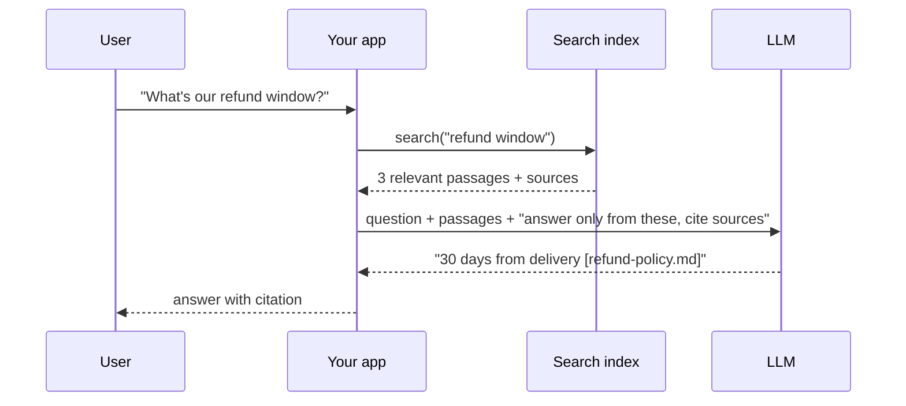

# Why RAG

> Module 7 · Lesson 1 · ~10 min

**Goals**
- Explain retrieval-augmented generation in one sentence
- Recognize problems RAG is a good fit for, and ones it isn't
- Choose between RAG, fine-tuning, and stuffing everything into a long context

## The problem

Ask a model about your company's refund policy and one of three things happens: it says it doesn't know, it gives a generic answer, or it confidently makes one up. None are acceptable. The model simply never saw your policy, and even if it had, its knowledge is frozen at its training cutoff.

You already know one fix from [Module 5](../05-context-engineering/README.md): put the information in the context window. RAG is that idea, automated and scaled.

**Retrieval-augmented generation (RAG)** means: when a question arrives, *retrieve* the few passages from your data most relevant to it, *augment* the prompt with them, and let the model *generate* an answer grounded in those passages.

The model's job shifts from "remember the answer" to "read these passages and answer from them". LLMs are much better at the second one.

## What RAG gets you

- **Fresh and private knowledge.** Update the index and answers change immediately. No retraining.
- **Citations.** Every passage has a source, so answers can link to it and users can verify.
- **Fewer hallucinations.** Not zero, but "answer only from these sources, otherwise say you don't know" works far better than asking from memory.
- **Access control.** Retrieve only documents the current user is allowed to see.
- **Cost.** Sending 3K relevant tokens beats sending 300K tokens of everything on every request.

## Typical use cases

- Docs and help-center assistants ("How do I configure SSO?")
- Internal knowledge search over wikis, Slack exports, runbooks
- Customer support copilots that draft replies from past tickets and policies
- Legal, medical, and financial research over large document sets, where citations are mandatory
- Code assistants that pull relevant files from a large repository
- And our capstone: Course Buddy answering questions about this course

## RAG vs fine-tuning vs long context

These get confused constantly. They solve different problems.

| | RAG | Fine-tuning | Long context (stuff it all in) |
|---|---|---|---|
| Teaches the model... | facts, at question time | style, format, skills, behavior | facts, for this one request |
| Update knowledge | re-index a document (seconds) | retrain (hours, plus eval) | edit the prompt |
| Citations | natural | no | possible |
| Cost per request | low (small context) | low | high when the corpus is large |
| Scales to | millions of documents | n/a | what fits in the window |
| Main risk | retrieval misses the right passage | model still hallucinates facts | cost, latency, "lost in the middle" |

Rules of thumb:

- **Need it to *know* things?** RAG. Fine-tuning is a poor way to inject facts: it's expensive, hard to update, and the model still can't tell you where a fact came from.
- **Need it to *behave* differently** (a strict output format, a domain's jargon, a tone)? Try prompting first, then fine-tuning.
- **Corpus is small** (say, under ~100K tokens) and questions span all of it? Just put it in the context with [prompt caching](../05-context-engineering/03-long-context-and-caching.md). Simpler than RAG, and often better.
- They combine: a fine-tuned model can still use RAG, and RAG can retrieve whole documents into a long context.

Check yourself: your 40-page employee handbook changes twice a year, and people ask about it a few hundred times a month. RAG or long context?

Probably long context. 40 pages is roughly 20–30K tokens, which fits easily, and with prompt caching repeated requests are cheap. RAG earns its complexity when the corpus is too big to send, changes often, or needs per-user access control.

## What RAG doesn't fix

RAG is only as good as its retrieval. If the right passage isn't retrieved, the model either says "I don't know" (good) or fills the gap from memory (bad). Most RAG debugging is retrieval debugging, which is why the next lessons focus so much on the pipeline and chunking. RAG also opens a new attack surface: retrieved text can contain instructions (indirect prompt injection), covered in [Module 13](../13-safety-and-ethics/02-prompt-injection.md).

> [!TIP]
> **Try it:** Ask Course Buddy (or any chat model, with no context) two questions: "What's the name of this course's capstone project?" and "What embedding model does Module 6 use?". Note how it fails. Then paste the [capstone README](../capstone/README.md) into the prompt and ask the first question again. You just did RAG by hand; the rest of the module automates the "find and paste" part.

## Key takeaways
- RAG = retrieve relevant passages at question time, add them to the prompt, generate a grounded answer.
- It gives you fresh, private, citable knowledge without retraining.
- Use RAG for knowledge, fine-tuning for behavior, and plain long context when the corpus is small.
- Retrieval quality is the ceiling on answer quality.

## Go deeper
- [Lewis et al., Retrieval-Augmented Generation for Knowledge-Intensive NLP Tasks](https://arxiv.org/abs/2005.11401) — the 2020 paper that named RAG
- [Anthropic: Introducing Contextual Retrieval](https://www.anthropic.com/news/contextual-retrieval) — a practical look at why RAG retrieval fails and how to improve it, including when to skip RAG entirely
- [Lost in the Middle (Liu et al.)](https://arxiv.org/abs/2307.03172) — why dumping everything into a long context isn't free

---
[← Module home](README.md) · [The RAG pipeline →](02-the-rag-pipeline.md)
