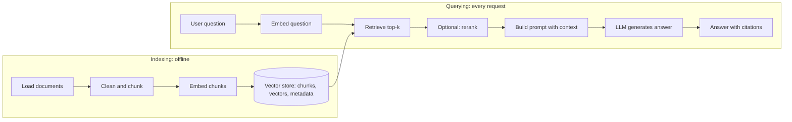

# The RAG pipeline

> Module 7 · Lesson 2 · ~15 min

**Goals**
- Draw the two halves of a RAG system: offline indexing and online querying
- Know what each stage does and how it typically fails
- Know the main upgrades (hybrid search, reranking, query rewriting) and when to reach for them

## Two pipelines, not one

A RAG system is really two pipelines that share an index. **Indexing** runs ahead of time (on deploy, nightly, or when a document changes). **Querying** runs on every user request.



You built most of the indexing half in [Module 6](../06-embeddings-and-vector-search/05-indexing-and-similarity-search.md). This module completes the query half.

## Stage by stage

### 1. Load
Get text out of wherever it lives: Markdown, HTML, PDFs, Notion, Confluence, databases. Keep the source (path, URL, title) and anything useful for filtering (date, author, product, permissions).

**Fails when:** PDFs come out as garbled text, tables lose their structure, navigation menus and footers leak in. Look at your extracted text before anything else. Garbage in, garbage retrieved.

### 2. Chunk
Split documents into passages small enough to embed well and specific enough to be useful. This is the most underrated decision in RAG, so it gets [its own lesson](03-chunking-strategies.md).

**Fails when:** chunks are so big that the relevant sentence is diluted (or truncated by the embedding model), or so small that they lose context ("It must be enabled first." Enable *what*?).

### 3. Embed and store
Embed each chunk with your chosen model and store it with its text and metadata.

**Fails when:** queries and documents use different models, the model is weak for your domain or language, or you forgot the metadata you'll need for filtering and citations.

### 4. Retrieve
Embed the question with the same model and fetch the top-k most similar chunks, applying metadata filters (user permissions, product version).

**Fails when:** `k` is too small to include the answer, or so large the prompt fills with noise. A typical starting point is k = 4–8 chunks, then tune it against an eval.

### 5. Generate
Put the retrieved chunks into the prompt with clear instructions, and let the model answer. A good RAG prompt:

```text
Answer the question using ONLY the sources below.
Cite the source file for every claim, like [07-rag/01-why-rag.md].
If the sources don't contain the answer, say "I couldn't find that in the course."

<sources>
<source file="07-rag/01-why-rag.md">...chunk text...</source>
<source file="06-embeddings-and-vector-search/02-embedding-models.md">...</source>
</sources>

Question: ...
```

XML-style tags keep the sources clearly separated from instructions ([Module 4](../04-prompt-engineering/01-anatomy-of-a-prompt.md)). Explicitly allowing "I don't know" is what keeps the model from filling gaps from memory.

**Fails when:** the model ignores the sources, blends in outside knowledge, cites the wrong source, or follows instructions hidden inside a retrieved document.

## Debug retrieval first

When a RAG answer is wrong, there are only two possibilities:

1. **The right passage wasn't retrieved.** A retrieval problem: fix loading, chunking, embedding, k, or filters.
2. **It was retrieved, but the model didn't use it well.** A generation problem: fix the prompt, the passage ordering, or the model.

So always log what was retrieved for every request. Look at the chunks before you touch the prompt. Most of the time it's #1.

## Common upgrades

Start simple. Add these when an eval shows a specific weakness:

- **Hybrid search.** Run keyword search (BM25) alongside vector search and merge the results, often with *reciprocal rank fusion*. Fixes misses on exact terms like error codes, product names, and function names.
- **Reranking.** Retrieve generously (say 30–50 candidates), then use a slower, more accurate **reranker** (a cross-encoder model, or an API like Voyage or Cohere rerank) to pick the best 5. Usually a big quality win for little effort.
- **Query rewriting.** Have an LLM turn a vague or conversational question ("what about the other one?") into a standalone search query using chat history. Variants generate several queries, or a hypothetical answer to embed (HyDE).
- **Contextual chunks.** Prepend a short, LLM-generated summary of where each chunk sits in its document before embedding it. Covered in the next lesson.
- **Metadata filters and routing.** Narrow by product, version, or date before vector search, or route a question to the right index.
- **Agentic retrieval.** Give an agent a `search` tool and let it decide what to search for, and when to search again. That's where Course Buddy goes in [Module 8](../08-agents/README.md).

> [!NOTE]
> Every upgrade adds latency, cost, or moving parts. Measure before and after with a small set of question/expected-source pairs. You'll build that properly in [Module 11](../11-evals/README.md), but even 20 hand-written pairs beat guessing.

> [!TIP]
> **Try it:** Using your Module 6 index, run `search` for three questions you know the course answers. For each, write down which of the five stages would be to blame if the answer were wrong. Then look at the actual retrieved chunks: are any of them `## Go deeper` link lists or other noise? You'll fix that next lesson.

<details><summary>Check yourself: users say the bot "makes things up" about a feature that's documented. Retrieval logs show the right doc chunk was in the top 5. Where do you look?</summary>

Generation. The passage was retrieved, so check the prompt (does it require answering only from sources and allow "I don't know"?), where the chunk appears in the context, and whether the chunk is complete enough to answer from. If retrieval logs had *not* shown the chunk, you'd look at chunking and search first.

</details>

## Key takeaways
- RAG has an offline indexing pipeline (load, chunk, embed, store) and an online query pipeline (embed, retrieve, optionally rerank, generate).
- Every stage has its own failure modes; inspect extracted text and retrieved chunks before tuning prompts.
- Wrong answers are either retrieval misses or generation misses. Log retrieval so you can tell which.
- Hybrid search, reranking, and query rewriting are the highest-value upgrades, but add them based on measurements.

## Go deeper
- [Anthropic: Introducing Contextual Retrieval](https://www.anthropic.com/news/contextual-retrieval) — measured gains from contextual embeddings, BM25 hybrid search, and reranking
- [Sentence Transformers: Retrieve and Re-Rank](https://sbert.net/examples/sentence_transformer/applications/retrieve_rerank/README.html) — bi-encoder retrieval plus cross-encoder reranking, with code
- [Pinecone: Rerankers and two-stage retrieval](https://www.pinecone.io/learn/series/rag/rerankers/) — why reranking helps, explained visually

---
[← Why RAG](01-why-rag.md) · [Module home](README.md) · [Chunking strategies →](03-chunking-strategies.md)
