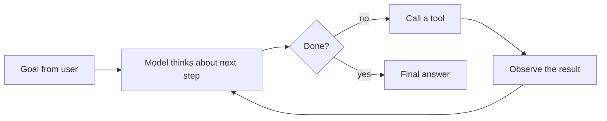

# What makes an agent

> Module 8 · Lesson 1 · ~10 min

**Goals**
- Define an agent in one sentence and draw its loop
- Place a system on the spectrum from single call, to workflow, to agent
- Recognize good agent use cases and the ones where an agent is a mistake

## The one-sentence definition

An **agent** is an LLM that uses tools in a loop, deciding for itself what to do next, until it judges the task finished.

All three parts matter:

- **Tools.** The model can act: search, read a file, call an API, run code. Without tools it can only talk.
- **A loop.** The model sees the result of each action and goes again. One tool call followed by an answer is plain [function calling](../02-calling-models/05-function-calling.md), not an agent.
- **The model decides.** Which tool, with what arguments, and when to stop are the model's choices, not branches in your code.

Your code still owns the loop. It sends the conversation to the model, runs whatever tool the model asks for, appends the result, and repeats. The model only ever produces text and tool requests. You'll build exactly this in [lesson 3](03-build-an-agent-from-scratch.md).

## A spectrum, not a switch

Most LLM features sit somewhere on this line:

| | Single call | Workflow | Agent |
|---|---|---|---|
| Who decides the steps? | Nobody, there's one step | You, in code | The model, at runtime |
| Example | Summarize this email | Retrieve, rerank, then answer (your RAG bot) | "Figure out why this test fails and fix it" |
| Predictability | High | High | Lower |
| Cost and latency | Lowest | Known in advance | Varies per run, often high |
| Debugging | Read one prompt | Inspect each stage | Read a whole trajectory |

A **workflow** chains LLM calls along paths you wrote: prompt chaining, routing, running things in parallel and merging. It's often the right answer. Your Module 7 RAG pipeline is a workflow: it always retrieves, then always answers.

An agent earns its keep when **you can't write the path down in advance**. If you can draw the flowchart, write the workflow.

> [!NOTE]
> "Agentic" gets stuck on everything from chatbots to cron jobs. In this course an agent means the loop above: tools, repeated, with the model choosing the steps.

## Where agents shine

Good agent tasks are open-ended, multi-step, and checkable:

- **Coding.** Read files, edit, run tests, read the failure, edit again. Tests tell the agent (and you) whether it worked.
- **Research.** Search, read, notice a gap, search again, then synthesize.
- **Support and operations.** Look up the account, check the order, issue the refund, all within permissions you control.
- **Data work.** Explore a schema, write a query, see the error, fix the query.
- **Question answering over a big corpus.** Course Buddy, when a question needs two lessons and a list of modules to answer well.

What these share: the next step depends on what the last step returned.

## When not to use an agent

Ask four questions before you build one. If any answer is "no," stay with a single call or a workflow.

1. **Is the task hard to specify in advance?** "Extract the invoice total" isn't. "Turn this bug report into a fix" is.
2. **Is the result worth the cost?** Agents make many model calls. A 10-step run costs roughly 10 calls' worth of tokens, and each call resends the growing history.
3. **Can the model actually do it?** Try the task by hand in a chat window with the same tools. If a strong model can't, a loop won't fix it.
4. **Can you catch and recover from mistakes?** Tests, human review, dry runs, undo. An agent that can send email or move money without a check is a liability.

Other red flags:

- You need the same output every time (compliance reports, billing).
- You have a hard latency budget (autocomplete, voice turn-taking).
- The "agent" would only ever call one tool once. That's function calling.

> [!WARNING]
> Every tool you hand an agent is something it can do *wrong*, or be tricked into doing by text it reads. Grant read-only tools by default, add write tools one at a time, and gate risky ones behind confirmation. [Module 13](../13-safety-and-ethics/02-prompt-injection.md) covers the attacks.

**Check yourself:** your RAG bot always retrieves 5 chunks and then answers. Is it an agent?

Answer

No. Your code fixes the steps (retrieve, then answer). It becomes an agent when the model gets a search tool and decides whether to search, what to search for, and whether to search again.

> [!TIP]
> **Try it.** For each task below, decide: single call, workflow, or agent? Write one sentence of justification for each.
> 1. Translate product descriptions into French.
> 2. Answer "Which lessons in this course mention prompt caching, and how do they differ?"
> 3. Every night, pull yesterday's support tickets, tag each by topic, and post counts to Slack.
> 4. Given a failing CI run, find the cause and open a PR with a fix.
> 5. Classify incoming emails as spam or not spam.

Suggested answers

1. Single call per description (or a batch). The steps never change.
2. Agent, or at least a strong case for one. The model has to find the relevant lessons, read several, and compare them. How many reads it needs depends on what it finds.
3. Workflow. The steps are fixed: fetch, classify each (an LLM call), aggregate, post.
4. Agent. Open-ended, multi-step, and the tests give a clear success signal.
5. Single call (or a small classifier model). Cheap, fast, and the same every time.

## Key takeaways
- An agent is an LLM using tools in a loop, choosing its own next step until it decides it's done.
- Your code runs the loop. The model only proposes text and tool calls.
- Prefer a single call or a workflow whenever you can write the steps down. Agents cost more, run slower, and are harder to debug.
- Good agent tasks are open-ended, multi-step, worth the cost, and checkable.

## Go deeper
- [Building effective agents (Anthropic)](https://www.anthropic.com/engineering/building-effective-agents): the clearest write-up of workflows vs. agents and the common patterns
- [ReAct: Synergizing Reasoning and Acting in Language Models](https://arxiv.org/abs/2210.03629): the paper behind the think, act, observe loop
- [Tool use overview (Claude docs)](https://platform.claude.com/docs/en/agents-and-tools/tool-use/overview): how tool calling works at the API level

---
[← Module home](README.md) · [Tools and the ReAct loop →](02-tools-and-the-react-loop.md)
