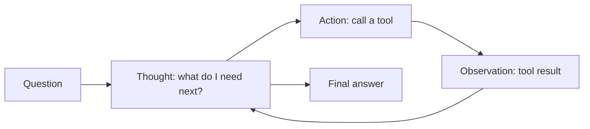

# Tools and the ReAct loop

> Module 8 · Lesson 2 · ~15 min

**Goals**
- Read and write a tool definition, and follow one tool call through the API
- Handle parallel tool calls and tool errors correctly
- Design tools a model can use well
- Connect ReAct (think, act, observe) to native tool calling

## A tool is a contract, not a function

You met tool calling in [Module 2](../02-calling-models/05-function-calling.md). Here's the part that matters for agents: the model never runs your code. It reads a **description** of a tool and, when it wants to use it, emits a structured request. Your code runs the real function and reports back.

A Claude tool definition has three fields:

```python
search_tool = {
    "name": "search_course",
    "description": (
        "Keyword search over all lessons in the course. Returns up to 8 matching "
        "lines, each prefixed with its file path. Use short, specific keywords. "
        "Use read_lesson afterwards to see a whole lesson."
    ),
    "input_schema": {
        "type": "object",
        "properties": {
            "query": {"type": "string", "description": "Keywords, e.g. 'prompt caching'"}
        },
        "required": ["query"],
    },
}
```

The model sees the name, the description, and the JSON Schema. That's all it knows about your tool, so the description does the heavy lifting.

## One round trip

When the model wants a tool, the response comes back with `stop_reason: "tool_use"` and a `tool_use` content block:

```json
{
  "stop_reason": "tool_use",
  "content": [
    {"type": "text", "text": "I'll search the course for that."},
    {"type": "tool_use", "id": "toolu_01A", "name": "search_course",
     "input": {"query": "prompt caching"}}
  ]
}
```

You run the tool and send the result back in a **user** message as a `tool_result` block whose `tool_use_id` matches:

```python
messages.append({"role": "assistant", "content": response.content})  # keep the whole turn
messages.append({
    "role": "user",
    "content": [{
        "type": "tool_result",
        "tool_use_id": "toolu_01A",
        "content": "05-context-engineering/03-long-context-and-caching.md: ## Prompt caching ...",
    }],
})
```

Then you call the API again with the longer history. When the model has what it needs, it answers and the response comes back with `stop_reason: "end_turn"`.

Three rules that trip people up:

1. **Append the full assistant `content`**, not just its text. The `tool_use` block has to be in the history for the `tool_result` to match it.
2. **Parallel calls come back together.** One response can hold several `tool_use` blocks. Run them all (concurrently if you like), then return **all** the `tool_result` blocks in **one** user message.
3. **Failures are results too.** If a tool throws, send a `tool_result` with `"is_error": true` and a useful message. Don't drop the block, and don't crash the loop. The model can often recover: fix the argument, try another tool, or tell the user.

```python
{"type": "tool_result", "tool_use_id": block.id,
 "content": "FileNotFoundError: 08-agents/99-nope.md. Use list_modules to see valid paths.",
 "is_error": True}
```

## Steering tool use

`tool_choice` controls whether the model may call tools:

- `{"type": "auto"}` (the default): the model decides.
- `{"type": "none"}`: no tools this turn, just text.

Older models also accepted `{"type": "any"}` and `{"type": "tool", "name": ...}` to force a call. Current Claude models (including `claude-sonnet-5-5`) reject forced tool choice with a 400 error. Use `auto` and say in the system prompt when a tool must be used. If you were forcing a tool only to get JSON back, use [structured output](../02-calling-models/04-structured-output.md) instead.

## Designing tools a model can use

Tool design matters more than prompt polish. Treat each tool like an API for a smart new teammate who can't ask you questions.

- **Few, well-scoped tools.** Three clear tools beat fifteen overlapping ones. If two tools are easy to confuse, merge them or sharpen their descriptions.
- **Say when to use it, not only what it does.** "Use this before read_lesson if you don't know the path" helps the model plan.
- **Return what the model needs, in a form it can read.** Short, labeled text or compact JSON. Include identifiers (file paths, IDs) the model can pass to the next tool. Truncate huge outputs and say that you did.
- **Make errors actionable.** "No lesson at that path. Valid paths look like `08-agents/01-what-makes-an-agent.md`" beats a stack trace.
- **Validate inputs yourself.** The schema guides the model, but your function is the last line of defense. Check paths, ranges, and permissions in code.
- **Separate reads from writes.** Read-only tools are safe to run freely. Writes (send, delete, pay) deserve confirmation or a dry-run mode.

**Check yourself:** the model calls `read_lesson` and `list_modules` in one response. How many user messages do you send back?

<details><summary>Answer</summary>

One user message containing two `tool_result` blocks, one per `tool_use_id`. Splitting them across messages breaks the pairing and teaches the model to stop making parallel calls.

</details>

## ReAct: the idea underneath

**ReAct** (Reason + Act) is a 2022 prompting pattern you saw in [Module 4](../04-prompt-engineering/03-reasoning-patterns.md): the model alternates a *Thought* ("I need the caching lesson"), an *Action* (`search_course["prompt caching"]`), and an *Observation* (the tool output), until it writes a final answer.



The original version did this with plain text and regex parsing: the model wrote `Action: search[...]`, your code parsed it, ran it, and pasted `Observation: ...` back in. Native tool calling is the same loop with a proper protocol:

| ReAct (text prompting) | Native tool calling |
|---|---|
| "Thought: ..." in the output | The model's reasoning (text or thinking blocks) |
| "Action: search[...]" parsed with regex | A `tool_use` block with JSON `input` |
| "Observation: ..." pasted into the prompt | A `tool_result` block |
| "Final Answer: ..." | A response with `stop_reason: "end_turn"` |

So you rarely write ReAct prompts by hand anymore. The idea still guides how you build: let the model reason between steps, give it observations it can learn from, and keep the loop going until it decides it's done.

> [!TIP]
> **Try it.** Take the `search_tool` definition above and write definitions for the other two Course Buddy tools: `list_modules` (no inputs) and `read_lesson` (a `path` string). Then swap descriptions with a friend, or with a model in a chat window, and ask: "Given only these definitions, which tool would you call first to answer 'What does lesson 3 of the agents module build?' and with what input?" If the answer is wrong, the description is what needs fixing.

<details><summary>One possible solution</summary>

```python
list_modules_tool = {
    "name": "list_modules",
    "description": "List every module folder and the lesson files inside it. "
    "Use this to find where a topic lives before reading.",
    "input_schema": {"type": "object", "properties": {}},
}

read_lesson_tool = {
    "name": "read_lesson",
    "description": "Read the full Markdown of one lesson. `path` is relative to the "
    "course root, e.g. '08-agents/01-what-makes-an-agent.md'.",
    "input_schema": {
        "type": "object",
        "properties": {"path": {"type": "string"}},
        "required": ["path"],
    },
}
```

A good answer to the question: call `list_modules` first to find the file name for lesson 3 in `08-agents`, then `read_lesson` on it.

</details>

## Key takeaways
- A tool is a name, a description, and a JSON Schema. The model sees nothing else, so write the description carefully.
- The protocol: `tool_use` block in the assistant turn, matching `tool_result` blocks in the next user turn, then call again.
- Return all parallel results in one message, and report failures as `is_error` results instead of crashing.
- Current Claude models don't support forced tool choice. Use `auto` plus instructions, or structured output.
- ReAct's think, act, observe loop is what native tool calling implements for you.

## Go deeper
- [How to implement tool use (Claude docs)](https://platform.claude.com/docs/en/agents-and-tools/tool-use/implement-tool-use): definitions, `tool_choice`, parallel calls, error results
- [Writing effective tools for agents (Anthropic)](https://www.anthropic.com/engineering/writing-tools-for-agents): practical tool design advice, with evaluations
- [ReAct paper](https://arxiv.org/abs/2210.03629): the original think, act, observe experiments

---
[← What makes an agent](01-what-makes-an-agent.md) · [Module home](README.md) · [Build an agent from scratch →](03-build-an-agent-from-scratch.md)
