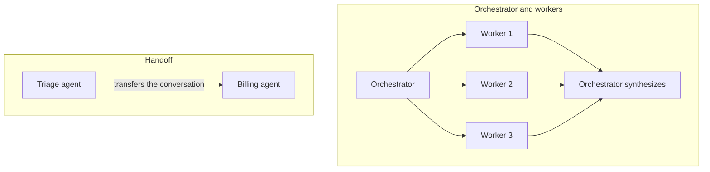

# Multi-agent systems

> Module 8 · Lesson 5 · ~15 min

**Goals**
- Name the common multi-agent patterns and when each fits
- Explain the real benefit (context isolation and parallelism) and the real cost (tokens and coordination)
- Build a small orchestrator-workers system out of the agent from lesson 3

## Why more than one agent?

One agent with every tool and the whole history in its context hits limits. The context fills with tool output that's irrelevant to the next step, the tool list gets long enough to confuse the model, and everything runs one step at a time.

Splitting the work across agents helps in two ways:

- **Context isolation.** Each sub-agent starts with a clean context focused on one sub-task. It may read ten lessons, but it returns a one-paragraph summary to its parent. The parent never sees the noise. ([Module 5](../05-context-engineering/04-context-for-multiple-agents.md) covers this from the context side.)
- **Parallelism.** Independent sub-tasks run at the same time, so a broad research question finishes sooner.

Specialization (a "billing agent" with billing tools and a billing prompt) is a third, smaller benefit. Often a better prompt or a better tool for a single agent gets you the same result.

## The patterns



| Pattern | How it works | Good for |
|---|---|---|
| **Orchestrator and workers** | A lead agent breaks the task down, spawns workers (often in parallel), and combines their results | Research, broad questions, codebase-wide changes |
| **Agents as tools** | A sub-agent is exposed to the parent as an ordinary tool (`ask_billing_expert(question)`). The parent keeps control | Delegating a focused sub-task while one agent stays in charge |
| **Handoff** | One agent passes the whole conversation to another, which takes over talking to the user | Triage and routing in support flows |
| **Pipeline** | Fixed stages, each its own agent or LLM call (draft, then review, then edit) | When the steps are known. This is really a workflow |
| **Evaluator and optimizer** | One agent produces, another critiques, and they loop until the critic is satisfied | Writing, translation, code that has clear quality criteria |

The OpenAI Agents SDK has handoffs and `agent.as_tool()` built in. ADK has `sub_agents` plus sequential, parallel, and loop agents. The Claude Agent SDK has sub-agents. All of them are thin layers over the same idea: one agent's output becomes another agent's input.

## The cost

Multi-agent systems are expensive. Anthropic reported that in its research feature, single agents used about 4 times the tokens of a chat interaction, and multi-agent runs about 15 times. They also add failure modes:

- **Lost context at the seams.** A worker only knows what the orchestrator wrote in its brief. Vague briefs produce duplicated or off-target work.
- **Conflicting actions.** Two agents editing the same file or record. Keep writes with one agent, and let parallel workers read.
- **Harder debugging.** You now trace a tree of trajectories, not a single list ([Module 12](../12-observability/01-tracing-and-logging.md)).

Use multiple agents when the task is broad, splits into **independent** parts, and is valuable enough to pay for. Tightly coupled tasks, where every step depends on the last, usually do better with one agent.

## Build it: Course Buddy research mode

You already have a working agent, `run_agent()` from [lesson 3](03-build-an-agent-from-scratch.md). Each call starts with a fresh context, so it makes a ready-made worker. Add a planner in front and a synthesizer behind:

```python
# research.py
from concurrent.futures import ThreadPoolExecutor

from agent import MODEL, client, run_agent  # the lesson 3 agent


def ask(prompt: str) -> str:
    response = client.messages.create(
        model=MODEL, max_tokens=4000, messages=[{"role": "user", "content": prompt}]
    )
    return "".join(b.text for b in response.content if b.type == "text")


def research(question: str) -> str:
    # 1. Orchestrator: split the question into independent sub-questions.
    plan = ask(
        "Split this question about the course into 2-4 independent sub-questions "
        "that can each be answered separately. One per line, no numbering.\n\n" + question
    )
    sub_questions = [line.strip() for line in plan.splitlines() if line.strip()][:4]

    # 2. Workers: one fresh agent per sub-question, in parallel.
    with ThreadPoolExecutor(max_workers=4) as pool:
        findings = list(pool.map(run_agent, sub_questions))

    # 3. Orchestrator: synthesize. It sees the short findings, not the workers' tool output.
    notes = "\n\n".join(f"### {q}\n{a}" for q, a in zip(sub_questions, findings))
    return ask(
        f"Question: {question}\n\nResearch notes from helpers:\n{notes}\n\n"
        "Write one coherent answer. Keep the lesson citations."
    )


if __name__ == "__main__":
    print(research("Compare how the course treats context windows, RAG, and agents."))
```

This is a fixed orchestration: your code decides "plan, fan out, synthesize." A fully agentic orchestrator would instead get a `delegate(task)` tool and decide for itself how many workers to spawn and when. Start with the fixed version. It's cheaper and easier to debug.

> [!WARNING]
> If any worker raises (iteration limit, refusal), `pool.map` re-raises and the whole run fails. In production, catch per-worker errors and pass "this sub-question failed" to the synthesizer instead.

**Check yourself:** why does the synthesizer produce a better answer than one agent that read all the lessons itself?

<details><summary>Answer</summary>

Context isolation. Each worker's raw tool output (whole lessons) stays in its own context. The synthesizer sees only compact, relevant findings, so its context is small and focused. The trade-off is that details a worker left out of its summary are gone.

</details>

> [!TIP]
> **Try it.** Run `research.py` and the single agent from lesson 3 on the same broad question. Compare (a) answer quality, (b) wall-clock time, and (c) total tokens. For (c), add up `response.usage.input_tokens` and `output_tokens` across all calls. A quick way: wrap `client.messages.create` in a function that adds to a global counter. Was the multi-agent version worth it for this question? Try a narrow question too ("What does lesson 3 of the agents module build?").

<details><summary>What you'll likely find</summary>

On the broad comparison question, research mode is usually faster (parallel workers) and more thorough, and it costs several times the tokens. On the narrow question it's pure overhead: the planner invents sub-questions that don't need asking, and a single agent answers just as well for a fraction of the cost.

</details>

## Key takeaways
- Multiple agents help mainly through context isolation and parallelism, not role-play.
- Main patterns: orchestrator and workers, agents as tools, handoffs, pipelines, evaluator and optimizer.
- Multi-agent runs cost many times more tokens than one agent and add coordination failures. Use them only for broad, separable, valuable tasks.
- Keep writes in one place, give workers precise briefs, and handle per-worker failures.

## Go deeper
- [How we built our multi-agent research system (Anthropic)](https://www.anthropic.com/engineering/multi-agent-research-system): orchestrator and workers in production, including the token costs
- [Building effective agents (Anthropic)](https://www.anthropic.com/engineering/building-effective-agents): orchestrator-workers and evaluator-optimizer as workflow patterns
- [Handoffs (OpenAI Agents SDK)](https://openai.github.io/openai-agents-python/handoffs/): how one framework implements handoffs

---
[← Agent SDKs](04-agent-sdks.md) · [Module home](README.md) · [Module review →](review.md)
