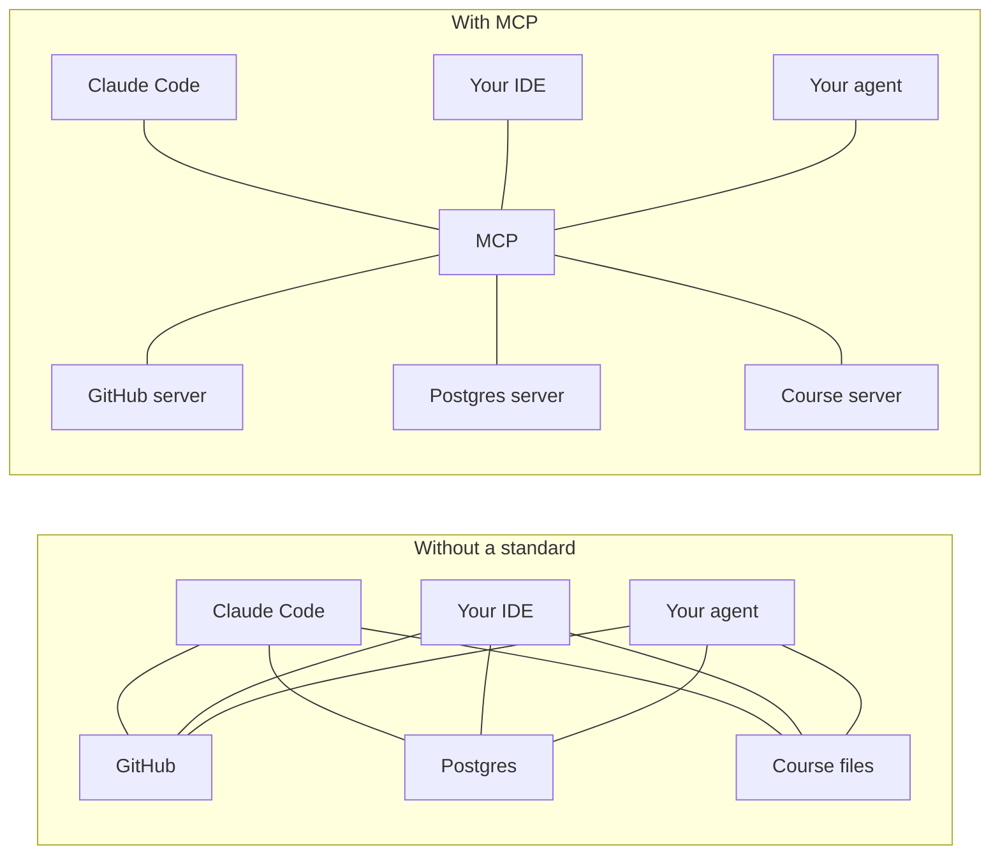

# Why MCP

> Module 9 · Lesson 1 · ~10 min

**Goals**
- Describe the integration problem MCP was created to solve
- Name the three things an MCP server can offer: tools, resources, and prompts
- Decide when MCP is worth it and when a plain function is enough

## The integration mess

Look at the tools you wrote in [Module 8](../08-agents/03-build-an-agent-from-scratch.md). They live inside `agent.py`, in Claude's tool format. Now imagine you want them in three more places: Claude Code while you study, your editor's AI assistant, and a teammate's agent built on another SDK.

Without a standard, each app needs its own adapter for each data source. With *N* AI applications and *M* tools or data sources, you're writing up to *N × M* integrations, each with its own schema format, auth, and quirks.

The **Model Context Protocol** is an open protocol, introduced by Anthropic in late 2024 and now widely adopted, that defines one way for AI applications to discover and use external tools and data. Each data source is wrapped once, as an **MCP server**. Every application that speaks MCP (Claude Code, Claude Desktop, ChatGPT, VS Code, Cursor, many agent SDKs) can use it. *N × M* becomes *N + M*.

The closest analogy is the Language Server Protocol for code editors: before it, every editor needed its own plugin for every language. After it, a language server written once works in any editor.

## What a server can offer

An MCP server exposes up to three kinds of things. The difference is **who decides to use them**.

| Primitive | What it is | Who's in control | Course Buddy example |
|---|---|---|---|
| **Tools** | Functions the model can call | The model decides when to call them | `search_course`, `read_lesson` |
| **Resources** | Read-only data identified by a URI | The application decides what to attach as context | `course://syllabus`, the course home page |
| **Prompts** | Reusable prompt templates with arguments | The user picks them, often as a slash command | `quiz_me(module)` |

Tools get the most use, because they plug straight into the agent loop you already know. Resources and prompts are less widely supported by hosts, but they're handy when you want the user or app, not the model, to choose the context.

## What MCP is not

- **Not a model API.** MCP doesn't say how you call an LLM. Your host still uses the Claude, OpenAI, or Gemini API. MCP only standardizes the tool and data side.
- **Not an agent framework.** It doesn't run a loop or decide anything. The host's agent does that and uses MCP to reach tools.
- **Not a security boundary.** Connecting a server gives the model whatever that server can do. A malicious or sloppy server can return text that tries to hijack the model (prompt injection, [Module 13](../13-safety-and-ethics/02-prompt-injection.md)). Treat installing an MCP server like installing a package: know where it came from.

## When to use it (and when not to)

Use MCP when:

- You want the **same tools in several hosts**, such as your agent and Claude Code.
- You want to **use existing servers** instead of writing integrations. There are official and community servers for GitHub, databases, filesystems, browsers, Sentry, Notion, and many more.
- You're **publishing** a capability for others to plug into their AI apps.

Skip it when you have one agent, a handful of tools, and no plan to share them. A plain function and a tool definition, as in Module 8, is less code and one less process to run. You can always wrap those functions in a server later. That's exactly what you'll do in [lesson 3](03-build-an-mcp-server.md).

**Check yourself:** a user selects "Summarize this PR" from a slash-command menu in their IDE, and the IDE fills in a template from an MCP server. Which primitive is that?

Answer

A **prompt**. It's user-selected and template-shaped. If the model had decided on its own to fetch the PR diff, that would be a tool call.

> [!TIP]
> **Try it.** If you use Claude Code, run `claude mcp list` in a terminal to see which servers you already have. Then browse the [reference servers repository](https://github.com/modelcontextprotocol/servers) and pick two servers you'd find useful. For each, write down: which primitives it exposes (tools, resources, prompts), whether it runs locally or remotely, and what it could do that you wouldn't want an AI to do unsupervised.

Example answer

The **filesystem** server runs locally and exposes tools to read, write, and search files inside the directories you allow. Risk: writes and deletes. Only allow specific folders. The **fetch** server runs locally and exposes a tool that fetches a URL and converts it to Markdown. Risk: fetched pages can contain prompt injection, and the server can reach internal URLs from your network.

## Key takeaways
- MCP is an open protocol that lets any compatible AI app use any compatible tool or data server, turning N × M integrations into N + M.
- Servers offer **tools** (model-controlled), **resources** (application-controlled), and **prompts** (user-controlled).
- MCP standardizes the tool and data side only. It's not a model API, not an agent framework, and not a security boundary.
- Use it to share tools across hosts or reuse existing servers. For one private agent, plain functions are fine.

## Go deeper
- [What is MCP? (official intro)](https://modelcontextprotocol.io/docs/getting-started/intro): the protocol's own overview
- [Introducing the Model Context Protocol (Anthropic)](https://www.anthropic.com/news/model-context-protocol): the original announcement and motivation
- [Reference servers](https://github.com/modelcontextprotocol/servers): official example servers and a directory of others

---
[← Module home](README.md) · [MCP architecture →](02-mcp-architecture.md)
