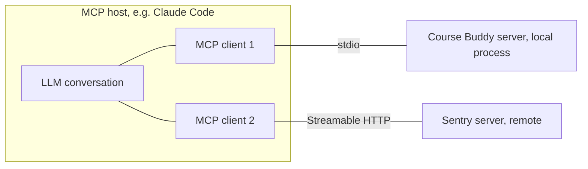
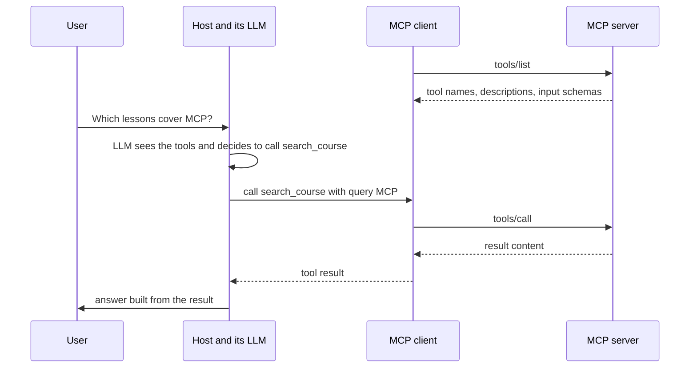

# MCP architecture

> Module 9 · Lesson 2 · ~15 min

**Goals**
- Name the three participants (host, client, server) and how they connect
- Separate MCP's two layers: the data layer and the transport layer
- Pick between the stdio and Streamable HTTP transports
- Read a raw `tools/call` exchange

## Three participants

MCP uses three roles. The names are easy to mix up, so pin them down now:

- **MCP host.** The AI application the user works in: Claude Code, Claude Desktop, an IDE, or your own agent. It owns the LLM conversation and decides when to use what.
- **MCP client.** A connection component **inside** the host. The host creates **one client per server**, and each client keeps a dedicated connection to its server.
- **MCP server.** A program that offers tools, resources, and prompts. "Server" describes the role, not the location: it can be a local process on your laptop or a service on the internet.



So when people say "Claude Code is an MCP client," they mean it's a host that contains clients. You'll write a host with a client in [lesson 4](04-build-an-mcp-client.md).

## Two layers

MCP is split into an inner layer that defines *what* is said and an outer layer that defines *how it travels*.

### The data layer: what is said

The data layer is a [JSON-RPC 2.0](https://www.jsonrpc.org/specification) protocol. Every message is a JSON object: a **request** (has an `id` and expects a response), a **response** (same `id`), or a **notification** (no `id`, no reply). It defines:

- **Server primitives:** tools, resources, and prompts, each with methods to discover and use them: `tools/list` and `tools/call`, `resources/list` and `resources/read`, `prompts/list` and `prompts/get`.
- **Client primitives:** things a server can ask of the host. The main one is **elicitation**, which asks the user for input or confirmation mid-task. (Older revisions also had *sampling*, where a server borrows the host's LLM, and *logging*. Both are deprecated in the current spec.)
- **Discovery and versioning:** which protocol version each side speaks and what each side supports.
- **Utilities:** progress updates, cancellation, and change notifications (for example, "my tool list changed").

> [!NOTE]
> The protocol changes over time, and each revision is named by date. In revisions up to 2025, a connection started with an `initialize` handshake that set up a session. The current revision (`2026-07-28`) is **stateless**: every request carries the protocol version and client capabilities in a `_meta` field, and a client can optionally call `server/discover` to learn the server's versions and capabilities. SDKs hide this from you, but it explains why older tutorials show an `initialize` step.

### The transport layer: how it travels

The same JSON-RPC messages can ride on different transports. The spec defines two:

| | stdio | Streamable HTTP |
|---|---|---|
| How it works | The client **launches the server as a subprocess** and exchanges newline-delimited JSON over stdin and stdout | Each client message is an **HTTP POST** to one endpoint (often `/mcp`). The server replies with JSON or streams via Server-Sent Events |
| Where the server runs | Same machine | Anywhere reachable over HTTP |
| Clients per server | Usually one | Many |
| Auth | Inherits your local user. Secrets come from env vars | Standard HTTP auth: bearer tokens, API keys, and OAuth (recommended by the spec) |
| Typical use | Local files, local databases, dev tools | SaaS integrations, shared team servers |

> [!WARNING]
> With stdio, **stdout belongs to the protocol**. A stray `print()` in your server writes non-JSON onto the channel and corrupts the connection. Log to stderr instead (`print(..., file=sys.stderr)` or the `logging` module).

You may also see an older "HTTP + SSE" transport in tutorials and SDKs. Streamable HTTP replaced it, so use Streamable HTTP for new remote servers.

## A tool call, end to end

Here's what happens when Claude Code uses a Course Buddy tool. The host's LLM decides, the MCP client carries the request, and the server does the work.



On the wire, the `tools/call` request and its response look like this (the `_meta` contents are trimmed):

```json
{"jsonrpc": "2.0", "id": 3, "method": "tools/call",
 "params": {"name": "search_course",
            "arguments": {"query": "MCP"},
            "_meta": {"io.modelcontextprotocol/protocolVersion": "2026-07-28"}}}
```

```json
{"jsonrpc": "2.0", "id": 3,
 "result": {"content": [{"type": "text",
                          "text": "09-mcp/01-why-mcp.md: # Why MCP ..."}],
            "isError": false}}
```

Compare this with the Claude tool flow from [Module 8](../08-agents/02-tools-and-the-react-loop.md#one-round-trip). The shapes are close: a name plus JSON arguments go out, and content blocks plus an error flag come back. MCP standardizes the leg between the host and the tool. The leg between the host and the LLM still uses the model provider's API.

**Check yourself:** Claude Desktop is connected to three MCP servers. How many MCP clients are running, and where?

<details><summary>Answer</summary>

Three, all inside Claude Desktop (the host), one per server. Each keeps its own connection.

</details>

> [!TIP]
> **Try it.** Watch the real protocol. With `uv` installed, start the MCP Inspector against a reference server:
> ```bash
> npx @modelcontextprotocol/inspector uvx mcp-server-fetch
> ```
> In the Inspector UI, connect, open the **Tools** tab, list the tools, and call `fetch` on `https://modelcontextprotocol.io`. Find the raw JSON-RPC request and response in the history panel. Which transport is the Inspector using here, and how can you tell?

<details><summary>Answer</summary>

stdio. The Inspector launched `uvx mcp-server-fetch` as a subprocess on your machine. There's no URL involved, and the transport selector shows STDIO with that command. A remote server would instead be configured with a URL and the Streamable HTTP transport.

</details>

## Key takeaways
- **Host** = the AI app. **Client** = one connection inside the host, one per server. **Server** = the program offering capabilities, local or remote.
- The **data layer** is JSON-RPC 2.0: tools, resources, prompts, elicitation, discovery, and notifications.
- The **transport layer** carries those messages: **stdio** for local subprocesses, **Streamable HTTP** for remote servers.
- In stdio servers, never print to stdout. Log to stderr.
- The current spec revision is stateless, with per-request metadata. Older revisions used an `initialize` handshake.

## Go deeper
- [Architecture overview (MCP docs)](https://modelcontextprotocol.io/docs/learn/architecture): participants, layers, and a full annotated message exchange
- [Server concepts (MCP docs)](https://modelcontextprotocol.io/docs/learn/server-concepts): tools, resources, and prompts in more depth
- [Transports (MCP specification)](https://modelcontextprotocol.io/specification/latest/basic/transports): the exact stdio and Streamable HTTP rules
- [MCP Inspector](https://github.com/modelcontextprotocol/inspector): the visual debugging tool used above

---
[← Why MCP](01-why-mcp.md) · [Module home](README.md) · [Build an MCP server →](03-build-an-mcp-server.md)
