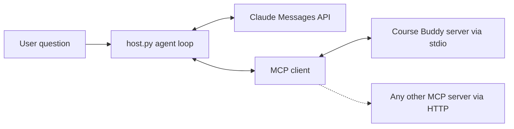

# Build an MCP client

> Module 9 · Lesson 4 · ~20 min

**Goals**
- Connect to a local MCP server over stdio and to a remote one over Streamable HTTP
- List and call tools, read resources, and get prompts from Python
- Wire MCP tools into your own Claude agent loop, making your app an MCP host

## Why write a client?

Claude Code and Claude Desktop are ready-made hosts. You write your own client when **your application** should use MCP servers: your Course Buddy CLI, a support bot that should use your company's existing MCP servers, or an automated test that checks your server in CI. The same `mcp` package you used for the server includes a client.

## Connect to a local server (stdio)

For a local server, the client **launches it as a subprocess** and talks over stdin and stdout. You describe how to start it with `StdioServerParameters`:

```python
import asyncio

from mcp import Client, StdioServerParameters

server = StdioServerParameters(
    command="uv",
    args=["run", "server.py"],                       # the server from lesson 3
    env={"COURSE_DIR": "/path/to/zth-ai-engineer"},  # extra env for the server
)


async def main() -> None:
    async with Client(server) as client:  # starts the process and connects
        tools = await client.list_tools()
        print([t.name for t in tools.tools])

        result = await client.call_tool("search_course", {"query": "transport layer"})
        print(result.is_error, result.content[0].text)

        syllabus = await client.read_resource("course://syllabus")
        print(syllabus.contents[0].text[:200])

        prompt = await client.get_prompt("quiz_me", {"module": "09-mcp"})
        print(prompt.messages[0].content.text)


asyncio.run(main())
```

Leaving the `async with` block shuts the server process down. Each tool result has `content` (a list of content blocks meant for the model, usually text), `is_error`, and, when the tool returns structured data, `structured_content`.

> [!NOTE]
> Older examples use `stdio_client(...)` together with `ClientSession(...)` and an explicit `await session.initialize()`. That's the v1 SDK style. In v2, `Client` wraps all of it, and connecting handles protocol negotiation for you.

## Connect to a remote server (Streamable HTTP)

For a remote server, pass a URL. `Client` treats a URL as Streamable HTTP:

```python
async with Client("http://127.0.0.1:8000/mcp") as client:
    result = await client.call_tool("list_modules", {})
```

Most real remote servers require authentication. To send a bearer token or API key, give the transport an HTTP client with default headers:

```python
import os

import httpx2  # the HTTP library the mcp SDK v2 uses (installed with it)
from mcp import Client
from mcp.client.streamable_http import streamable_http_client

headers = {"Authorization": f"Bearer {os.environ['COURSE_MCP_TOKEN']}"}

async with httpx2.AsyncClient(headers=headers) as http:
    transport = streamable_http_client("https://mcp.example.com/mcp", http_client=http)
    async with Client(transport) as client:
        print([t.name for t in (await client.list_tools()).tools])
```

Many public servers use OAuth instead of static tokens. The SDK has an OAuth client flow for that, which is beyond this lesson. See the SDK docs under Go deeper.

**Check yourself:** what's the practical difference between the two connection styles, from your app's point of view?

<details><summary>Answer</summary>

With stdio, your app **owns the server process**: it starts it, passes env vars, and kills it when done. The server runs as you, on your machine. With HTTP, the server is **already running somewhere else**. You just need its URL and credentials, and many clients can share it.

</details>

## Make Course Buddy an MCP host

Now combine this with the agent loop from [Module 8](../08-agents/03-build-an-agent-from-scratch.md). Instead of hard-coding tool definitions and handlers, the agent **discovers** tools from the MCP server and **routes** each `tool_use` to `call_tool`. MCP's tool format maps almost one-to-one onto Claude's:

```python
# host.py
import asyncio
import sys

import anthropic
from mcp import Client, StdioServerParameters

claude = anthropic.AsyncAnthropic()
MODEL = "claude-sonnet-5-5"
MAX_ITERATIONS = 10
SERVER = StdioServerParameters(
    command="uv", args=["run", "server.py"], env={"COURSE_DIR": "/path/to/zth-ai-engineer"}
)


def to_claude_tool(tool) -> dict:
    """MCP tool definition -> Claude tool definition."""
    return {"name": tool.name, "description": tool.description or "", "input_schema": tool.input_schema}


async def ask(question: str) -> str:
    async with Client(SERVER) as mcp:
        tools = [to_claude_tool(t) for t in (await mcp.list_tools()).tools]
        messages = [{"role": "user", "content": question}]

        for _ in range(MAX_ITERATIONS):
            response = await claude.messages.create(
                model=MODEL, max_tokens=16000, tools=tools, messages=messages
            )
            messages.append({"role": "assistant", "content": response.content})
            if response.stop_reason == "end_turn":
                return "".join(b.text for b in response.content if b.type == "text")
            if response.stop_reason != "tool_use":
                raise RuntimeError(f"Stopped early: {response.stop_reason}")

            results = []
            for block in response.content:
                if block.type == "tool_use":
                    result = await mcp.call_tool(block.name, block.input)  # MCP does the work
                    text = "\n".join(c.text for c in result.content if c.type == "text")
                    results.append({
                        "type": "tool_result",
                        "tool_use_id": block.id,
                        "content": text,
                        "is_error": result.is_error,
                    })
            messages.append({"role": "user", "content": results})

    raise RuntimeError(f"No answer after {MAX_ITERATIONS} iterations")


if __name__ == "__main__":
    print(asyncio.run(ask(" ".join(sys.argv[1:]) or "Which modules cover agents and MCP?")))
```

Run it with `uv run --env-file .env host.py "What is the transport layer in MCP?"`.

Compare it with lesson 3 of Module 8: the loop is identical. Only the tool source changed. That's the payoff. Point `SERVER` at the GitHub MCP server or a database server and the same 50 lines become a GitHub or database agent.



With several servers, open one `Client` per server, merge their tool lists, and keep a `tool name -> client` map for routing. Prefix tool names with the server name if two servers might both have a `search` tool.

> [!NOTE]
> Two shortcuts exist. For remote servers, the Claude API has an **MCP connector**: you pass the server URL in the request, and Anthropic's side calls the tools for you (beta, Streamable HTTP servers only). And the `anthropic` SDK has helpers that convert MCP tools for its tool runner. Writing the bridge yourself first means you'll understand what those shortcuts do.

> [!WARNING]
> Tool output from an MCP server goes straight into your model's context. A third-party server, or the data behind it, can include text like "ignore your instructions and...". Only connect servers you trust, keep write tools behind confirmation, and see [Module 13](../13-safety-and-ethics/02-prompt-injection.md) for defenses.

> [!TIP]
> **Try it.** Run your lesson 3 server in HTTP mode (`mcp.run(transport="streamable-http", port=8000)`) in one terminal. In `host.py`, replace `SERVER` with the URL `"http://127.0.0.1:8000/mcp"` and ask a question. Nothing else should need to change. Then stop the server and run `host.py` again. What error do you get, and where would you catch it to give the user a friendly message?

<details><summary>What you should see</summary>

With the server running, the answer is the same as over stdio. Only the transport changed. With the server stopped, entering `Client(...)` fails with a connection error (an `httpx2` connect error wrapped in an exception group), before any model call. Catch it around the `async with Client(...)` in `ask()` and report "Course Buddy's tool server isn't reachable" instead of a traceback.

</details>

## Key takeaways
- `Client(StdioServerParameters(...))` launches and connects to a local server. `Client("https://.../mcp")` connects to a remote one over Streamable HTTP.
- Add auth headers by passing an HTTP client to `streamable_http_client`. Many public servers use OAuth.
- `list_tools`, `call_tool`, `read_resource`, and `get_prompt` map directly onto the server primitives.
- Bridging MCP into Claude is a small mapping: MCP tool definitions become Claude tools, and each `tool_use` becomes a `call_tool`. The agent loop doesn't change.
- Tool output is untrusted input to your model. Connect servers you trust.

## Go deeper
- [MCP Python SDK: clients](https://py.sdk.modelcontextprotocol.io/client/): transports, results, OAuth, and more client features
- [Build an MCP client (MCP docs)](https://modelcontextprotocol.io/docs/develop/build-client): the official walkthrough of an LLM-powered client
- [MCP connector (Claude docs)](https://platform.claude.com/docs/en/agents-and-tools/mcp-connector): let the Claude API call remote MCP servers for you
- [Code execution with MCP (Anthropic)](https://www.anthropic.com/engineering/code-execution-with-mcp): how agents can use many MCP tools without flooding their context

---
[← Build an MCP server](03-build-an-mcp-server.md) · [Module home](README.md) · [Module review →](review.md)
