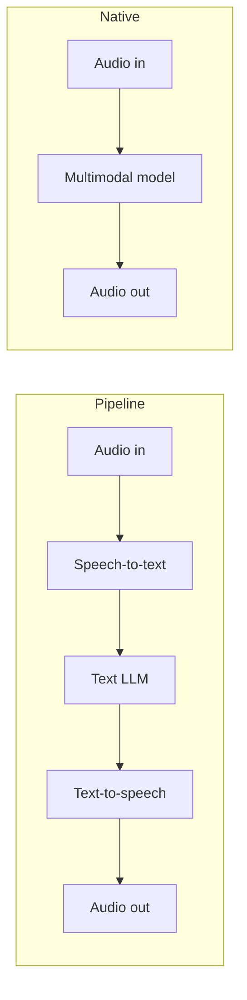

# Beyond text

> Module 10 · Lesson 1 · ~10 min

**Goals**
- Name the main multimodal task types and what goes in and comes out of each
- Spot multimodal opportunities in a product idea
- Choose between one native multimodal model and a pipeline of specialist models

## What "multimodal" means

A *modality* is a kind of data: text, images, audio, video. A multimodal system takes in or produces more than one of them. You've already been using one half of this. Modern frontier LLMs (Claude, GPT, Gemini) are *vision-language models*: they read images alongside text, even if you've only sent them text so far.

Under the hood the trick is the same one you met in [Module 1](../01-how-llms-work/01-text-to-tokens.md). Everything becomes tokens. An image is cut into small patches, and each patch is turned into a vector that sits in the same sequence as your text tokens. Audio gets a similar treatment with short slices of sound. The model then attends over all of it at once.

That has a practical consequence you should remember: **images and audio cost tokens.** A 1000×1000 screenshot is roughly 1,300 input tokens on Claude, about the size of a long email. Video is a stream of images (plus audio), so it adds up fast.

## The task types

Sort tasks by what goes in and what comes out:

| Task | In | Out | Typical tool |
|------|----|-----|--------------|
| Image understanding | image + text | text | Claude, GPT, Gemini (vision) |
| Document understanding | PDF / scan + text | text or JSON | Claude PDF support, Gemini |
| Video understanding | video + text | text | Gemini (native video), or frames into any vision model |
| Image generation and editing | text (+ images) | image | OpenAI GPT Image, Gemini image ("Nano Banana") |
| Speech-to-text (STT) | audio | text | OpenAI transcription models, Whisper |
| Text-to-speech (TTS) | text | audio | OpenAI TTS, other voice APIs |
| Audio understanding | audio + text | text | Gemini, OpenAI audio models |
| Classic vision | image | labels, boxes | Hugging Face models (CLIP, detectors) |

Notice the asymmetry. Most chat LLMs *read* many modalities but only *write* text. Claude, for example, understands images and PDFs but doesn't generate images or audio. Generating pixels or sound is usually a separate, specialised model.

## Use cases that actually ship

- **Screenshot support.** A user pastes an error dialog or a broken UI. The model reads it and answers. (This is your Course Buddy milestone.)
- **Document extraction.** Receipts, invoices, forms, ID cards. Image in, validated JSON out with the [structured output](../02-calling-models/04-structured-output.md) you already know.
- **Content moderation and tagging.** Classify uploaded photos, generate alt text, catch policy violations.
- **Meeting and call tools.** Transcribe, summarise, extract action items.
- **Voice interfaces.** Speech in, LLM in the middle, speech out.
- **Creative and marketing assets.** Product shots, thumbnails, variations of a brand image.
- **Video review.** Find the moment something happens, summarise a lecture, check dashcam footage.

> [!TIP]
> **Try it.** Pick an app you use daily (your bank, a food delivery app, your IDE). Write down two features that could use a multimodal model. For each, name the task type from the table above, and what the input and output are.
>
> 

Example answers

>
> Food delivery: "photo of a damaged order → refund claim" is image understanding with JSON output. "Read the menu aloud for accessibility" is TTS.
>
> IDE: "paste a screenshot of a design → generate the component" is image understanding with code output.
>
> 

## Two ways to build: native or pipeline

Say you want a voice assistant. You have two broad options.

**Pipeline**: chain specialist models, with text as the glue between them.
- Every step is inspectable. You can log the transcript, eval it, and run guardrails on it.
- You can swap any piece, for example a cheaper STT or a local LLM.
- Latency adds up across hops, and you lose information. A transcript drops tone, hesitation and who's speaking.

**Native**: one model handles the modalities end to end, such as Gemini reading a video directly or a realtime speech-to-speech model.
- Lower latency, and the model sees everything (tone, visual layout, timing).
- Fewer choices. You're tied to whoever offers that modality, and debugging is harder because there's no text in the middle.

> [!NOTE]
> Most production systems start as pipelines because they're easier to debug and evaluate. Move a piece to a native model when latency or lost information becomes the real problem.

**Check yourself:** a user uploads a 40-page scanned contract and asks "what's the termination clause?" Is that a task for image generation, vision, or STT?

Answer

Vision, specifically document understanding. Send the PDF (or page images) to a vision-capable model. For long documents you might add retrieval from [Module 7](../07-rag/01-why-rag.md) on top.

## Things that change when you leave text

- **Cost and latency grow** with resolution and duration. Downscale images and sample video frames instead of sending everything.
- **Evals get harder.** "Is this image good?" has no exact-match answer. You'll lean on human review and model judges ([Module 11](../11-evals/README.md)).
- **New attack surface.** Text hidden inside an image can carry a prompt injection just like a web page can ([Module 13](../13-safety-and-ethics/02-prompt-injection.md)).
- **Privacy.** Photos and voice recordings are often personal data. Faces, voices and documents need the same care as any PII.

## Key takeaways
- Multimodal models turn images and audio into tokens. That makes them powerful, but it also means every image and every second of audio costs tokens.
- Sort a feature by input and output modality, and the task type and likely tools follow.
- Most chat LLMs read many modalities but only write text. Image and audio generation are usually separate models.
- Pipelines are debuggable and swappable. Native models are faster and lose less information. Start with a pipeline unless you have a reason not to.

## Go deeper
- [Hugging Face Tasks](https://huggingface.co/tasks) — browse every task type, with demos and example models
- [Vision Language Models Explained](https://huggingface.co/blog/vlms) — how VLMs combine an image encoder with an LLM
- [CLIP paper (Radford et al., 2021)](https://arxiv.org/abs/2103.00020) — the image-text model that much of modern multimodal work builds on

---
[← Module home](README.md) · [Vision: images and video →](02-vision.md)
