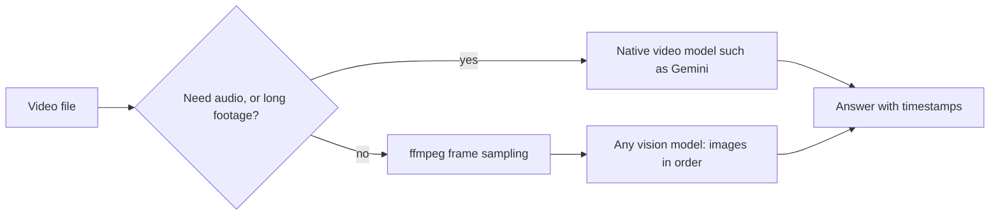

# Vision: images and video

> Module 10 · Lesson 2 · ~15 min

**Goals**
- Send local and remote images to Claude and ask questions about them
- Extract structured data from an image
- Handle video by sampling frames, or by using a model that reads video natively
- Keep image token costs under control

## Images are just another content block

In [Module 2](../02-calling-models/01-your-first-api-call.md), `content` was a string. It can also be a **list of blocks**, and an image is one kind of block. With Claude you give the image a `source`, which is one of three types:

- `base64`: the bytes, inline in the request. Use this for local files.
- `url`: a public image URL that Anthropic fetches for you.
- `file`: a `file_id` from the Files API. Upload once, then reference it many times.

Here's a small helper that works for a local file or a URL:

```python
# uv add anthropic
import base64, mimetypes
from pathlib import Path
import anthropic

client = anthropic.Anthropic()  # reads ANTHROPIC_API_KEY

def image_block(src: str) -> dict:
    if src.startswith(("http://", "https://")):
        return {"type": "image", "source": {"type": "url", "url": src}}
    media_type = mimetypes.guess_type(src)[0]  # image/png, image/jpeg, ...
    data = base64.standard_b64encode(Path(src).read_bytes()).decode()
    return {"type": "image", "source": {"type": "base64", "media_type": media_type, "data": data}}

def ask_about_image(src: str, question: str) -> str:
    msg = client.messages.create(
        model="claude-sonnet-5-5",
        max_tokens=1024,
        messages=[{
            "role": "user",
            "content": [image_block(src), {"type": "text", "text": question}],
        }],
    )
    return msg.content[0].text

print(ask_about_image("error.png", "What went wrong here, and how do I fix it?"))
```

Put the image **before** the question. Like long documents, images work best when they come first. To send several images, label them with text blocks such as `"Image 1:"` and `"Image 2:"` placed before each one, so you can refer to them by name.

Claude accepts JPEG, PNG, GIF (first frame only) and WebP. It also reads PDFs through a `document` block, which is often better than screenshotting pages yourself. OpenAI and Gemini use the same idea under different names. The Responses API has an `input_image` part, and Gemini takes `image` inputs.

> [!TIP]
> **Try it.** Take a screenshot of any Python traceback (cause one with `python -c "1/0"`). Run `ask_about_image` on it. Then ask the same question with the traceback pasted as text. Compare the answers and the `msg.usage.input_tokens` of each call.
>
> <details><summary>What you should see</summary>
>
> Both answers should be correct. The image version usually costs more input tokens than the plain-text version. When the user *has* the text, prefer text. Screenshots earn their keep for layout, diagrams, charts and UI.
>
> </details>

## From pixels to JSON

The most valuable vision work in production is usually extraction. Combine an image block with the structured-output habits from [Module 2](../02-calling-models/04-structured-output.md):

```python
from pydantic import BaseModel

class Receipt(BaseModel):
    merchant: str | None
    date: str | None       # ISO 8601
    total: float | None
    currency: str | None

prompt = (
    "Extract the receipt fields. Reply with only JSON matching this schema:\n"
    f"{Receipt.model_json_schema()}\n"
    "If a field is unreadable, use null rather than guessing."
)
raw = ask_about_image("receipt.jpg", prompt)
receipt = Receipt.model_validate_json(raw)  # fails loudly if the model drifts
```

The line "use null rather than guessing" matters. Vision models hallucinate more on blurry, rotated or tiny images, and on precise counts. Validate the output, and route low-confidence results to a human.

## Video: frames, or a model that watches

Claude's API takes images and PDFs, not video files. Video is a sequence of images, though, so the portable approach is to **sample frames** and send them as an ordered set of images:

```bash
# one frame every 5 seconds, scaled to 768px wide
ffmpeg -i demo.mp4 -vf "fps=1/5,scale=768:-1" frames/%03d.jpg
```

Then send the frames in order, each labelled with its timestamp ("Frame at 0:05:"). Pick the sampling rate to suit the question. A slide-based lecture needs very few frames. Spotting a quick event needs many.

Gemini reads video **natively**: frames *and* the audio track, with timestamps. For long videos you upload through the Files API, then reference the file. This uses the Gemini **Interactions API** that current Google docs use for multimodal work. It's the newer alternative to `generate_content`, which was mentioned in [Lesson 2.1](../02-calling-models/01-your-first-api-call.md):

```python
# uv add google-genai   (reads GEMINI_API_KEY)
import time
from google import genai

client = genai.Client()
video = client.files.upload(file="demo.mp4")
while not video.state or video.state.name != "ACTIVE":   # wait for processing
    time.sleep(5)
    video = client.files.get(name=video.name)

interaction = client.interactions.create(
    model="gemini-3.8-flash",
    input=[
        {"type": "video", "uri": video.uri, "mime_type": video.mime_type},
        {"type": "text", "text": "List the key moments with MM:SS timestamps."},
    ],
)
print(interaction.output_text)
```

You can lower the sampling rate (an `fps` setting on the video input) to cut cost on long, slow footage.



## Controlling cost

Claude splits an image into 28×28-pixel patches, and each patch is one visual token. Large images are downscaled to a per-model maximum, which caps the cost, but you still pay up to that cap. Some rough numbers:

| Image | Approx. tokens |
|-------|----------------|
| 200×200 thumbnail | ~64 |
| 1000×1000 | ~1,300 |
| 1920×1080 screenshot | ~1,600 to 2,700, depending on the model's resolution tier |

Practical rules:
- **Resize before sending** if you don't need fine detail. It's cheaper, faster, and the result is predictable.
- **Crop to the region that matters** rather than sending a whole screen. But don't crop so tight that you lose the context the model needs.
- **Use the Files API or URLs** in multi-turn chats, so you don't resend base64 bytes on every turn.
- Limits apply: per-image size (10 MB base64 on the Claude API), maximum dimensions, and a count per request. Check the docs before batching hundreds.

**Check yourself:** your app sends 4K phone photos of receipts and your bill is high. What's the first fix?

<details><summary>Answer</summary>

Downscale (and maybe crop) the images on the client before you send them. Receipt text is readable at much lower resolution, and you stop paying for pixels the model doesn't need.

</details>

## Key takeaways
- An image is a content block (`base64`, `url`, or `file` source) placed before your text question.
- Extraction plus schema validation is the workhorse vision pattern. Tell the model not to guess, and validate what comes back.
- Video means frame sampling for any vision model, or a native video model such as Gemini when you need audio, timing or long footage.
- Images cost tokens in proportion to resolution. Resize and crop on purpose.

## Go deeper
- [Claude vision guide](https://platform.claude.com/docs/en/build-with-claude/vision) — sources, limits, token math and prompting tips
- [Claude PDF support](https://platform.claude.com/docs/en/build-with-claude/pdf-support) — send whole documents instead of screenshots
- [Gemini video understanding](https://ai.google.dev/gemini-api/docs/video-understanding) — uploads, YouTube URLs, timestamps and frame rate
- [Claude vision cookbook](https://platform.claude.com/cookbook/multimodal-getting-started-with-vision) — charts, forms and transcription recipes

---
[← Beyond text](01-beyond-text.md) · [Module home](README.md) · [Image generation →](03-image-generation.md)
