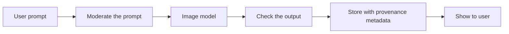

# Image generation

> Module 10 · Lesson 3 · ~12 min

**Goals**
- Generate and edit images with OpenAI's GPT Image models
- Do the same with Gemini's native image models ("Nano Banana")
- Write image prompts that give you control over the result
- Know the cost, safety and provenance issues before you ship

## Who makes pictures

Claude reads images but doesn't generate them. For generation you'll use a dedicated image model. Two families cover most app work today:

- **OpenAI GPT Image** (`gpt-image-*`), available through the Images API (`generate` and `edit`) or as a built-in `image_generation` tool in the Responses API.
- **Gemini native image models**, nicknamed "Nano Banana", available through the Gemini API.

Both are built into multimodal model families rather than being standalone text-to-image tools. In practice they follow long, specific instructions well, render text inside images fairly reliably, and are good at **editing**: you give them an image and an instruction ("make the background white"), and they change only what you asked.

> [!WARNING]
> Image model names change often. At the time of writing, OpenAI's docs list `gpt-image-2.5-flare` (fast) and `gpt-image-2.5-sunburst` (best editing precision), and Google's list `gemini-nano-banana-2.1` alongside Pro and Lite variants. Check the docs linked below before you copy a model ID.

## OpenAI: the Images API

The simplest call takes a prompt and returns base64 image data:

```python
# uv add openai   (reads OPENAI_API_KEY)
import base64
from pathlib import Path
from openai import OpenAI

client = OpenAI()

result = client.images.generate(
    model="gpt-image-2.5-flare",
    prompt=(
        "Flat vector illustration for a course banner: a friendly robot "
        "reading a stack of Markdown files. Teal and off-white palette, "
        "no text, lots of empty space on the right."
    ),
    size="1536x1024",       # also 1024x1024, 1024x1536, or custom sizes
    quality="low",          # cheap drafts first; raise it for the final asset
)
Path("banner.png").write_bytes(base64.b64decode(result.data[0].b64_json))
```

**Editing** uses `images.edit`. You pass one or more input images, and the model uses them as references or as the canvas to change:

```python
result = client.images.edit(
    model="gpt-image-2.5-sunburst",
    image=[open("banner.png", "rb")],
    prompt="Same image, but make the robot wave and add a small coffee mug.",
)
```

Useful extras include `background="transparent"` (with PNG or WebP output) for logos and stickers, and `output_format="jpeg"` when you care about speed more than lossless quality.

If you're already in a conversation with the Responses API, add `tools=[{"type": "image_generation"}]`. The model decides when to draw, and you can refine across turns ("make it darker").

## Gemini: Nano Banana

Gemini's image models go through the same Interactions API you saw for video. Text goes in, and the image comes back as base64 data:

```python
# uv add google-genai   (reads GEMINI_API_KEY)
import base64
from google import genai

client = genai.Client()

interaction = client.interactions.create(
    model="gemini-nano-banana-2.1",
    input="A cozy desk at night with a laptop showing a terminal, watercolor style",
)
with open("desk.png", "wb") as f:
    f.write(base64.b64decode(interaction.output_image.data))
```

To edit with Gemini, pass the source image as an `image` input next to your text instruction, just as you passed video in the previous lesson. Gemini's image models are popular for multi-turn editing, for keeping a character consistent across several images, and for combining several reference photos into one scene.

> [!TIP]
> **Try it.** Generate one image with an under-specified prompt ("a logo for Course Buddy"), then with a specified one (subject, style, palette, composition, what to avoid). Then make a single edit to the better one ("swap the color palette to purple"). Note how much of the original survived the edit.
>
> <details><summary>A prompt structure that works</summary>
>
> `[subject] + [style/medium] + [composition/framing] + [lighting/palette] + [text, if any, in quotes] + [what to leave out]`
>
> For example: "A minimalist logo of an open book with a speech bubble, flat vector, centered on a white background, navy and coral, the words 'Course Buddy' in a rounded sans-serif below, no gradients."
>
> </details>

## Prompting image models

Image models reward specificity in a different way from chat models:

- **Describe the picture, not the goal.** "A product shot of a blue ceramic mug on oak, soft window light from the left" works better than "an image that will sell mugs".
- **Quote any text you want rendered**, and keep it short. Long passages still come out garbled at times.
- **Iterate with edits** instead of rerolling from scratch. Once composition is right, change one thing per edit.
- **Generate drafts at low quality**, then regenerate the winner at high quality.

## Before you ship it



- **Cost and latency.** Image generation is slow (seconds to tens of seconds) and priced per image or per output token, rising with size and quality. Cache results, and don't generate on every keystroke.
- **Safety.** Providers filter prompts and outputs, and OpenAI exposes a `moderation` setting. Add your own checks for your domain, such as brand rules and no real people ([Module 13](../13-safety-and-ethics/03-guardrails.md)). Handle refusals gracefully.
- **Provenance.** Both providers attach provenance signals to generated images: C2PA "Content Credentials" metadata and/or invisible SynthID watermarks. Don't strip them, and label AI imagery in your UI.
- **Rights.** Avoid prompts that imitate living artists, trademarks or real people, and check your provider's terms for commercial use.

**Check yourself:** your marketing team wants 200 product images, all with the same mascot. Fresh generation for each one, or editing from a reference?

<details><summary>Answer</summary>

Use a reference image of the mascot and edit or compose from it. Both GPT Image and Gemini accept reference images, and that gives far more consistent results than hoping 200 independent prompts produce the same character.

</details>

## Key takeaways
- Chat LLMs like Claude read images. Generating them takes a dedicated model such as GPT Image or Gemini's Nano Banana family.
- Both families return base64 image data and support editing from reference images, which is the key to consistency.
- Specific, visual prompts beat vague goals. Draft cheap, edit one thing at a time, then render the final at high quality.
- Plan for latency, cost, moderation and provenance before you put generation in front of users.

## Go deeper
- [OpenAI image generation guide](https://developers.openai.com/api/docs/guides/image-generation) — current models, sizes, quality, editing and the Responses tool
- [Gemini image generation](https://ai.google.dev/gemini-api/docs/image-generation) — Nano Banana models, editing and multi-image composition
- [Gemini Interactions API](https://ai.google.dev/gemini-api/docs/interactions) — the request shape used in the Gemini examples here

---
[← Vision: images and video](02-vision.md) · [Module home](README.md) · [Audio: speech in, speech out →](04-audio.md)
