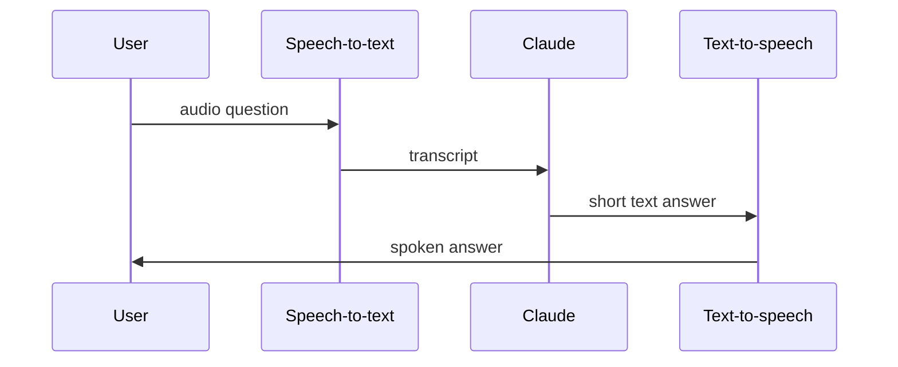

# Audio: speech in, speech out

> Module 10 · Lesson 4 · ~15 min

**Goals**
- Transcribe audio with a hosted API and with open Whisper running locally
- Generate natural speech from text and control its delivery
- Prepare audio properly: formats, size limits, chunking, timestamps and speakers
- Wire STT, an LLM and TTS into a simple voice loop

## The three audio jobs

- **Speech-to-text (STT)**, also called ASR (automatic speech recognition): audio in, transcript out. This is the workhorse.
- **Text-to-speech (TTS)**: text in, audio out. It's how your app talks back.
- **Audio understanding**: audio plus a question in, an answer out ("Is the caller angry?", "What song is this?"). Some models, such as Gemini, take audio directly as input. Otherwise you transcribe first and lose tone and non-speech sounds along the way.

Claude's API doesn't take audio input directly, so with Claude you use the pipeline pattern from [lesson 1](01-beyond-text.md): transcribe, then send text.

## Speech-to-text with OpenAI

OpenAI's transcription endpoint has several models. At the time of writing, `gpt-transcribe` is the recommended general model. `whisper-1` (the original Whisper) remains the choice for word and segment timestamps and for translating into English, and `gpt-4o-transcribe-diarize` labels who is speaking.

```python
# uv add openai   (reads OPENAI_API_KEY)
from openai import OpenAI

client = OpenAI()

with open("question.m4a", "rb") as f:
    transcript = client.audio.transcriptions.create(
        model="gpt-transcribe",
        file=f,
        prompt="A question about an AI engineering course: RAG, MCP, Chroma, embeddings.",
    )
print(transcript.text)
```

The `prompt` is a cheap accuracy win. Give it the domain and any unusual words (product names, acronyms, people's names) so "MCP" doesn't come back as "MSP".

Need timestamps for captions or for jumping to a moment in a video? Use Whisper's verbose output:

```python
with open("lecture.mp3", "rb") as f:
    result = client.audio.transcriptions.create(
        model="whisper-1",
        file=f,
        response_format="verbose_json",
        timestamp_granularities=["segment"],
    )
for seg in result.segments:
    print(f"{seg.start:7.1f}s  {seg.text}")
```

## Whisper on your own machine

Whisper is also an open-weight model. You can run it locally for free through Hugging Face, which is good for privacy and for bulk jobs:

```python
# uv add transformers torch
from transformers import pipeline

asr = pipeline("automatic-speech-recognition", model="openai/whisper-large-v3-turbo")
print(asr("question.wav", return_timestamps=True)["text"])
```

The first run downloads the weights. On a laptop CPU it's slower than real time for long files, so use a GPU or a smaller checkpoint (`openai/whisper-small`) if speed matters.

## Preparing audio

Most audio bugs are input bugs, not model bugs:

- **Formats.** The OpenAI endpoint accepts mp3, mp4, mpeg, mpga, m4a, wav and webm. Convert anything else with ffmpeg.
- **Size.** Uploads are capped at 25 MB. Compress (`ffmpeg -i in.wav -ac 1 -b:a 64k out.mp3`, mono speech at 64 kbps is plenty), or split long recordings into chunks. Split on silences rather than mid-sentence, so you don't cut words in half.
- **Noise and levels.** Background noise, music and quiet speakers hurt accuracy. Light denoising and normalisation help more than switching models.
- **Speakers.** For meetings, use a diarization model or a speaker-labelling step. A wall of unattributed text is much less useful.

> [!TIP]
> **Try it.** Record yourself asking a question that includes two course terms ("How does MCP differ from function calling?"). Transcribe it once without `prompt` and once with a `prompt` listing the terms. Did any term come back wrong in the first run?
>
> <details><summary>No microphone handy?</summary>
>
> Generate the audio with the TTS snippet below first, then transcribe that file. It's also a neat round-trip test: text → speech → text should return roughly what you started with.
>
> </details>

## Text-to-speech

`gpt-4o-mini-tts` takes text plus a voice, and also takes free-form **instructions** about delivery (tone, pace, accent, emotion). Stream it straight to a file:

```python
from openai import OpenAI

client = OpenAI()

with client.audio.speech.with_streaming_response.create(
    model="gpt-4o-mini-tts",
    voice="marin",
    input="RAG means the model looks things up before it answers.",
    instructions="Friendly tutor. Calm, clear, slightly slow.",
) as response:
    response.stream_to_file("answer.mp3")
```

For a live voice app, stream the audio to the speaker as it arrives rather than waiting for the whole file. The first chunk of audio is what users perceive as latency.

> [!IMPORTANT]
> Tell users when a voice is AI-generated, and never clone or imitate a real person's voice without their consent. Provider policies require this, and so does basic trust.

## A simple voice loop

Put the pieces together and you have a voice assistant built as a pipeline:



Two tips make this feel good:

1. **Ask the LLM for speakable answers.** Short sentences, no Markdown, no code blocks, no URLs read aloud. Put that in the system prompt for voice mode.
2. **Watch the latency budget.** STT, then LLM, then TTS, each adding time. Stream every stage you can, and start TTS on the first sentence of the LLM's answer. If that's still too slow, look at realtime speech-to-speech APIs, which collapse the pipeline into one model at the cost of control.

**Check yourself:** you transcribe a customer call and ask an LLM "was the customer frustrated?" It says no, but the customer was shouting. What happened?

<details><summary>Answer</summary>

The transcript threw away the tone. Text has no volume. Use a model that takes the audio itself (audio understanding) for questions about how something was said, not just what was said.

</details>

## Key takeaways
- STT, TTS and audio understanding are different jobs. With Claude, audio goes through a transcription step first.
- `prompt` hints and clean input audio improve transcripts more than swapping models does.
- Open Whisper runs locally through a Hugging Face pipeline when privacy or volume matters.
- Voice UX is a latency game. Stream each stage and ask the LLM for short, speakable text.

## Go deeper
- [OpenAI speech-to-text guide](https://developers.openai.com/api/docs/guides/speech-to-text) — models, prompting, timestamps, diarization and chunking
- [OpenAI text-to-speech guide](https://developers.openai.com/api/docs/guides/text-to-speech) — voices, instructions and streaming
- [Whisper paper (Radford et al., 2022)](https://arxiv.org/abs/2212.04356) — how large-scale weak supervision produced a robust ASR model
- [Hugging Face ASR task guide](https://huggingface.co/docs/transformers/main/en/tasks/asr) — running and fine-tuning speech recognition models
- [Gemini audio understanding](https://ai.google.dev/gemini-api/docs/audio) — sending audio straight to a multimodal model

---
[← Image generation](03-image-generation.md) · [Module home](README.md) · [Multimodal pipelines and frameworks →](05-multimodal-pipelines.md)
