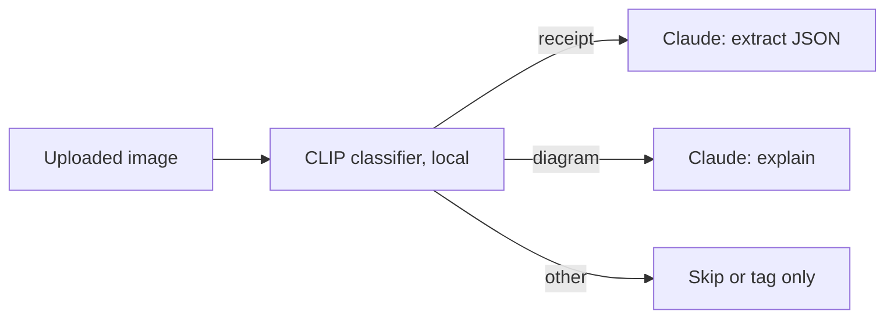
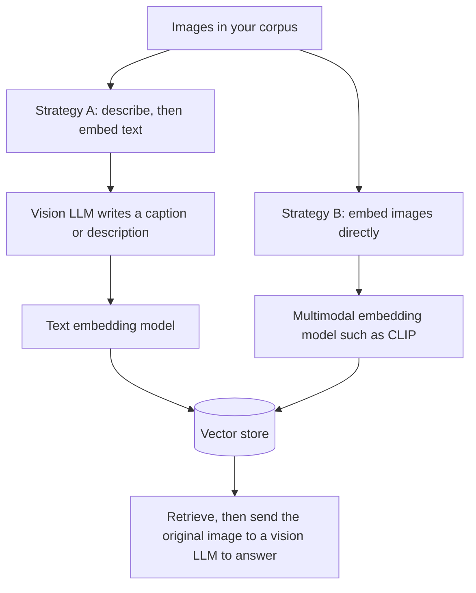

# Multimodal pipelines and frameworks

> Module 10 · Lesson 5 · ~15 min

**Goals**
- Use Hugging Face pipelines for local, task-specific multimodal models
- Send images through LangChain and LlamaIndex with their provider-neutral message formats
- Design a multimodal RAG system and pick between two indexing strategies
- Decide when a framework helps and when raw SDK calls are simpler

## Specialists still matter

Frontier LLMs can answer almost any question about an image, but they're a sledgehammer. They're slow-ish, priced per token, and they need the network. Many multimodal jobs are narrow and high-volume, like tagging a million product photos, transcribing a call center's backlog, or flagging which uploads contain a receipt. Small open models are cheaper and faster for those jobs, and they can run on your own hardware.

[Hugging Face](../03-choosing-models/03-hugging-face.md) `pipeline()` gives you a one-line entry point to them:

```python
# uv add transformers torch pillow
from transformers import pipeline

# 1. Zero-shot image classification with CLIP: labels you choose at runtime
clf = pipeline("zero-shot-image-classification", model="openai/clip-vit-base-patch32")
print(clf("upload.jpg", candidate_labels=["receipt", "screenshot", "photo of a person", "diagram"]))

# 2. A small vision-language model, chat-style
vlm = pipeline("image-text-to-text", model="HuggingFaceTB/SmolVLM-256M-Instruct")
messages = [{"role": "user", "content": [
    {"type": "image", "image": "diagram.png"},
    {"type": "text", "text": "Describe this diagram in one sentence."},
]}]
print(vlm(text=messages, max_new_tokens=60, return_full_text=False)[0]["generated_text"])

# 3. Speech recognition (as in the previous lesson)
asr = pipeline("automatic-speech-recognition", model="openai/whisper-small")
```

Other task names worth knowing are `object-detection`, `image-classification`, `image-to-text` and `text-to-speech`. A common pattern is a **cascade**: a cheap local model handles the easy 90% (or routes the input), and only hard or ambiguous inputs go to a frontier model.



## LangChain: standard content blocks

If your app already uses LangChain ([Module 7](../07-rag/05-rag-frameworks.md)), images go in the same `HumanMessage` you use for text. LangChain's **standard content blocks** use the same keys for every provider, so switching from Claude to GPT or Gemini doesn't change your message code:

```python
# uv add langchain langchain-anthropic
import base64
from pathlib import Path
from langchain.chat_models import init_chat_model
from langchain.messages import HumanMessage

model = init_chat_model("claude-sonnet-5-5", model_provider="anthropic")

img = base64.b64encode(Path("diagram.png").read_bytes()).decode()
msg = HumanMessage(content=[
    {"type": "image", "base64": img, "mime_type": "image/png"},
    {"type": "text", "text": "Explain this diagram to a beginner."},
])
print(model.invoke([msg]).text)
```

Use `{"type": "image", "url": "https://..."}` for remote images. The same message works inside chains and agents, so a tool can return a screenshot and the agent can look at it.

## LlamaIndex: blocks on a ChatMessage

LlamaIndex models a message as a list of typed **blocks**:

```python
# uv add llama-index-llms-anthropic
from llama_index.core.llms import ChatMessage, ImageBlock, TextBlock
from llama_index.llms.anthropic import Anthropic

llm = Anthropic(model="claude-sonnet-5-5")
resp = llm.chat([ChatMessage(role="user", blocks=[
    ImageBlock(path="diagram.png"),
    TextBlock(text="Explain this diagram to a beginner."),
])])
print(resp)
```

LlamaIndex's bigger multimodal strength is on the **indexing** side. It has readers for PDFs with images and multimodal vector indexes that store text and image embeddings side by side.

## Multimodal RAG

Your course has diagrams, and a company wiki has screenshots, charts and slide decks. Plain-text RAG ignores all of that. You have two main ways to make images retrievable:



- **Describe, then embed.** Ask a vision model to write a detailed description of each image, then index the description like any other chunk. It's simple and works with your existing [text pipeline](../07-rag/02-the-rag-pipeline.md). Retrieval quality depends on the descriptions, and you pay a one-time vision cost per image.
- **Embed images directly.** Use a model that puts images and text in the same vector space (CLIP-style), so a text query can match an image. There's no captioning cost, but general-purpose image embeddings can miss domain detail such as the exact numbers in a chart.

Either way, keep a pointer from each chunk to the **original image**, and send that image to the vision LLM at answer time. Descriptions are for finding. The image itself is for answering.

> [!TIP]
> **Try it.** Pick three images: a diagram, a screenshot and a photo. Run the CLIP classifier above with labels you invent. Then ask Claude, through LangChain or the raw SDK, for a two-sentence description of each one. Which description would you rather search over? Which labels did CLIP get wrong?
>
> <details><summary>What usually happens</summary>
>
> CLIP is fast and decent at coarse categories, but it struggles with labels that need reading ("error message" vs "code"). The LLM's descriptions are richer and include the text in the image, which is what makes strategy A strong for screenshots and diagrams.
>
> </details>

## Framework or raw SDK?

| Situation | Reach for |
|-----------|-----------|
| One provider, a few vision calls | Raw SDK (lesson 2). Fewest moving parts |
| Swapping providers, or already on LangChain/LlamaIndex | Framework content blocks |
| Indexing PDFs and images for retrieval | LlamaIndex readers and indexes, or your own describe-and-embed step |
| High-volume narrow task, privacy, offline | Hugging Face pipelines, local |

Frameworks move fast and add a layer between you and the provider. When a multimodal feature is new or experimental, it often shows up in the provider SDK first.

## Key takeaways
- Hugging Face pipelines give you cheap, local specialists (CLIP, small VLMs, Whisper). Cascade them in front of frontier models.
- LangChain's standard content blocks and LlamaIndex's `ImageBlock` let you send images without provider-specific code.
- Multimodal RAG means either describing images and embedding the text, or embedding images directly. Answer from the original image either way.
- Use a framework when it removes real work. Otherwise the raw SDK is clearer.

## Go deeper
- [Transformers image-text-to-text guide](https://huggingface.co/docs/transformers/main/en/tasks/image_text_to_text) — running VLMs locally, with pipelines or full control
- [LangChain messages and content blocks](https://docs.langchain.com/oss/python/langchain/messages) — the standard multimodal message format
- [LlamaIndex multi-modal guide](https://developers.llamaindex.ai/python/framework/module_guides/models/multi_modal/) — multimodal LLMs, indexes and RAG
- [CLIP ViT-B/32 for Sentence Transformers](https://huggingface.co/sentence-transformers/clip-ViT-B-32) — a ready-made model for embedding images and text in one space

---
[← Audio: speech in, speech out](04-audio.md) · [Module home](README.md) · [Module review →](review.md)
