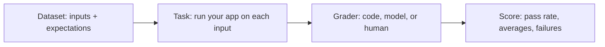
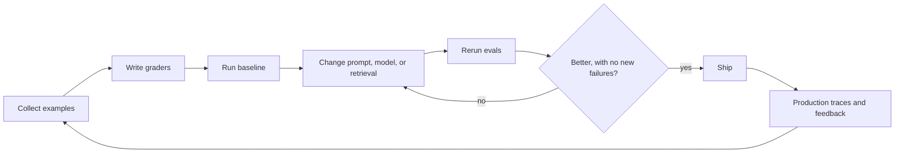

# Why evals

> Module 11 · Lesson 1 · ~10 min

**Goals**
- Explain why manual spot checks stop working once an LLM feature grows
- Describe the parts of an eval: dataset, task, grader, score
- Build the first version of a golden dataset for Course Buddy
- Sketch the eval-driven development loop

## The vibe check problem

You change a prompt, ask your app three questions, and the answers look good. Ship it? You have no idea what happened to the other 300 kinds of question your users ask. Maybe the new prompt fixed citations and broke refusals. Maybe a new model is better at summaries and worse at following your output format.

LLM features fail in ways normal code doesn't:

- **They're non-deterministic.** The same input can produce different outputs on different runs.
- **They fail softly.** A wrong answer looks just as fluent as a right one. Nothing throws.
- **Small changes have wide effects.** One sentence in a system prompt touches every response.
- **Things change under you.** Your retrieved documents change, and you'll eventually move to a newer model.

An **eval** is a repeatable measurement of how well your system does a task. It's the LLM version of a test suite, with one difference: you usually care about a pass *rate* across many examples, not a single green tick.

## The four parts of an eval



1. **Dataset.** Inputs, plus whatever you know about a good output: a reference answer, required facts, the source file it should cite.
2. **Task.** The thing under test. This should be your real pipeline (prompt, retrieval, tools), not a simplified copy.
3. **Grader.** Something that decides whether an output is good. Three kinds, from cheapest to most expensive: code ([lesson 2](02-deterministic-evals.md)), a model, and a human ([lesson 3](03-model-and-human-evals.md)).
4. **Score.** An aggregate you can compare across runs, plus the list of failures you actually read.

> [!IMPORTANT]
> The list of failures matters more than the score. A number tells you *that* something got worse. Reading the failing outputs tells you *why*.

## Your first golden dataset

A **golden dataset** is a set of inputs with known-good expectations that you keep under version control. Start small. Twenty well-chosen examples beat 2,000 random ones, because you'll actually read the failures.

For Course Buddy, store one JSON object per line in `evals/golden.jsonl`:

```json
{"id": "rag-001", "question": "What are the steps of a RAG pipeline?", "must_include": ["chunk", "embed", "retrieve"], "expected_source": "07-rag/02-the-rag-pipeline.md", "reference": "Chunk documents, embed the chunks, store them in a vector database, retrieve the most similar chunks for a query, and generate an answer from them."}
{"id": "tok-001", "question": "Why do tokens matter for cost?", "must_include": ["token"], "expected_source": "01-how-llms-work/01-text-to-tokens.md", "reference": "Providers bill per input and output token, and context limits are measured in tokens."}
{"id": "oos-001", "question": "What's a good recipe for banana bread?", "must_include": [], "expected_source": null, "reference": "Politely say this is outside the course and offer to help with course topics."}
```

Where do examples come from?

- **Real usage.** Questions people actually asked (from logs, once you have them, see [Module 12](../12-observability/README.md)).
- **Known failures.** Every bug report becomes a test case.
- **Coverage.** At least a few examples per module, per question type (definition, how-to, comparison), and per edge case.
- **Out-of-scope and adversarial inputs.** Off-topic questions, empty input, an attempt to make it ignore its instructions ([Module 13](../13-safety-and-ethics/README.md)).

You can ask a model to draft extra questions, but review every one. A golden set with wrong "golden" answers is worse than none.

## The eval-driven loop

Evals change how you work. Instead of "tweak, eyeball, ship", you work like this:



It's test-driven development with a statistical twist. Production feeds new examples back into the dataset, so the suite keeps getting closer to what users actually do.

<details><summary>Check yourself: your eval pass rate goes from 82% to 85% after a prompt change. Is the change good?</summary>

Maybe. Look at which cases flipped. If three cases started passing and none started failing, great. If ten started passing and seven started failing, you've traded one set of problems for another, and the seven new failures might matter more. With a small dataset, a 3-point swing can also be noise from non-determinism. Rerun before you celebrate.

</details>

## What evals won't do

- They only measure what's in the dataset. If users ask things you never wrote down, the suite won't notice.
- Graders can be wrong too. An LLM judge has its own biases, and a regex can be too strict or too loose.
- A high score on a dataset you tuned against can overfit. Keep a held-out slice you don't look at while iterating.

> [!TIP]
> **Try it:** Create `evals/golden.jsonl` in your `course-buddy` project with 10 questions about modules you've finished. Include at least two out-of-scope questions and one question whose answer spans two lessons. For each, write the `expected_source` by finding the lesson yourself. Then run Course Buddy on all ten and note by hand which ones you'd call a pass. That hand-labeling is your first human eval, and you'll reuse it in lesson 3.

## Key takeaways
- LLM features fail softly and non-deterministically, so spot checks miss regressions.
- An eval has four parts: a dataset, the task, a grader, and a score.
- Start with a small, carefully reviewed golden dataset and grow it from real usage and bugs.
- Read the failures, not just the score.

## Go deeper
- [Your AI product needs evals](https://hamel.dev/blog/posts/evals/) — Hamel Husain on why evals are the core of iterating on LLM products.
- [Define your success criteria](https://platform.claude.com/docs/en/test-and-evaluate/define-success) — Anthropic's guide to turning "good" into measurable criteria.
- [Demystifying evals for AI agents](https://www.anthropic.com/engineering/demystifying-evals-for-ai-agents) — how Anthropic thinks about graders, datasets, and agent evals.

---
[← Module home](README.md) · [Deterministic evals →](02-deterministic-evals.md)
