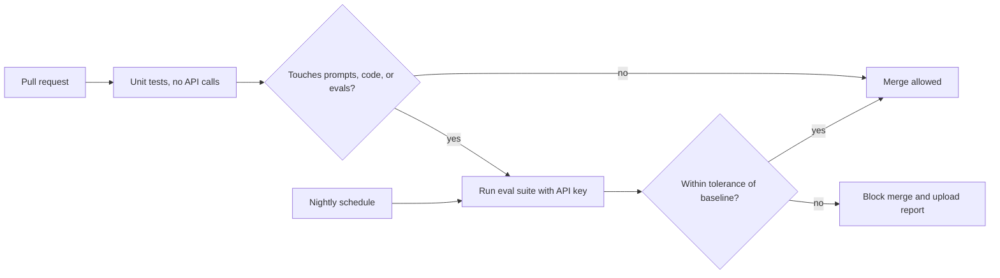

# Regression testing

> Module 11 · Lesson 5 · ~15 min

**Goals**
- Save an eval baseline and compare every new run against it
- Tell a real regression from sampling noise
- Run evals in GitHub Actions on pull requests and on a schedule
- Keep the eval bill under control

## What counts as a regression

A regression is a case that used to pass and now fails, or a metric that dropped below where it was. To spot either, you need a stored **baseline**: the per-case results and aggregate scores from the last known-good version.

You'll get regressions from more places than your own code:

- A prompt edit, a new few-shot example, a reordered system prompt
- A model upgrade (always rerun the full suite before switching model IDs)
- Changes to retrieval: chunk size, embedding model, `k`, a re-index after content changed
- Dependency updates in your SDK or framework
- The documents themselves: new lessons, renamed files

## A runner that writes results

Pytest is great for pass/fail. For regression tracking you also want numbers in a file. A small runner reuses the checks from earlier lessons:

```python
# evals/run.py
import json
from pathlib import Path

from evals.helpers import GOLDEN, answer_for
from evals.judge import judge

def run() -> dict:
    cases = {}
    for c in GOLDEN:
        a = answer_for(c["question"])
        text = a.text.lower()
        cases[c["id"]] = {
            "terms": all(t.lower() in text for t in c["must_include"]),
            "source": (a.sources == []) if c["expected_source"] is None
                      else c["expected_source"] in a.sources,
            "judge": judge(c["question"], c["reference"], a.text).verdict == "pass",
        }
    n = len(cases)
    summary = {m: sum(r[m] for r in cases.values()) / n for m in ("terms", "source", "judge")}
    return {"summary": summary, "cases": cases}

if __name__ == "__main__":
    results = run()
    Path("evals/results.json").write_text(json.dumps(results, indent=2))
    print(json.dumps(results["summary"], indent=2))
```

When you're happy with a version, copy `results.json` to `evals/baseline.json` and commit it. The baseline changes only on purpose, in a reviewed commit.

## Compare against the baseline

```python
# evals/compare.py
import json
import sys
from pathlib import Path

TOLERANCE = 0.03   # allow a 3-point dip for sampling noise

base = json.loads(Path("evals/baseline.json").read_text())
now = json.loads(Path("evals/results.json").read_text())

failed = False
for metric, old in base["summary"].items():
    new = now["summary"][metric]
    flag = "REGRESSION" if new < old - TOLERANCE else "ok"
    failed |= flag == "REGRESSION"
    print(f"{metric:8} {old:.0%} -> {new:.0%}  {flag}")

flipped = [cid for cid, r in now["cases"].items()
           if cid in base["cases"] and any(base["cases"][cid][m] and not r[m] for m in r)]
print("newly failing:", flipped or "none")
sys.exit(1 if failed else 0)
```

The exit code makes it a CI gate. The "newly failing" list is the part you'll actually read.

## Noise vs regression

LLM outputs vary between runs, so a small golden set will wobble even with no code change. Before you trust a drop:

- **Measure the noise.** Run the suite three times on the *same* code. The spread is your floor. Set `TOLERANCE` a little above it.
- **Grow the dataset.** With 20 cases, one flip is 5 points. With 200, it's half a point.
- **Repeat flaky cases.** For a case that flips back and forth, run it 3–5 times and score the pass rate rather than one sample.
- **Pin what you can.** Pin the model ID, SDK versions, and the index snapshot used in CI, and record them in `results.json`.

> [!IMPORTANT]
> Hard rules don't get a tolerance. "Cites a file that doesn't exist" or "leaks the system prompt" should fail the build on a single occurrence.

## Evals in CI

The pipeline: free tests on every push, the paid eval suite on pull requests that touch anything that can change model behavior, and a full run on a schedule.



```yaml
# .github/workflows/evals.yml
name: evals
on:
  pull_request:
    paths: ["prompts/**", "course_buddy/**", "evals/**"]
  schedule:
    - cron: "0 6 * * *"   # nightly full run, 06:00 UTC
  workflow_dispatch:

jobs:
  evals:
    runs-on: ubuntu-latest
    steps:
      - uses: actions/checkout@v7
      - uses: astral-sh/setup-uv@v10
      - run: uv sync --locked
      - name: Unit tests (free)
        run: uv run pytest -m "not llm"
      - name: Eval suite (paid)
        env:
          ANTHROPIC_API_KEY: ${{ secrets.ANTHROPIC_API_KEY }}
        run: |
          uv run pytest evals -m llm --junitxml=eval-junit.xml
          uv run python -m evals.run
          uv run python -m evals.compare
      - uses: actions/upload-artifact@v7
        if: always()
        with:
          name: eval-results
          path: |
            evals/results.json
            eval-junit.xml
```

Add `ANTHROPIC_API_KEY` under the repo's **Settings → Secrets and variables → Actions**. GitHub doesn't pass secrets to workflows triggered from forks, so outside contributors' PRs will skip or fail the paid step. That's a feature: strangers can't spend your API budget.

> [!NOTE]
> Make the `evals` job a required status check in your branch protection rules so a regression actually blocks the merge.

## Keeping the bill sane

- **Cheap judge.** A smaller model (e.g. `claude-haiku-5-5`) is often accurate enough as a judge once calibrated against human labels.
- **Tiers.** Run a fast, representative subset on every PR and the full set nightly.
- **Prompt caching.** The judge's rubric is identical across calls, so cache it ([Module 5](../05-context-engineering/03-long-context-and-caching.md)).
- **Batch API.** For big nightly runs that don't need results in seconds, batch requests cost less.
- **Know the cost.** Print tokens and dollars per eval run. You'll build that logging in [Module 12](../12-observability/02-cost-and-latency.md).

<details><summary>Check yourself: a teammate's PR only edits README.md. Should the paid evals run?</summary>

No, and with the `paths` filter above they won't. Only changes that can affect model behavior (prompts, application code, the eval suite itself) trigger the paid job. Unit tests still run on their own workflow if you have one.

</details>

> [!TIP]
> **Try it:** Run `python -m evals.run` three times without changing anything and note the spread of each metric. Set `TOLERANCE` just above it, save a baseline, then make a deliberately bad prompt change (for example, remove the instruction to cite sources) and run `run` and `compare`. Confirm it exits non-zero and lists the flipped cases.

## Key takeaways
- A regression is a case that flipped from pass to fail, or a metric that dropped below a stored baseline.
- Commit the baseline, and update it only on purpose.
- Measure run-to-run noise and set tolerances above it, but never tolerate failures of hard rules.
- Run free tests on every push, paid evals on relevant PRs and nightly, and gate merges on the result.

## Go deeper
- [Using uv in GitHub Actions](https://docs.astral.sh/uv/guides/integration/github/) — official setup for `setup-uv`, caching, and `uv sync`.
- [Workflow syntax for GitHub Actions](https://docs.github.com/en/actions/writing-workflows/workflow-syntax-for-github-actions) — `paths` filters, `schedule`, secrets.
- [Create strong empirical evaluations](https://platform.claude.com/docs/en/test-and-evaluate/develop-tests) — guidance on eval volume and automated grading.

---
[← Metrics and tools](04-metrics-and-tools.md) · [Module home](README.md) · [Module review →](review.md)
