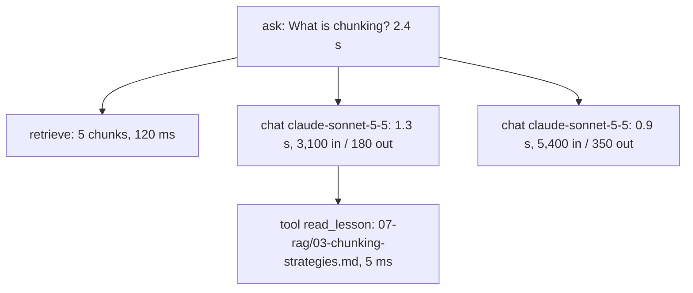

# Tracing and logging

> Module 12 · Lesson 1 · ~15 min

**Goals**
- Explain traces and spans, and why LLM apps need them more than most apps
- Decide what to record for each model call
- Build a minimal tracer that writes nested spans to a JSONL file
- Map your fields onto OpenTelemetry's GenAI semantic conventions

## Why print statements aren't enough

A user reports: "Course Buddy told me RAG needs fine-tuning first." To debug that, you need to know what they asked, which chunks were retrieved, what the full prompt looked like, which tools the agent called and with what arguments, what each model call returned, and which prompt version and model were live. A one-line log of the final answer tells you none of that.

That's what a **trace** is for. A trace is the record of one request end to end. It's made of **spans**: timed units of work with a name, attributes, and a parent. Nest them and you get a tree.



From this tree you can see at a glance that most of the time went to model calls, that the agent needed two of them, and that the second call had much more input because it included the lesson text.

## What to record

For every **model call**:

- Model ID requested and model returned, and key parameters (`max_tokens`, effort, tools offered)
- Input messages and output (or a reference to where they're stored, see the privacy note below)
- Token usage: input, output, cache reads, cache writes
- Latency, and time to first token for streamed calls
- `stop_reason` (`end_turn`, `max_tokens`, `tool_use`, `refusal`...)
- Errors and retries

For the **request as a whole**:

- A trace ID you can show users or support ("reference: 3f2a…")
- A pseudonymous user or session ID
- App version, prompt version ([Module 4](../04-prompt-engineering/04-prompts-as-code.md)), index version
- Retrieved document IDs and scores, tool calls and their results
- User feedback when it arrives, joined by trace ID

> [!WARNING]
> Traces contain whatever users typed and whatever your documents say. Treat them like production data: access control, a retention period, and PII redaction before storage where you can. See [Module 13](../13-safety-and-ethics/03-guardrails.md).

## A tracer in 40 lines

Hosted tools do this for you, but building a small one shows you exactly what they record. Python's `contextvars` keeps track of the current span, so nested `with span(...)` blocks become children automatically.

```python
# course_buddy/tracing.py
import json
import time
import uuid
from contextlib import contextmanager
from contextvars import ContextVar
from pathlib import Path

TRACE_FILE = Path("traces.jsonl")
_current: ContextVar[dict | None] = ContextVar("current_span", default=None)

@contextmanager
def span(name: str, **attributes):
    parent = _current.get()
    record = {
        "trace_id": parent["trace_id"] if parent else uuid.uuid4().hex,
        "span_id": uuid.uuid4().hex[:16],
        "parent_id": parent["span_id"] if parent else None,
        "name": name,
        "start": time.time(),
        "attributes": dict(attributes),
        "status": "ok",
    }
    token = _current.set(record)
    t0 = time.perf_counter()
    try:
        yield record
    except Exception as e:
        record["status"] = "error"
        record["error"] = repr(e)
        raise
    finally:
        record["duration_ms"] = round((time.perf_counter() - t0) * 1000, 1)
        _current.reset(token)
        with TRACE_FILE.open("a") as f:
            f.write(json.dumps(record, default=str) + "\n")
```

Now a wrapper for model calls that records what the API tells you in `response.usage`:

```python
# course_buddy/tracing.py (continued)
def traced_create(client, **kwargs):
    model = kwargs["model"]
    with span(f"chat {model}", kind="llm", model=model) as s:
        response = client.messages.create(**kwargs)
        u = response.usage
        s["attributes"].update(
            response_model=response.model,
            stop_reason=response.stop_reason,
            input_tokens=u.input_tokens,                         # uncached input
            output_tokens=u.output_tokens,
            cache_read_tokens=u.cache_read_input_tokens or 0,
            cache_write_tokens=u.cache_creation_input_tokens or 0,
        )
        return response
```

Use it in Course Buddy:

```python
from course_buddy.tracing import span, traced_create

def ask(question: str, user_id: str):
    with span("ask", user=user_id, question=question) as root:
        with span("retrieve", k=5) as r:
            chunks = search(question, k=5)
            r["attributes"]["sources"] = [c.source for c in chunks]
        response = traced_create(
            client,
            model="claude-sonnet-5-5",
            max_tokens=2048,
            system=SYSTEM_PROMPT,
            messages=[{"role": "user", "content": build_prompt(question, chunks)}],
        )
        root["attributes"]["trace_id"] = root["trace_id"]
        return response
```

Each line in `traces.jsonl` is one span. Spans with the same `trace_id` form one request, and `parent_id` rebuilds the tree.

<details><summary>Check yourself: why does each span get written in the `finally` block rather than when it starts?</summary>

Because the interesting facts (duration, token usage, status, errors) are only known when the work ends. Writing in `finally` also guarantees failed spans get recorded with their error, which are exactly the ones you'll want to debug. The trade-off is that children are written before their parents, so readers have to rebuild the tree by ID.

</details>

## Speak a common language: OpenTelemetry GenAI

[OpenTelemetry](https://opentelemetry.io/docs/concepts/signals/traces/) (OTel) is the open standard for traces, metrics, and logs. Its **GenAI semantic conventions** define standard span names and attribute names for model calls, so any OTel-compatible backend knows how to display them. They're still marked as *development* status, so names can change, but most LLM observability tools already read them.

| Your field | GenAI convention |
|---|---|
| span name `chat claude-sonnet-5-5` | `{gen_ai.operation.name} {gen_ai.request.model}` |
| `kind="llm"` | `gen_ai.operation.name` = `chat` |
| provider | `gen_ai.provider.name` = `anthropic` |
| `model`, `response_model` | `gen_ai.request.model`, `gen_ai.response.model` |
| `stop_reason` | `gen_ai.response.finish_reasons` |
| `output_tokens` | `gen_ai.usage.output_tokens` |
| `cache_read_tokens`, `cache_write_tokens` | `gen_ai.usage.cache_read.input_tokens`, `gen_ai.usage.cache_write.input_tokens` |
| tool span | span name `execute_tool {gen_ai.tool.name}` |

> [!IMPORTANT]
> Watch the input-token definitions. Anthropic's `usage.input_tokens` counts only the *uncached* input. The OTel convention says `gen_ai.usage.input_tokens` should *include* cache reads and writes. If you export to OTel, set it to `input_tokens + cache_read_input_tokens + cache_creation_input_tokens`. Mixing the two up makes your cache hit rate and your costs look wrong.

You don't have to adopt OTel on day one. Naming your fields close to the convention now makes switching to a real OTel exporter (or a tool from [lesson 4](04-observability-tools.md)) a mapping exercise rather than a rewrite.

> [!TIP]
> **Try it:** Add `tracing.py` to Course Buddy and wrap `ask`, retrieval, every model call, and (if you built the agent in Module 8) every tool call. Ask three questions, then print the tree for the last one:
> ```python
> import json
> spans = [json.loads(l) for l in open("traces.jsonl")]
> last = spans[-1]["trace_id"]
> for s in [s for s in spans if s["trace_id"] == last]:
>     print(s["name"], s["duration_ms"], s["attributes"].get("output_tokens", ""))
> ```
> Which span dominates the total time?

## Key takeaways
- A trace is one request, made of nested, timed spans. It's what lets you debug a single bad answer after the fact.
- Record model, parameters, inputs and outputs, token usage, latency, stop reason, and versions for every call.
- A `contextvars`-based tracer gets you nesting for free, and it's all the hosted tools are doing at their core.
- OTel's GenAI conventions standardize the names. Note that their `input_tokens` includes cached tokens and Anthropic's doesn't.

## Go deeper
- [OpenTelemetry GenAI semantic conventions](https://github.com/open-telemetry/semantic-conventions-genai) — the spec for GenAI spans, metrics, and attributes.
- [Traces in OpenTelemetry](https://opentelemetry.io/docs/concepts/signals/traces/) — spans, context propagation, and attributes explained.
- [Messages API reference](https://platform.claude.com/docs/en/api/messages) — the full request and response shape, including `usage` and `stop_reason`.

---
[← Module home](README.md) · [Cost and latency →](02-cost-and-latency.md)
