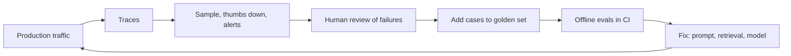

# Production monitoring

> Module 12 · Lesson 3 · ~15 min

**Goals**
- List the signals worth watching for an LLM feature, beyond uptime
- Set alerts that fire on real problems, not noise
- Run online evals on sampled production traffic
- Close the loop from production failures back into your eval set

## Healthy-looking failures

A normal web service is mostly healthy when it returns 200s quickly. An LLM feature can return fast 200s all day while giving wrong, empty, or truncated answers. So you monitor in three layers:

| Layer | Signals | Example alert |
|---|---|---|
| **System** | Error rate by type (429 rate limits, 5xx, timeouts), retries, p95 latency, TTFT | 429s above 2% for 10 minutes |
| **Model behavior** | `stop_reason` mix (`max_tokens` = truncated, `refusal`), empty answers, JSON parse failures, tool-call errors, agent steps per request | `max_tokens` stops above 5% of responses |
| **Quality and business** | Online eval pass rate, thumbs down rate, "no answer found" rate, cost per request and per user, cache hit rate | Daily spend 50% above the 7-day average |

The middle layer is the one teams forget. A spike in `stop_reason == "max_tokens"` means users are getting cut-off answers, and no HTTP status will tell you.

## Dashboards and alerts that earn their keep

Start with a handful of charts, broken down by model and prompt version:

- Requests, errors, and p50/p95 latency over time
- Tokens and cost per request, and total spend per day
- `stop_reason` distribution
- Online eval pass rate and user feedback rate

For alerts, two rules keep them useful:

1. **Alert on rates over a window, not single events.** One timeout is life. 5% timeouts for 10 minutes is an incident.
2. **Every alert needs an action.** If nobody would do anything when it fires, make it a dashboard line instead.

> [!IMPORTANT]
> Set a hard spend limit in your provider console and an alert well below it. A retry loop or an agent that never stops can burn through a monthly budget in an afternoon. Cost per user also catches abuse, like one account scripting thousands of requests.

## Online evals

Your offline evals ([Module 11](../11-evals/README.md)) run on a fixed dataset. **Online evals** run graders on a sample of real production traces. They catch problems your golden set doesn't cover.

```python
# scripts/online_eval.py: run hourly or daily on a sample
import json
import random

from evals.judge import judge_grounded   # a judge variant that checks the answer against retrieved context

spans = [json.loads(line) for line in open("traces.jsonl")]
roots = [s for s in spans if s["parent_id"] is None and s["status"] == "ok"]

sample = random.sample(roots, k=min(50, len(roots)))
results = []
for r in sample:
    a = r["attributes"]
    v = judge_grounded(question=a["question"], answer=a["answer"], context=a["context"])
    results.append({"trace_id": r["trace_id"], "verdict": v.verdict, "reasoning": v.reasoning})

rate = sum(x["verdict"] == "pass" for x in results) / len(results)
print(f"online groundedness: {rate:.0%} on {len(results)} sampled requests")
```

There's no reference answer in production, so online judges check reference-free properties: is the answer grounded in the retrieved context, does it address the question, did it follow the format, is it on-topic. (This assumes your root span stores the question, answer, and context. If storing full text isn't OK for privacy reasons, run the judge inline at request time and store only the verdict.)

Sampling keeps the cost down. Judging 2% of traffic, or every request with a thumbs down, is usually plenty.

## User feedback

Explicit feedback (thumbs up/down, "this was wrong") is the cheapest human eval you'll get. Attach the trace ID to the feedback event so you can open the exact request:

```python
def record_feedback(trace_id: str, score: int, comment: str = ""):
    with span("feedback", feedback_for=trace_id, score=score, comment=comment):
        pass
```

Implicit signals matter too: the user rephrasing the same question, copying the answer, abandoning the session, or escalating to a human.

Feedback is biased. Unhappy users click far more often than happy ones, so watch its *trend*, not its absolute level.

## Close the loop

Monitoring is only worth it if what you find makes the product better. The loop:



Each failure you review becomes a golden case. Over time your offline suite stops being what you *guessed* users would ask and becomes what they *do* ask.

## Drift

Things change even when your code doesn't:

- **Input drift.** Users start asking about new topics, in new languages, or in longer forms. Watch the distribution of question types and lengths, and the "no relevant chunks found" rate.
- **Data drift.** Documents get added or edited, and the index goes stale. Track index version in traces.
- **Model changes.** When you move to a new model ID, compare its dashboards side by side with the old one for a while (a canary or A/B split) before switching all traffic.

<details><summary>Check yourself: latency and error rate are flat, but thumbs-down rate doubled since yesterday's deploy. What do you look at?</summary>

What changed in the deploy (prompt version, model, retrieval settings), then the traces with thumbs down since the deploy. Compare their `stop_reason` mix, answer length, and retrieved sources with the day before. Run your offline eval suite on the new version too, and if the cause isn't in your golden set, add it once you find it.

</details>

> [!TIP]
> **Try it:** Write three alert rules for Course Buddy as plain sentences, each with a metric, a threshold, a window, and the action you'd take. Then compute the first one from your `traces.jsonl` with a few lines of Python. If you can't compute it, your traces are missing a field. Add it.

## Key takeaways
- Monitor three layers: system health, model behavior (`stop_reason`, parse failures, tool errors), and quality and cost.
- Alert on rates over time windows, and only on things someone will act on. Set a hard spend limit.
- Online evals run reference-free judges on sampled real traffic.
- Tie feedback to trace IDs, and turn reviewed failures into golden cases.

## Go deeper
- [Your AI product needs evals](https://hamel.dev/blog/posts/evals/) — includes how to look at production data and turn it into tests.
- [Demystifying evals for AI agents](https://www.anthropic.com/engineering/demystifying-evals-for-ai-agents) — how offline evals and production monitoring complement each other.
- [OpenTelemetry GenAI semantic conventions](https://github.com/open-telemetry/semantic-conventions-genai) — also defines standard GenAI metrics like token usage and operation duration.

---
[← Cost and latency](02-cost-and-latency.md) · [Module home](README.md) · [Observability tools →](04-observability-tools.md)
