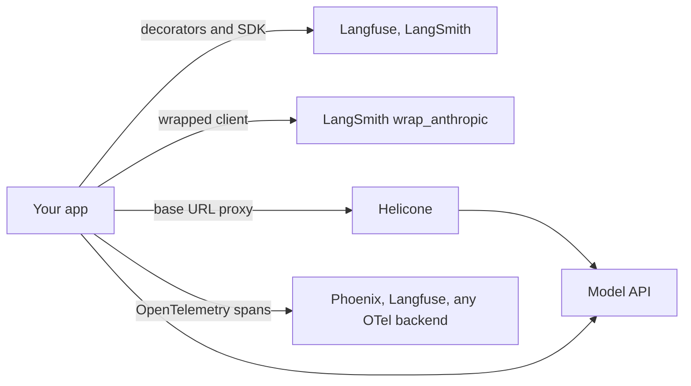

# Observability tools

> Module 12 · Lesson 4 · ~20 min

**Goals**
- Know what hosted LLM observability tools add on top of a hand-rolled tracer
- Tell the main integration styles apart: SDK decorators, client wrappers, proxies, and OpenTelemetry
- Wire Course Buddy into Langfuse, LangSmith, Helicone, or Arize Phoenix
- Choose a tool based on hosting, openness, and how much you want to change your code

## What you get over `traces.jsonl`

The tracer from [lesson 1](01-tracing-and-logging.md) records the right data. The tools add the parts that take real effort to build:

- A UI to browse traces as trees, search them, and filter by user, model, cost, or error
- Dashboards for cost, latency, and token use, with model price tables built in
- Sessions (multi-turn conversations), user tracking, and feedback scores attached to traces
- Datasets built from production traces, plus eval runs and LLM-judge scoring
- Prompt management (versioned prompts linked to the traces that used them)

They differ mostly in **how they hook into your code**:



## Langfuse

Open source (MIT core) and self-hostable, with a managed cloud. Its Python SDK uses an `@observe` decorator, and it's built on OpenTelemetry, so it can also ingest OTel spans.

```bash
uv add langfuse
# .env: LANGFUSE_PUBLIC_KEY, LANGFUSE_SECRET_KEY, LANGFUSE_BASE_URL (e.g. https://cloud.langfuse.com)
```

```python
import anthropic
from langfuse import get_client, observe

langfuse = get_client()
client = anthropic.Anthropic()

@observe(as_type="generation")
def call_claude(messages: list[dict]):
    response = client.messages.create(model="claude-sonnet-5-5", max_tokens=1024, messages=messages)
    langfuse.update_current_generation(
        model=response.model,
        output="".join(b.text for b in response.content if b.type == "text"),
        usage_details={
            "input": response.usage.input_tokens,
            "output": response.usage.output_tokens,
            "cache_read_input_tokens": response.usage.cache_read_input_tokens or 0,
        },
    )
    return response

@observe()   # the root span: nested @observe calls become children
def ask(question: str):
    chunks = search(question, k=5)
    return call_claude([{"role": "user", "content": build_prompt(question, chunks)}])

ask("What is chunking?")
langfuse.flush()   # short-lived scripts must flush before exiting
```

Langfuse computes cost from its own price table for known models, or from `cost_details` if you pass it.

## LangSmith

LangChain's hosted platform (self-hosting is an enterprise option). It works with or without LangChain. `wrap_anthropic` traces every client call, and `@traceable` adds your own spans around them.

```bash
uv add langsmith
# .env: LANGSMITH_TRACING=true, LANGSMITH_API_KEY=...
```

```python
import anthropic
from langsmith import traceable
from langsmith.wrappers import wrap_anthropic

client = wrap_anthropic(anthropic.Anthropic())   # model calls traced automatically

@traceable(name="retrieve", run_type="retriever")
def retrieve(question: str):
    return search(question, k=5)

@traceable(name="ask")
def ask(question: str):
    chunks = retrieve(question)
    return client.messages.create(
        model="claude-sonnet-5-5",
        max_tokens=1024,
        messages=[{"role": "user", "content": build_prompt(question, chunks)}],
    )
```

`LANGSMITH_TRACING` turns tracing on and off without code changes. If you use LangChain or LangGraph, tracing works with just the environment variables.

## Helicone

An open-source **proxy**. You point the SDK's base URL at Helicone, which forwards requests to the provider and logs them on the way. No decorators: it sees every call your client makes, and nothing else.

```python
import os
import anthropic

client = anthropic.Anthropic(
    base_url="https://anthropic.helicone.ai",
    default_headers={"Helicone-Auth": f"Bearer {os.environ['HELICONE_API_KEY']}"},
)

response = client.messages.create(
    model="claude-sonnet-5-5",
    max_tokens=1024,
    messages=[{"role": "user", "content": "What is chunking?"}],
    extra_headers={"Helicone-User-Id": hashed_user_id},   # per-user cost and usage
)
```

The proxy style is the fastest to set up and can add gateway features like caching and rate limiting. The trade-off: it only sees model calls, not your retrieval or tool spans, and it sits in the request path, so it's one more hop and one more dependency.

## Arize Phoenix

Open source, OpenTelemetry-native, and easy to run locally. Instrumentation comes from the **OpenInference** packages, which patch SDKs like `anthropic` to emit OTel spans.

```bash
uv add arize-phoenix arize-phoenix-otel openinference-instrumentation-anthropic
uv run python -m phoenix.server.main serve      # UI at http://localhost:6006
```

```python
from phoenix.otel import register

tracer_provider = register(project_name="course-buddy", auto_instrument=True)

# From here on, every anthropic client call in this process is traced.
```

`auto_instrument=True` picks up any installed `openinference-instrumentation-*` package. Set `PHOENIX_COLLECTOR_ENDPOINT` to send traces to a remote Phoenix instead of localhost. Arize also sells a managed platform (Arize AX) built on the same instrumentation.

> [!NOTE]
> Because Phoenix's spans are plain OpenTelemetry, you can point the same instrumentation at any OTel-compatible backend later. That's the main argument for OTel-based instrumentation: you aren't locked into one vendor's SDK.

## Choosing

| | Langfuse | LangSmith | Helicone | Arize Phoenix |
|---|---|---|---|---|
| Integration | Decorators, SDK, OTel | Client wrappers, decorators | Proxy (base URL) | OTel + OpenInference |
| Open source | Yes, self-hostable | No (managed, enterprise self-host) | Yes, self-hostable | Yes, runs locally |
| Sees non-LLM spans (retrieval, tools) | Yes | Yes | No | Yes |
| Evals and datasets | Yes | Yes | Basic | Yes |
| Good fit when | You want open source with a full feature set | You're using LangChain or LangGraph | You want logging in five minutes with no code changes | You want local, OTel-first tracing |

Questions that decide it:

1. **Can trace data leave your infrastructure?** If not, self-host Langfuse, Helicone, or Phoenix.
2. **Do you need spans for retrieval and tools, or just model calls?** Proxies only see model calls.
3. **Do you already have OTel?** Then pick a backend that accepts OTel and instrument once.

Any of these is fine for Course Buddy. Picking one and actually reading its traces matters far more than which one you pick.

<details><summary>Check yourself: you use Helicone and your agent gives a bad answer because retrieval returned the wrong chunks. Will the Helicone trace show you that?</summary>

Only indirectly. Helicone logs the model request, so you'll see the chunks that ended up in the prompt, but not the retrieval step itself (the query, the scores, the chunks that were dropped). For that you need span-level instrumentation, either your own tracer or a decorator- or OTel-based tool alongside the proxy.

</details>

> [!TIP]
> **Try it:** Run Phoenix locally (no account needed), add the two `register` lines to Course Buddy, and ask three questions. Open `http://localhost:6006` and find the token counts for each model call. Compare them with the numbers in your own `traces.jsonl`. Do they match?

## Key takeaways
- Hosted tools add a trace UI, cost dashboards, sessions, feedback, datasets, and evals on top of the same span data.
- Integration styles differ: decorators (Langfuse, LangSmith), wrapped clients (LangSmith), proxies (Helicone), and OpenTelemetry instrumentation (Phoenix, and Langfuse via OTel).
- Proxies are the quickest to set up but only see model calls. Span-based tools see the whole request.
- OTel-based instrumentation keeps you portable between backends.

## Go deeper
- [Langfuse Python SDK instrumentation](https://langfuse.com/docs/observability/sdk/python/instrumentation) — `@observe`, context managers, and updating generations.
- [LangSmith: custom instrumentation](https://docs.langchain.com/langsmith/annotate-code) — `@traceable` and the client wrappers.
- [Helicone with the Anthropic Python SDK](https://docs.helicone.ai/integrations/anthropic/python) — the proxy setup and headers.
- [Arize Phoenix docs](https://arize.com/docs/phoenix) — running Phoenix and tracing with OpenInference.

---
[← Production monitoring](03-production-monitoring.md) · [Module home](README.md) · [Module review →](review.md)
