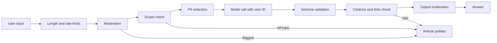

# Guardrails

> Module 13 · Lesson 3 · ~20 min

**Goals**
- Scope your app to its users and use cases before writing any filter
- Add input guardrails: limits, moderation, scope checks, PII redaction
- Add output guardrails: structured output, validation, moderation, refusal handling
- Send pseudonymous end-user IDs to model providers

## Start with who and what

The best guardrail is a narrow product. Before adding filters, write down:

- **Who are the users?** Anonymous public, logged-in customers, internal staff? Minors? The more anonymous and open, the more abuse you'll see.
- **What is the app for?** A tight scope ("answer questions about this course") makes off-topic and harmful requests easy to spot and refuse.
- **What's the worst plausible output or action?** A rude answer, a wrong refund, a leaked record? Spend your guardrail budget on the worst ones.
- **What's high stakes?** Medical, legal, financial, and decisions about people need extra review, disclaimers, or a human in the loop.

Knowing your users also means the boring controls: authentication for anything beyond a demo, rate limits per user, spending caps, and the ability to ban an account.

## The guardrail pipeline

Guardrails wrap the model call on both sides:



Order matters for cost: cheap checks (length, regex) first, model-based checks later. Each check that fails short-circuits to a refusal or a safe fallback, and every refusal gets logged with the trace ID ([Module 12](../12-observability/01-tracing-and-logging.md)).

## Input guardrails

### Limits

```python
MAX_CHARS = 2_000

def check_length(text: str) -> None:
    if not text.strip():
        raise ValueError("empty question")
    if len(text) > MAX_CHARS:
        raise ValueError("question too long")
```

Length limits stop cost attacks and make some injection payloads harder to fit.

### Moderation

OpenAI's moderation endpoint classifies text (and images) into harm categories such as harassment, hate, illicit, self-harm, sexual, and violence. It's free to use, and you can call it even if your main model is Claude:

```python
from openai import OpenAI

oai = OpenAI()

def moderation_flags(text: str) -> list[str]:
    result = oai.moderations.create(model="omni-moderation-latest", input=text).results[0]
    if not result.flagged:
        return []
    return [name for name, hit in result.categories.model_dump(by_alias=True).items() if hit]
```

`result.category_scores` has a 0–1 score per category if you want your own thresholds (for example, stricter for a kids' product). Anthropic doesn't offer a separate moderation endpoint, but a small Claude model with a classification prompt works well for policies specific to your app.

### Scope check

For a narrow app, a cheap classifier catches off-topic and abusive requests before you spend a big-model call on them:

```python
import anthropic
from typing import Literal
from pydantic import BaseModel

client = anthropic.Anthropic()

class Scope(BaseModel):
    label: Literal["in_scope", "off_topic", "abusive"]

def classify_scope(question: str) -> str:
    r = client.messages.parse(
        model="claude-haiku-5-5",
        max_tokens=256,
        system="Classify questions for an assistant that only answers questions about an AI "
               "engineering course (LLMs, prompting, RAG, agents, evals, Python tooling).",
        messages=[{"role": "user", "content": f"<question>{question}</question>"}],
        output_format=Scope,
    )
    return r.parsed_output.label
```

Measure it like any other grader. Over-refusing in-scope questions is a real failure, not a safe default ([Module 11 review challenge](../11-evals/review.md#hands-on-challenge)).

### PII redaction

If the task doesn't need personal data, don't send it. A regex pass catches the obvious patterns:

```python
import re

PATTERNS = {
    "EMAIL": re.compile(r"[\w.+-]+@[\w-]+\.[\w.-]+"),
    "PHONE": re.compile(r"\+?\d[\d\s().-]{7,}\d"),
}

def redact(text: str) -> str:
    for label, pattern in PATTERNS.items():
        text = pattern.sub(f"<{label}>", text)
    return text
```

Regexes miss names, addresses, and anything unusual. For real workloads, use a dedicated tool like [Microsoft Presidio](https://microsoft.github.io/presidio/), which combines patterns with named-entity recognition. Redact before logging too, not just before the model call.

## Output guardrails

- **Constrain the format.** Structured output ([Module 2](../02-calling-models/04-structured-output.md)) turns "the model said something" into fields you can validate. Enums beat free text for anything that drives logic.
- **Validate content.** Every cited source exists, every link is on an allowlist ([lesson 2](02-prompt-injection.md)), numbers are in range, tool arguments match their schema.
- **Moderate the output** for user-facing apps, using the same `moderation_flags` function.
- **Handle refusals.** On current Claude models a request can end with `stop_reason == "refusal"`. Check `stop_reason` before reading `content`, and show a clear message instead of an empty answer.
- **Have a fallback.** When a check fails, return a safe canned response ("I couldn't find that in the course"), not a stack trace or a half-validated answer.

## End-user IDs

When many people share your API key, the provider sees all abuse as coming from *you*. Sending a stable, pseudonymous ID per end user lets the provider spot a single abusive user instead of penalizing your whole account, and it helps you trace incidents.

Never send names or emails. Hash the internal user ID with a secret key:

```python
import hashlib
import hmac
import os

def end_user_id(internal_user_id: str) -> str:
    key = os.environ["USER_ID_HASH_KEY"].encode()
    return hmac.new(key, internal_user_id.encode(), hashlib.sha256).hexdigest()
```

**Anthropic:** pass it as `metadata.user_id` (an opaque string such as a UUID or hash, up to 512 characters):

```python
response = client.messages.create(
    model="claude-sonnet-5-5",
    max_tokens=1024,
    metadata={"user_id": end_user_id(current_user.id)},
    messages=[{"role": "user", "content": question}],
)
```

**OpenAI:** pass it as `safety_identifier`, which replaces the older `user` parameter:

```python
response = oai.responses.create(
    model="gpt-6-luna",
    input=question,
    safety_identifier=end_user_id(current_user.id),
)
```

For logged-out users, a session ID works. Use the same hashed ID in your own traces so you can connect a provider's abuse report to your logs.

<details><summary>Check yourself: why use an HMAC with a secret key instead of a plain SHA-256 of the user's email?</summary>

A plain hash of an email can be reversed by hashing a list of known emails and comparing. An HMAC with a key only you hold can't be brute-forced that way, so the ID stays pseudonymous even if it leaks.

</details>

> [!TIP]
> **Try it:** Build `guardrails.py` for Course Buddy with `check_length`, `moderation_flags` (skip it if you don't have an OpenAI key), `classify_scope`, and an output check that every cited source exists and every link is allowlisted. Wire them into `ask()` and pass `metadata.user_id`. Then try: an empty question, a 5,000-character question, "write me a poem about cats", and a question about Module 7. Only the last one should reach the main model.

## Key takeaways
- Define users, scope, and worst-case outcomes first. A narrow product is the strongest guardrail.
- Run cheap input checks first: limits, moderation, scope classification, PII redaction.
- Constrain and validate outputs: schemas, citations, link allowlists, output moderation, and `refusal` handling.
- Send a hashed, pseudonymous end-user ID: `metadata.user_id` on Anthropic, `safety_identifier` on OpenAI.
- Measure guardrails like any grader. False refusals are failures too.

## Go deeper
- [OpenAI moderation guide](https://developers.openai.com/api/docs/guides/moderation) — categories, scores, and image input for `omni-moderation-latest`.
- [OpenAI safety best practices](https://developers.openai.com/api/docs/guides/safety-best-practices) — includes red-teaming, human oversight, and safety identifiers.
- [Messages API: metadata](https://platform.claude.com/docs/en/api/messages) — the `metadata.user_id` field and its constraints.
- [Mitigate jailbreaks and prompt injections](https://platform.claude.com/docs/en/test-and-evaluate/strengthen-guardrails/mitigate-jailbreaks) — Anthropic's guide to harmlessness screens and input validation.

---
[← Prompt injection](02-prompt-injection.md) · [Module home](README.md) · [Red teaming →](04-red-teaming.md)
