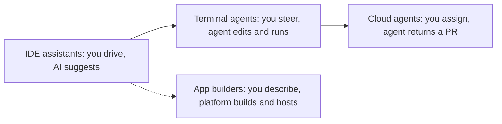

# The AI coding landscape

> Module 14 · Lesson 1 · ~12 min

**Goals**
- Sort AI coding tools into four categories by where they run and how autonomous they are
- Know what Claude Code, Gemini CLI, Codex, Cursor, Devin and Replit Agent each are, in a sentence or two
- Recognise the agent machinery from Modules 8 and 9 inside these tools
- Pick the right category for a given task

## They're agents, and you know how agents work

Strip away the branding and a modern coding tool is the [agent loop from Module 8](../08-agents/01-what-makes-an-agent.md). A model gets a goal, calls tools (read file, edit file, run shell command, search), looks at the results and repeats until it's done. The differences between products come down to four things:

1. **Where it runs**: your terminal, your editor, a cloud sandbox, or a browser app.
2. **How much it does before checking in**: one line, one diff, or a whole pull request.
3. **What context it gets**: open files, the whole repo, a project instructions file, MCP servers ([Module 9](../09-mcp/01-why-mcp.md)).
4. **Which models it uses**, and whether you can choose.

Features change monthly. These four questions don't, so use them to evaluate whatever tool is hot when you read this.

## Four categories

The arrow runs from **more human control** to **more delegation**. App builders sit off to the side because they target a different user: someone who wants a running app more than a codebase.

### 1. AI-native IDEs and editor assistants

The AI lives inside your editor. You get tab completion, chat about the open files, inline edits, and increasingly an "agent" mode that changes many files at once.

- **Cursor** is an AI-first code editor built on VS Code. It offers completions, chat and an agent that edits across the repo, plus cloud agents that keep working in a remote VM. Project rules live in `.cursor/rules`, and it also reads `AGENTS.md`.
- Others in this category include GitHub Copilot in VS Code and JetBrains, and Windsurf.

Best for work where you want to watch every change as it happens.

### 2. Terminal (CLI) agents

You run an agent in your project directory. It reads the codebase, makes edits, runs your tests and commands, and asks permission for risky actions. Because it's a CLI, you can also script it in CI.

- **Claude Code** is Anthropic's agentic coding tool. It started in the terminal and now also runs in VS Code and JetBrains, in a desktop app and on the web. It reads `CLAUDE.md` (or an existing `AGENTS.md`), connects to MCP servers, and supports subagents, hooks and skills.
- **Gemini CLI** is Google's open-source (Apache 2.0) terminal agent. It has a generous free tier with a personal Google account, a project context file called `GEMINI.md`, and MCP support.
- **Codex** is OpenAI's coding agent. The Codex CLI is open source and runs locally, and the same agent is available as IDE extensions, a desktop app and a cloud version that works on tasks in the background. It reads `AGENTS.md`.

Best for multi-file changes, refactors, debugging with real test runs, and anything you'd do at a terminal.

### 3. Autonomous and cloud agents

You hand over a task, often from a ticket, Slack or a web dashboard. The agent works in its own sandboxed environment, and you get back a branch or pull request to review.

- **Devin** (by Cognition) was the first widely known "AI software engineer". You assign it work through Slack, the web app or integrations, and it plans, codes, tests and opens a PR in its own cloud workspace.
- Most vendors now offer this mode too: Codex cloud, Claude Code on the web, Cursor's cloud agents, and GitHub's Copilot coding agent.

Best for well-specified, self-contained tasks you can review asynchronously, such as dependency bumps, small features or test backfills. Run several in parallel.

### 4. App builders

You describe an app in plain language, and the platform scaffolds, runs and hosts it, usually with a database, auth and deployment built in.

- **Replit Agent** builds and deploys full-stack web (and mobile) apps from a prompt inside Replit's browser-based environment, then iterates as you give feedback.

Best for prototypes, internal tools and non-engineers. Be cautious when the app needs to grow into a maintained codebase with your own infrastructure and review standards.

> [!NOTE]
> These categories blur. Claude Code, Codex and Cursor each now span more than one of them. Classify by the *mode* you're using for a task, not by the brand.

> [!TIP]
> **Try it.** Install one terminal agent (Claude Code or Gemini CLI both take a minute) and open it in your `course-buddy` project. Don't ask it to change anything yet. Ask: "Explain how this project is structured and how a question flows from the CLI to the model." Compare its answer to what you know you built. Where was it wrong or vague?
>
> 

Install commands at the time of writing

>
> - Claude Code: `curl -fsSL https://claude.ai/install.sh | bash`, then run `claude` in your project
> - Gemini CLI: `npm install -g @google/gemini-cli`, then run `gemini`
> - Codex CLI: `npm install -g @openai/codex`, then run `codex`
>
> Check each tool's docs if these have changed.
>
> 

## Choosing for the task

| Task | Good fit |
|------|----------|
| Learning a new codebase | Terminal agent or IDE chat. Ask questions before you edit |
| Small, focused edit you want to watch | IDE assistant |
| Multi-file refactor with tests to run | Terminal agent |
| Ten independent chores from the backlog | Cloud agents, in parallel, each returning a PR |
| A demo app for tomorrow's meeting | App builder |
| Security-sensitive or novel core logic | You, with an assistant for review and tests |

A few practical factors also matter: which models the tool supports, how it handles your code and data (enterprise terms, retention), price (subscription vs per token), and whether it works with your editor and CI.

**Check yourself:** your teammate says "Devin and Claude Code are the same thing." What's the useful distinction?

Answer

Both are agents, but in their default modes they differ in where they run and how often they check in. Claude Code usually runs alongside you in your terminal or editor while you steer. Devin works asynchronously in its own cloud environment and comes back with a PR. (Claude Code on the web blurs this, which is why you classify by mode.)

## Key takeaways
- Every modern coding tool is an agent loop with file, shell and search tools. Compare them by where they run, autonomy, context and models.
- Four categories: IDE assistants, terminal agents, cloud/autonomous agents, and app builders.
- More delegation means less real-time oversight, so it needs better task specs and better review.
- Products change monthly. The categories and the evaluation questions last.

## Go deeper
- [Claude Code overview](https://code.claude.com/docs/en/overview) — surfaces, MCP, CLAUDE.md, hooks and subagents
- [Gemini CLI on GitHub](https://github.com/google-gemini/gemini-cli) — open-source terminal agent, with docs and `GEMINI.md`
- [OpenAI Codex on GitHub](https://github.com/openai/codex) — the open-source CLI and links to other Codex surfaces
- [Cursor docs](https://cursor.com/docs) — editor, agent, rules and cloud agents
- [Devin docs](https://docs.devin.ai) — how an autonomous cloud agent is assigned work and reviewed

---
[← Module home](README.md) · [Working with AI pair programmers →](02-working-with-ai-pair-programmers.md)
