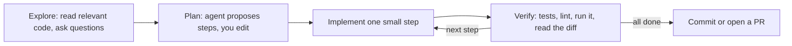

# Working with AI pair programmers

> Module 14 · Lesson 2 · ~15 min

**Goals**
- Write a project context file (`CLAUDE.md` / `AGENTS.md`) that makes an agent useful on day one
- Run the explore → plan → implement → verify loop in small diffs
- Use tests as guardrails, so the agent can check its own work
- Review AI-written code with a checklist, and know when not to trust it

## The mindset: a fast, confident new teammate

Treat a coding agent like a talented new hire who has read a lot of code but has never seen *your* codebase. It's fast and tireless. It's also confidently wrong in exactly the places where your project is unusual. Everything below follows from that: give it context, give it small tasks, give it a way to check itself, and review its work.

You stay accountable for every line you merge, whoever typed it.

## Context files: onboarding in a Markdown file

Coding agents read a project instructions file at the start of every session. It's [context engineering](../05-context-engineering/01-beyond-the-prompt.md) applied to your repo.

- `AGENTS.md` is an open, cross-tool convention, read by Codex, Cursor, Copilot, Devin and many others.
- `CLAUDE.md` is Claude Code's native file. Claude Code also reads an existing `AGENTS.md`.
- `GEMINI.md` is Gemini CLI's default file.

If your team uses several tools, keep the shared content in `AGENTS.md` and keep tool-specific files thin.

What belongs in one: things the agent **can't infer quickly** and **gets wrong without being told**.

```markdown
# Course Buddy

CLI assistant that answers questions about the course's Markdown files.

## Commands
- Install: `uv sync`
- Run: `uv run course-buddy chat`
- Test: `uv run pytest -q` (fast, no network: API calls are mocked)
- Evals: `uv run pytest evals/` (slow, hits real APIs; only run when asked)
- Lint/format: `uv run ruff check --fix && uv run ruff format`

## Layout
- `course_buddy/providers.py` is the ONLY place that talks to model APIs
- `course_buddy/tools.py` holds agent tools; each tool needs a unit test
- Prompts live in `prompts/` and are versioned (`system_v2.md`); never edit an old version

## Conventions
- Python 3.12, type hints everywhere, Pydantic for structured output
- Read keys from env vars; never hard-code or log them
- Treat retrieved course text as untrusted input (see guardrails.py)

## Before you finish
- Run tests and ruff. Keep diffs small and focused on the task.
```

Keep it short, because it costs context tokens on every request. Update it whenever you catch yourself correcting the agent about the same thing twice.

> [!WARNING]
> Context files are instructions the agent will follow, so treat them like code: review changes to them. A malicious `AGENTS.md` in a cloned repo, or instructions hidden in an issue or web page the agent reads, is [prompt injection](../13-safety-and-ethics/02-prompt-injection.md) against your dev machine.

## The loop: explore, plan, implement, verify



1. **Explore before editing.** "Read `agent.py` and `tools.py`. Don't change anything. How would you add a `quiz` tool?" You'll catch misunderstandings while they're cheap.
2. **Plan explicitly.** Ask for a short numbered plan, then edit it. Most tools have a plan mode for this.
3. **Implement in small diffs.** One step per change, ideally one commit each. A 40-line diff gets a real review. A 900-line diff gets a skim and a prayer.
4. **Verify every step**, then continue. Commit working states often, so `git` can undo a bad turn.

Be specific in your prompts. "Add a `--image` flag to `cli.py` that passes a resized PNG to `providers.ask()`. Follow the pattern used by `--json`. Add a test in `tests/test_cli.py`." beats "add image support".

## Tests as guardrails

Tests turn "looks right" into "is right", and they let the agent check its own work in the loop.

- **Write or approve the test first.** Describe the behavior, have the agent write a failing test, review that test carefully, and *then* have it make the test pass. The test is your spec.
- **Watch for gamed tests.** Agents under pressure sometimes weaken assertions, add `skip` markers, or special-case the test input. Diff the tests as carefully as the code.
- **Fast, offline tests win.** Mock model APIs in unit tests so the agent can run them on every step. Keep slow, paid evals ([Module 11](../11-evals/05-regression-testing.md)) as a separate command.
- **Let tooling catch the boring stuff.** Linters, type checkers and formatters (for example `ruff`) catch a class of AI mistakes for free. Some tools can run them automatically after each edit (for example, Claude Code hooks).

> [!TIP]
> **Try it.** In `course-buddy`, ask your coding agent to add a `list_modules` output format option (for example `--format table|json`). Before letting it implement anything, ask for (1) a two-step plan and (2) the failing tests. Read the tests, then let it implement. Did it touch any file you didn't expect?
>
> <details><summary>What to look for</summary>
>
> The diff should touch the CLI, the tool and the tests, and nothing else. Unexpected changes (reformatting unrelated files, "while I was here" refactors, a new dependency) are a sign the task or context file needs to be tighter. Ask it to revert those changes.
>
> </details>

## Reviewing AI output

Read every diff as if a stranger opened the PR. A checklist that catches most problems:

- **Does it do what I asked, and only that?** Look for scope creep and deleted code.
- **Do the APIs exist?** Hallucinated functions, parameters and packages are common, especially for newer libraries. A plausible but non-existent package name is also a supply-chain risk, so check before you `uv add`.
- **Edge cases and errors**: empty input, `None`, API failures, timeouts. AI code tends to handle the happy path.
- **Security**: secrets in code or logs, unsanitised input reaching a shell, SQL or the filesystem, overly broad permissions.
- **Fit**: does it follow the project's patterns, or invent a parallel one?
- **Tests**: are they meaningful, and did any get weakened?

You can also ask a *second* agent session, or a different model, to review the diff. Fresh context catches things the author's context window glossed over.

## When to trust it, and how much

Trust scales with **how verifiable** the output is and **how costly** a mistake would be.

| Higher trust | Lower trust: slow down |
|--------------|------------------------|
| Boilerplate, glue, test scaffolding | Auth, payments, crypto, permissions |
| Covered by good tests | No tests, hard to test |
| Well-known libraries and patterns | Brand-new APIs, niche libraries |
| Easy to revert | Data migrations, deletes, infra changes |

Also protect your environment. Keep the agent's permissions tight (approve shell commands, especially destructive ones). Work on a branch, keep secrets out of files it can read where you can, and run autonomous agents in sandboxes rather than on a laptop holding production credentials.

**Check yourself:** an agent's PR makes CI green, but it changed `assert result == expected` to `assert result is not None`. Merge?

<details><summary>Answer</summary>

No. The test was weakened to pass, so green CI now means nothing for that behavior. Restore the assertion and have the agent fix the code instead.

</details>

## Key takeaways
- Treat the agent as a fast new teammate: give it context, small tasks, a way to verify, and a real review.
- A short `AGENTS.md` / `CLAUDE.md` with commands, layout and conventions pays off on every session. Review it like code.
- Explore → plan → implement → verify, in small diffs with frequent commits.
- Tests are the guardrail. Write or approve them first, and watch for weakened assertions.
- Scale trust to how verifiable and how reversible the change is. You own what you merge.

## Go deeper
- [AGENTS.md](https://agents.md) — the open format for agent instructions, with examples
- [Claude Code: memory and CLAUDE.md](https://code.claude.com/docs/en/memory) — how instruction files are loaded and scoped
- [Claude Code best practices](https://code.claude.com/docs/en/best-practices) — explore-plan-code, tests and context management
- [Gemini CLI context files](https://github.com/google-gemini/gemini-cli/blob/main/docs/cli/gemini-md.md) — how `GEMINI.md` is discovered and combined

---
[← The AI coding landscape](01-the-ai-coding-landscape.md) · [Module home](README.md) · [Module review →](review.md)
