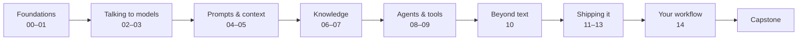

# Zero to Hero: AI Engineer

A free, hands-on course for developers who want to build real products on top of large language models. You'll go from "what is a token?" to shipping a tested, observable, injection-resistant AI assistant.

The whole course is plain Markdown. Read it right here on GitHub like a wiki, or clone it and read it in your editor. You need nothing else.

## Who this is for

You can write Python and you've called an HTTP API before. You don't need a machine learning background. This course is about *using* models well, not training them.

## How it works

Each module is a folder. Open the folder and its README is the module's home page. From there:

1. **Lessons** are short (about 10 minutes each). Each one opens with goals and closes with key takeaways and links for further reading.
2. **Try it** blocks are small hands-on exercises. Do them. They're where the learning happens.
3. **Reviews** close every module. They have questions with hidden answers (click to reveal) and one bigger challenge.
4. **The capstone**, [Course Buddy](capstone/README.md), is an assistant that answers questions about this course. You build it a piece at a time across all the modules.

Every page has previous/next links at the bottom, so you can go straight through.

## Syllabus

| # | Module | What you'll learn |
|---|--------|-------------------|
| 00 | [Orientation](00-orientation/README.md) | What AI engineers do, the core vocabulary, and setting up your workbench |
| 01 | [How LLMs Work](01-how-llms-work/README.md) | Tokens, training vs inference, context windows, and sampling |
| 02 | [Calling Models](02-calling-models/README.md) | The Claude, OpenAI and Gemini APIs, streaming, structured output, and function calling |
| 03 | [Choosing Models](03-choosing-models/README.md) | Closed vs open models, running them locally, Hugging Face, and picking well |
| 04 | [Prompt Engineering](04-prompt-engineering/README.md) | Anatomy of a prompt, few-shot prompting, reasoning patterns, and prompts as code |
| 05 | [Context Engineering](05-context-engineering/README.md) | Memory, compaction, caching, multi-agent context, and failure modes |
| 06 | [Embeddings & Vector Search](06-embeddings-and-vector-search/README.md) | Embeddings, embedding models, vector databases, and similarity search |
| 07 | [Retrieval-Augmented Generation](07-rag/README.md) | The RAG pipeline, chunking, building it from scratch, and frameworks |
| 08 | [Agents](08-agents/README.md) | The agent loop, tools, ReAct, agent SDKs, and multi-agent systems |
| 09 | [Model Context Protocol](09-mcp/README.md) | MCP architecture, and building MCP servers and clients |
| 10 | [Multimodal AI](10-multimodal/README.md) | Vision, image generation, audio, and multimodal pipelines |
| 11 | [Evals](11-evals/README.md) | Deterministic checks, LLM-as-judge, metrics, and regression testing |
| 12 | [Observability](12-observability/README.md) | Tracing, cost and latency, production monitoring, and tools |
| 13 | [Safety & Ethics](13-safety-and-ethics/README.md) | Prompt injection, guardrails, privacy, bias, and red-teaming |
| 14 | [AI-Assisted Coding](14-ai-assisted-coding/README.md) | Coding agents and IDEs, and how to work well with them |
| ★ | [Capstone: Course Buddy](capstone/README.md) | Putting it all together |

## What you'll need

- Python 3.12+ and [uv](https://docs.astral.sh/uv/)
- An API key for at least one provider ([Anthropic](https://console.anthropic.com/), [OpenAI](https://platform.openai.com/), or [Google AI Studio](https://aistudio.google.com/))
- Optional: [Ollama](https://ollama.com/) to run open models locally for free

Module 00 walks you through the setup.

## A note on change

This field moves fast. Model names, prices and SDK details will drift. The concepts here (tokens, context, retrieval, tools, evals, guardrails) are the durable part. When a code sample stops working, check the provider's docs linked in that lesson. Then open an issue or PR here.

## Credits

The course covers the topics in the [roadmap.sh AI Engineer roadmap](https://roadmap.sh/ai-engineer), reorganized into a hands-on learning path.

---

[Start the course →](00-orientation/README.md)
