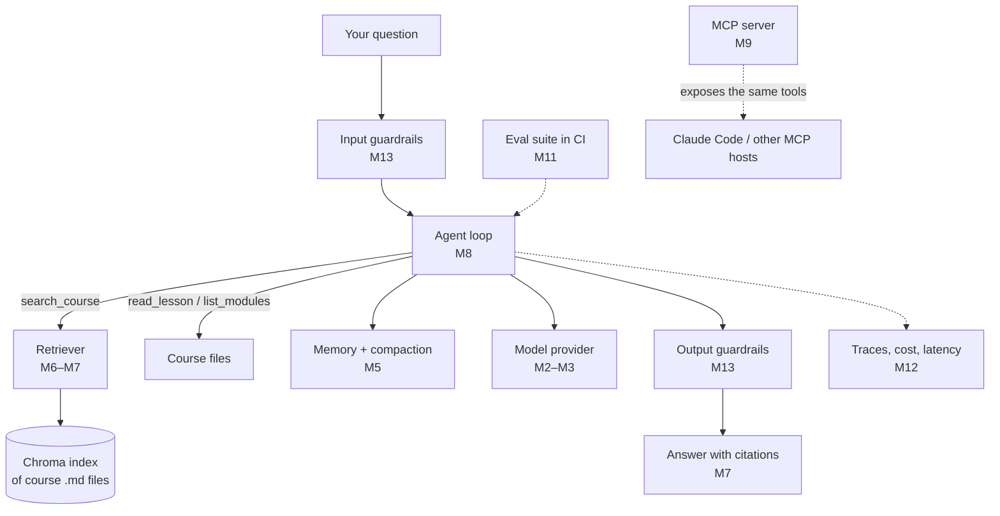

# Capstone: Course Buddy

Course Buddy is an assistant that answers questions about this course. It searches the lessons, cites where each answer came from, and has the guardrails, evals and tracing of a real production feature.

You don't build it all at the end. Each module adds one milestone, so by Module 14 you've already built it. This page is the map. Each module's review page has the detailed checklist for its milestone.



## Milestones

| Milestone | Module | Course Buddy can now… |
|-----------|--------|-----------------------|
| M0 | [00 Orientation](../00-orientation/review.md#capstone-checkpoint) | Exist. It's a `course-buddy` uv project that loads keys from `.env` and makes a hello-world model call. |
| M1 | [01 How LLMs Work](../01-how-llms-work/review.md#capstone-checkpoint) | Count tokens across every lesson and estimate the cost of putting the whole course in one prompt. |
| M2 | [02 Calling Models](../02-calling-models/review.md#capstone-checkpoint) | Chat in your terminal with streaming output. A `--json` mode returns `{answer, confidence}`. |
| M3 | [03 Choosing Models](../03-choosing-models/review.md#capstone-checkpoint) | Swap providers through config: Claude, OpenAI, or a local Ollama model. |
| M4 | [04 Prompt Engineering](../04-prompt-engineering/review.md#capstone-checkpoint) | Answer in a consistent voice and format, driven by a versioned system prompt and few-shot examples. |
| M5 | [05 Context Engineering](../05-context-engineering/review.md#capstone-checkpoint) | Remember the conversation and compact older turns near a token budget. The system prompt is cached. |
| M6 | [06 Embeddings](../06-embeddings-and-vector-search/review.md#capstone-checkpoint) | Search the course semantically through a local Chroma index (`course-buddy search "..."`). |
| M7 | [07 RAG](../07-rag/review.md#capstone-checkpoint) | Answer from retrieved lessons, citing each lesson file. |
| M8 | [08 Agents](../08-agents/review.md#capstone-checkpoint) | Decide on its own when to call `search_course`, `read_lesson`, and `list_modules`. |
| M9 | [09 MCP](../09-mcp/review.md#capstone-checkpoint) | Serve its tools over MCP, so Claude Code or any MCP host can use them. |
| M10 | [10 Multimodal](../10-multimodal/review.md#capstone-checkpoint) | Take a screenshot (a diagram or an error) as a question. Optionally take voice input. |
| M11 | [11 Evals](../11-evals/review.md#capstone-checkpoint) | Pass a golden Q&A eval suite, with both deterministic and LLM-judge checks, run in CI. |
| M12 | [12 Observability](../12-observability/review.md#capstone-checkpoint) | Trace every request and log tokens, cost and latency. |
| M13 | [13 Safety & Ethics](../13-safety-and-ethics/review.md#capstone-checkpoint) | Resist prompt injection hidden in retrieved content and enforce input/output guardrails. |
| M14 | [14 AI-Assisted Coding](../14-ai-assisted-coding/review.md#capstone-checkpoint) | Ship a feature built with an AI coding assistant. The project has its own `CLAUDE.md` / `AGENTS.md`. |

## Suggested project layout

This is a starting point, not a rule. Let it grow as you go.

```
course-buddy/
├── pyproject.toml
├── .env                    # API keys (never commit this)
├── prompts/
│   └── system_v1.md        # M4: versioned prompts
├── course_buddy/
│   ├── cli.py              # M2: chat loop, --json mode
│   ├── providers.py        # M3: Claude / OpenAI / Ollama
│   ├── memory.py           # M5: history + compaction
│   ├── index.py            # M6: chunk, embed, store in Chroma
│   ├── rag.py              # M7: retrieve + answer with citations
│   ├── agent.py            # M8: tool loop
│   ├── tools.py            # M8: search_course, read_lesson, list_modules
│   ├── mcp_server.py       # M9: expose tools over MCP
│   ├── tracing.py          # M12: spans, tokens, cost
│   └── guardrails.py       # M13: input/output checks
└── evals/
    ├── golden.jsonl        # M11: question → expected facts / source file
    └── test_evals.py       # M11: run in CI
```

> [!TIP]
> Point Course Buddy at the folder this course lives in. It then learns from the same material you do, and every eval question you write is a question you can answer yourself. That makes it easy to check whether a response is right.

## Stretch goals

Once all 15 milestones work, try one of these:

- **Re-ranking.** Add a cross-encoder or LLM re-ranker after retrieval, then measure the change with your M11 evals.
- **Quiz mode.** Have Course Buddy generate review questions from a lesson and grade your answers.
- **Web UI.** Put a small web front end on top of the agent and stream tokens to the browser.
- **Cost ceiling.** Refuse or downgrade to a cheaper model when a session goes over a budget.
- **Model bake-off.** Run the eval suite against three models and pick a winner on quality, cost and latency.

---

[← Module 14 review](../14-ai-assisted-coding/review.md) · [Course home](../README.md)
